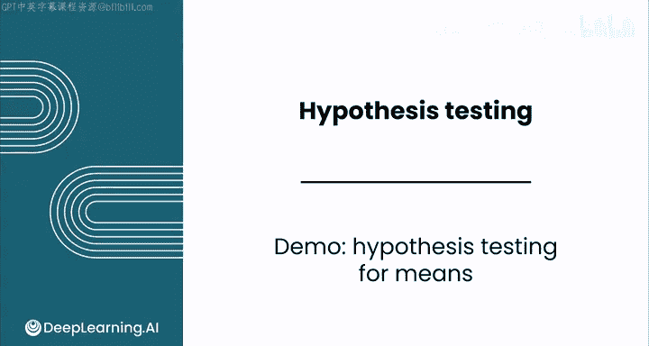

# 吴恩达《数据分析（数据分析基础／应用统计学，1-2课／共5课）｜DeepLearning.AI Data Analytics》中英字幕（claude-4-s - P142：71_演示：均值假设检验.zh_en - GPT中英字幕课程资源 - BV1SCXrYuEwr

Now it's time to take it over to a spreadsheet to perform some hypothesis tests yourself using real data you'll start to see a lot of parallels between confidence intervals and hypothesis tests。

 let's get started with the forestest fires data you've worked with previously。As you can imagine。

 the bigger the fire size， the more resources local agencies will need to deploy to put them out。

 if the park has a very large average fire size， the agency will need to call in the National Fire Service。

 as well as allocate aircraft in case of emergencies In order to plan accordingly。

 the agencies want to know if the mean burn area is larger than 10 hectares If so。

 they'll start working with the National Fire service and begin purchasing aircraft。

 What should the hypotheses be。The null hypothesis H not should be that the mean area is 10 hectares。

 While the alternative hypothesis H sub 1 should be that the mean is greater than 10 hectares。

 you'll start by determining the level of significance that you're comfortable with。

 A good starting point is alpha equals 0。05， which has an expected 5% error rate with respect to incorrectly rejecting the null hypothesis。

 Then you'll calculate the test statistic。 Remember that you need the sample mean X bar。

 the sample standard deviation S and the sample size n。

 These are the same statistics you use to compute a confidence interval。

You've seen all of these sample statistics previously， now you can calculate the test statistics。

Remember that you need to subtract the hypothesisthes mean of 10 from the sample mean and then divide by the sample standard deviation。

 divided by the square root of your sample size。 This gives you a test staistic of around1。

 Remember that this test statistic is essentially a z score。

 So where do you think this result falls within the standard normal distribution。 Next。

 you need to find the P value associated with the test statistic。 Since this is a right tail test。

 you want the probability of seeing a value to the right of your test statistic。

 So you can do this using the norm dot s dot disk function。 The Cf。

 Remember that the Cf corresponds to the probability that z is less than or equal to some value。

 but you want the complement。 The probability that the standard normal variable is greater than the value。

 So in order to calculate the complement， you want to do1 minus norm dot S dot disk and plug in your testistic z score value。

 This gives you a P value of around 0。155。 What would you conclude for this hypothesis test。

For a 5% significance level， you would fail to reject the null hypothesis。

 the average fire size is not greater than 10 requiring those additional resources。

 instead of using the normal distribution CDF to calculate the P value like you did here。

 you can also just shortcut all of these steps by using the Z test function。

So let's take a look at that right here。The first parameter is the data， so select the entire column。

And the value is the hypothesized meanme， which is 10。

 Notice that this Z test gives you exactly the same P value as using the CDF。

 but you didn't have to manually calculate all these sample statistics。 It's a super useful shortcut。

Let's take a deeper look at the calculation for the test staistic。 Your sample mean of 12。

85 hectares is， in fact， larger than your hypothesized mean of 10。 However。

 it's being divided by a very large sample standard deviation。 So because of this。

 the test statistic that you result is still not very large。

 So the result in test statistic that you get， is one， which is fairly uncommon。

 but not so uncommon that it would lead you to reject than all hypothesis。 Now。

 let's move on to the Ii feature， or initial spread index。

 initialial spread index measures how quickly the fire area expands after it starts。

 a value of 10 indicates a high rate of spread while a rating of 16 or more indicates extremely rapid rate of spread。

 The parks department asks you to verify that the mean of the Ii stays below 10。

 If the rate of spread was above 10， they would be required to start a few procedures to help control the rate of spread overall。

 such as initiating control burns or preemptively closing certain trails or campsites。

 These measures are both very expensive。 So the parks department asks you to be。

Extremely confident in your conclusions。 You selected alpha of 0。01。

 What should your hypothesistheses be for this scenario Start with your null hypothesis。

 You're testing whether the ISi is different from 10。 so Ii equals 10 should be your null hypothesis。

 You're looking for evidence that ISi is less than 10。

 so your alternative hypothesis is that the mean ISi is less than 10。

 you'll need the same statistics to conduct your test。Next。

 you'll calculate the test statistic in the same way。Different test， same calculation。

 You'll notice that the resulting test statistic is almost negative5。 So based on your intuition。

 Where do you think this Z score falls in the standard normal distribution。

 The next step is finding the P value。 In this case， since you have a left tail test。

 you want the probability that a Z score is smaller than or equal to the test statistic。

 you can calculate that probability directly using the Cf。

 you can use the norm dot S dot disk directly。 This result gives you an extremely small P value。

 You can safely say that you can reject the null hypothesis， even at the 1% significance level。

 When I convert it to a percent， you have to go to a lot of digits of level of significance。

 if the true mean Ii is 10， the probability of observing the sample mean of 9 is extremely rare。

 Therefore， you can reject the null hypothesis with high confidence。 samee as before。

 you can use the Z test function to calculate the P value directly。

Notice that the resulting P value is 0。99999。 It's the complement of this P value on the left that's because if you take a look at the Z test function。

 click on learn more， you can read under the notes that the P value is the probability that a randomly generated sample has a mean value greater than that of the original data set。

 so it's performing a right tail test to change this P value to represent a left tail test you can just say one minus its amount。

And then you get the exact same value as before， so to sum up。

 if you're performing a right tail test， you can just use the Z test function directly if you're performing a left tail test。

 you need to say1 minus the Z test result。Create work conducting those hypothesis tests。

 You're prepared to determine statistical significance on real world data coming up。

 you'll see the two possible errors you will encounter when conducting hypothesis tests。

 I'll see you in the next video。