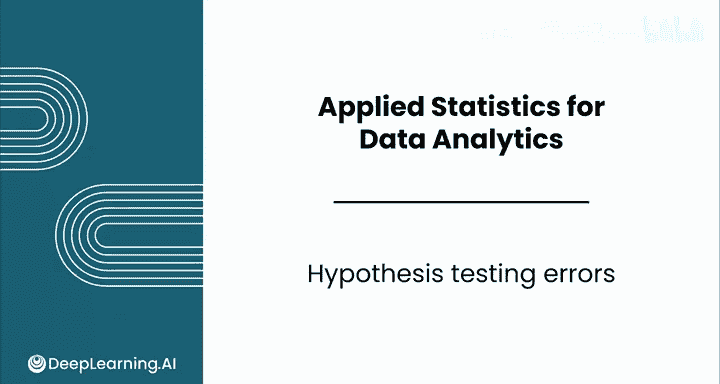
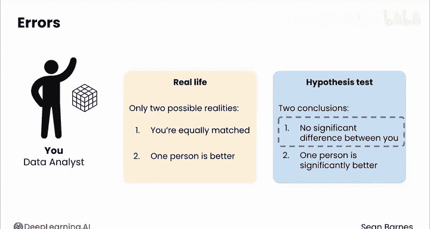
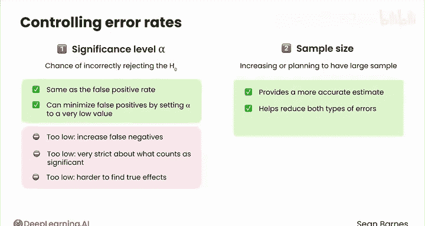
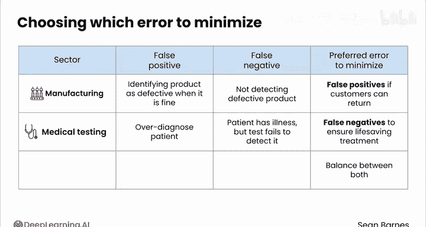

# 吴恩达《数据分析（数据分析基础／应用统计学，1-2课／共5课）｜DeepLearning.AI Data Analytics》中英字幕（claude-4-s - P143：72_假设检验中的错误.zh_en - GPT中英字幕课程资源 - BV1SCXrYuEwr

Inferential statistics is all about managing uncertainty。

 and part of managing uncertainty is understanding how things can go wrong。

 Hypothesis testing can be wrong in two key ways。 you found an effect， but in reality。

 there isn't one， or you didn't find an effect， but in reality， there is one。 Let's take a look。

Your hypothesis test uses a sample as a window into the true state of the world。

 Think back to the example of competing with your friend in solving a rubbiik's cube where they challenge you to see who's the better solver。

 In real life， there are only two possible realities。

 Either your equally matched or one person is better。

 And if you conducted a hypothesis test to answer that question。

 you'd come to one of two conclusions。There's no significant difference between the two of you or one person is significantly better。

 If you're equally matched and your test didn't find a significant difference， That's great。

 Your window into the truth saw the correct effect。 This situation is called a true negative。

You didn't find a significant difference， And there wasn't one defined。

 If you're not equally matched and your test found one of you to be better， That's great， too。

 This situation is called a true positive。 There was a difference in the real world。

 and your test correctly identified it。 You can see there are two ways to go wrong， though。

It's possible that you're equally matched， but your test concluded that one of you is better。

 That's a false positive。 You found a difference， but in reality， there isn't one。

 and it's also possible that your test concluded that there's no significant difference。

 Yet one of you is， in fact， better。 That's a false negative。 There's a true effect。

 but you fail to find it。 Let's generalize these areas beyond the rubic's cube example。

 As you saw in the previous videos， your hypothesis test has two possible conclusions。

 Either you reject the null hypothesis or you fail to reject the null hypothesis。

 Then there's the true state of the world。 Either the null hypothesis is true or the null hypothesis is false。

 If you reject the null hypothesis， but the null hypothesis is true， That's a false positive。

And conversely， not rejecting the null hypothesis， when the null hypothesis is false leads to a false negative。

 Meanwhile， if you reject the null hypothesis and the null hypothesis is false。

 that's a true positive。And if you fail to reject the null hypothesis and the null hypothesis is true。

 that's a true negative。You have a few mechanisms for controlling these error rates。

 One of them is your significance level Al。 Your significance level represents the chance of incorrectly rejecting an all hypothesis。

 It's the risk that you must take based on what you know。

 does alpha correspond to the rate of false positives or false negatives。

It's the same as the false positive rate。 You can try to minimize false positives by setting alpha to a very low value。

 but that will increase the likelihood of false negatives。

 Se alpha too low means that you're being very strict about what counts as significant。

 This makes it harder to find true effects。 Inc in your sample size or planning to have a sufficiently large sample is an important factor in the success of your hypothesis test。

 a large sample provides a more precise estimate and helps reduce both types of errors。

 A large sample can also help you detect the very subtle effect。

 Whether you want to minimize false positives or false negatives depends on the costs and risks associated with each outcome。

 For example， if you're working in manufacturing， you'll likely test for defective products before they're shipped。

 A false positive would mean identifying a product as defective when it's actually fine。

 whereasas a false negative would be not detecting a defective product。

 You may prefer to minimize false positive if customers can easily make returns。

 to avoid wasting product that actually。😊。

In medical testing for serious illnesses， however， it's typically more desirable to minimize false negatives。

A false negative happens when a patient actually has a particular illness。

 but the test fails to detect the illness。While diagnosis can be stressful for patients。

 it's generally more desirable to over diagnose since the diagnosis can be corrected with further testing。

 Meanwhile， a patient whose illness is not detected will not receive potentially lifesaving treatment。

 Most situations call for a balance between the two types of errors。 For example。

 if you're working at a bank that approves loan applications。

 A false positive might mean approving a loan for someone who actually defaults while a false negative might mean denying a loan to someone who would pay it back in full。

 The bank will likely conduct a significant risk assessment to minimize losses from false positives while maximizing the number of profitable loans。

Balancing atypes is just another compromise you'll have to make as a data analyst working with uncertainty。

 There's nothing you can really do to achieve 100% accuracy。 Now。

 you're almost to the end of this lesson。 There's just one more nuance to hypothesis testing。

 Follow me to the next video to learn more。