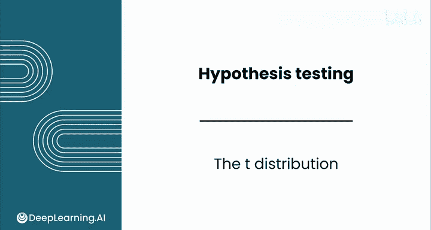
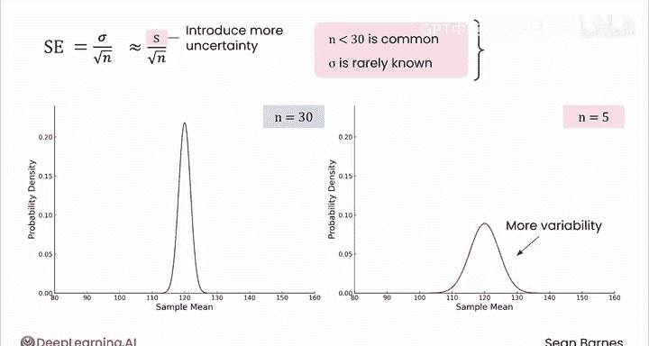
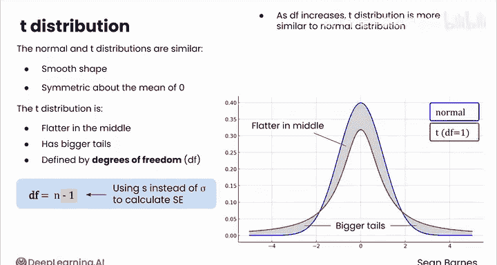
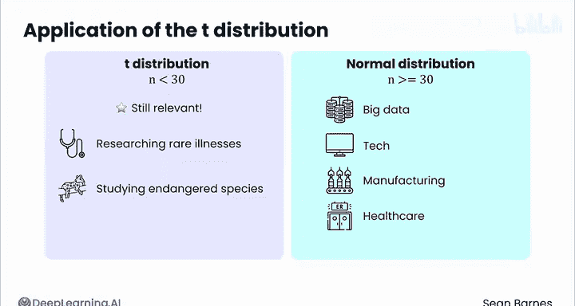

# 吴恩达《数据分析（数据分析基础／应用统计学，1-2课／共5课）｜DeepLearning.AI Data Analytics》中英字幕（claude-4-s - P144：73_t分布.zh_en - GPT中英字幕课程资源 - BV1SCXrYuEwr

There's one additional element of complexity here， which is that in some cases。

 the sampling distribution of the sample mean isn't normal。

 you'll have to use a different distribution to conduct your hypothesis test。

 recall the conditions for the central limit theorem。

 which states that when you are calculating the sample mean based on a large sample。

 typically 30 or more observations， the sampling distribution of the sample mean is normally distributed。

 So what happens if you calculate a sample mean based on less than 30 observations。

 Do you think the variability and the sampling distribution of the mean will be larger or smaller。

The sample mean for smaller samples is likely to have more variability than for larger samples。

 This condition introduces more uncertainty into your estimate。

 You also saw that the standard error for the sampling distribution for the mean was equal to the population standard deviation Sigma divided by the square root of the sample size。

 and when you use the sample standard deviation as an estimate for sigma。

 you introduce even more uncertainty。 Small sample sizes are common in many fields。

 including healthcare care， and the population standard deviation is rarely known。

 when either or both of these conditions are true， a sample size smaller than 30 or an unknown sigma。

 there is a more appropriate choice for the sample distribution for the mean。

 which is known as the t distribution。 The T distribution is very similar to the standard normal distribution。

 They both have a smooth shape and are symmetric about a mean of0。 However。

 the t distribution is flatter in the middle and has bigger tails。 Intuly。

 what this means is that you're more likely to observe values further from the mean。

 This observation。

is consistent with the idea that the T distribution reflects more uncertainty about the underlying data。

 however， one difference is that the t distribution is defined by a parameter known as the degrees of freedom DF。

 which is a statistical measure that tries to quantify the uncertainty in your estimate introduced by estimating population parameters from a limited sample It's a bit of an abstract concept。

 but for this scenario， the degrees of freedom is calculated as the sample size minus-1 The minus1 comes from using the sample standard deviation instead of the population standard deviation to construct the distribution because you're using an estimate。

 your calculation introduces more uncertainty As degrees of freedom increases。

 the T distribution becomes more and more similar to the normal distribution。

And therefore， your choice of which distribution to use becomes less important。

 This convergence on the normal distribution reflects the increased certainty you can have in your conclusions with a larger and larger sample size as your sample size increases。

 you get better information about the variability of the population。

 but with smaller samples you're working with the less precise estimate。

 you'll follow a similar process for conducting your hypothesis test as you just learned。

You will define your hypotheses the same way and collect the sample statistics needed in order to calculate your test statistic。

 However， you'll use the t distribution rather than the normal distribution to figure out whether your sample statistic is sufficiently rare for you to reject the null。

 your test statistic will be called T rather than Z and you'll use the t do test function rather than the Z dot test function。

 The rejection region and thus the P value are also different Since you're now using the t distribution to define them。

 Consider the movie duration example with the hypothesized population mean of 120 and a sample centered deviation of 12 over just5 samples。

 Take a look at the difference between the normal and t distributions。

 you can see that the t distribution has bigger tails。 The rejection region for alpha equals 0。

05 is also different。 notice that the rejection region for the normal distribution starts around 128 minutes while for the t distribution it starts around 132 minutes。

 That means that the t distribution requires stronger evidence to reject the null hypothesis。

 It's more straight。For example， save a sample mean you observe for the five movies was 130 minutes in the normal distribution。

130 minutes falls here， and the P value is 0。031， meaning that you would reject the null hypothesis since 0。

031 is less than your alpha of 0。05， and the t distribution，130 falls here。The P value is 0。068。

 In that case， you would fail to reject the null hypothesis。

 So you can see that for small sample sizes， choosing the t distribution over the normal distribution is impactful。

 It applies a bit more rigor for small sample sizes。 When the T distribution was initially developed。

 it was much more common to be dealing with sample sizes of say 10 or 15。

 and to try to draw conclusions about the population from that small group。 Nowadays。

 you're more likely to be working with larger sample sizes above 30。

 The general rule of thumb for a large sample that will follow the central limit fear。

 you learned in data analytics foundations that you'll often be working with big data in tech。

 if you want to survey users， you might be able to get thousands of people。In manufacturing。

 your systems might record the production time for every product。

 if you're working with emergency room data， you might have access to thousands of visits rather than a dozen。

 The T distribution is still relevant in many cases。

 such as in researching rare illnesses or studying endangered species when you're working with small samples。

When your sample sizes are above around 30， the difference is not likely to impact your decision making。

That's a wrap on your first lesson about hypothesis testing you've learned a ton from how to formulate your hypotheses to identifying your rejection region。

 calculating your test statistic and interpreting your P value Next up。

 you'll complete the practice assessment and practice lab。

 which involves examining human sleep patterns when you finish the practice assessment and lab join me the next lesson to learn about the wide variety of hypothesis tests you can employ in different business cases I'll see there。

