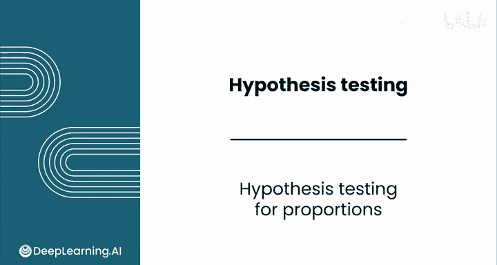
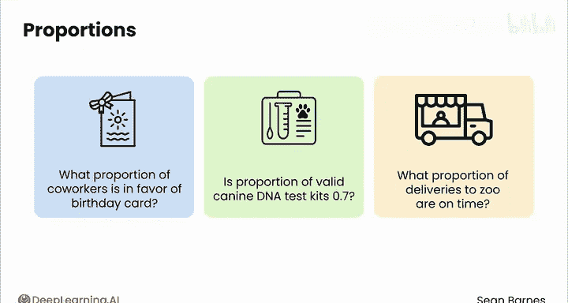
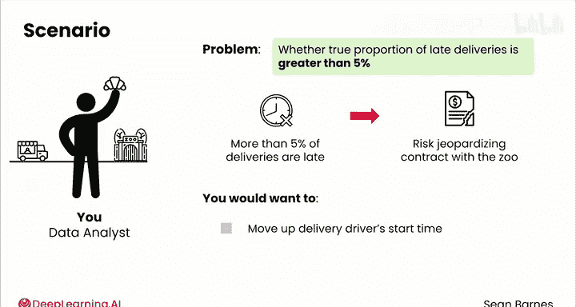
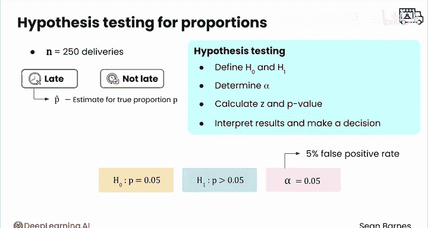
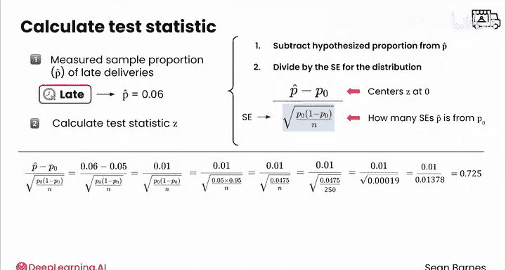
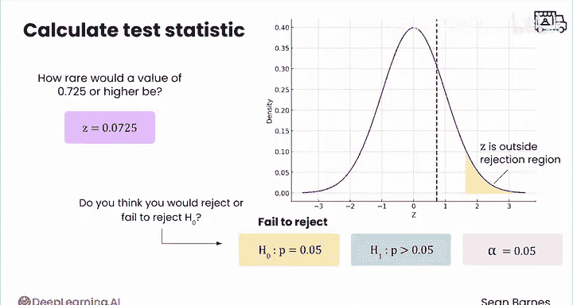
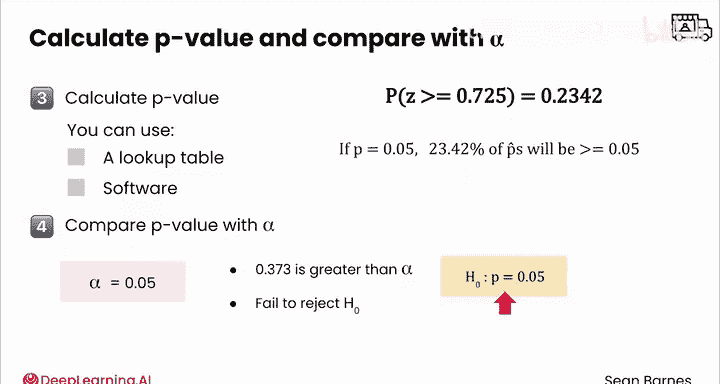
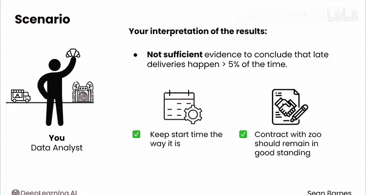

# 吴恩达《数据分析（数据分析基础／应用统计学，1-2课／共5课）｜DeepLearning.AI Data Analytics》中英字幕（claude-4-s - P145：74_比例假设检验.zh_en - GPT中英字幕课程资源 - BV1SCXrYuEwr

Your knowledge about how to conduct hypothesis tests for means also applies to many other kinds of hypothesis tests。

That's right。You can test a sample proportion， not just the mean。

You've seen examples of business questions related to proportions。

 where proportion of your coworkers is in favor of the birthday current policy。

 Is the proportion of valid K9 DNA test kits really 0。7。

 What proportion of our bakery deliveries to the zoo are on time。

 Let's focus on delivery times for this example。 recall the scenario where you were working with a bakery delivering pastries to the local zoo。

 Sa the bakery has just secured a large contract with the zoo to deliver fresh pastries five times per day instead of once。

 According to the contract terms， If more than 5% of deliveries are late。

 The bakery risks jeopardizing their contract with the zoo。 For that reason。

 you would want to move up your delivery drivers start time to ensure they can make it to the zoo on time。

 So you're interested in the question of whether the true proportion of late deliveries is greater than 5%。

 you can follow the process for hypothesis testing that you learned in the previous videos。 First。

 Def your hypothesistheses。 Second， determine the significance level。😊。

Third， calculate the test statistic and the P value and fourth。

 interpret the results and make a decision。 Suppose you collect a sample of 250 deliveries and record if they were late or not。

 The proportion of late deliveries in your sample is called PhaAP。

Which is an estimate for the true proportion of late deliveries P。

 You can define your hypotheses as H that p equals 0。05， which corresponds to the status quo。

 for which the proportion of late deliveries as 0。05。 If this hypothesis holds。

 you would not change your start time because you are confident that your deliveries will consistently arrive on time。

 H sub1 is that P is greater than 0。05， which means that the proportion of late deliveries is higher than 0。

05， you feel this decision has moderately high stakes， So you decide to select an alpha of 0。05。

 which is associated with the 5% false positive rate。

 The sampling distribution for the sample proportion is the normal distribution shown here。

 So you would reject the null hypothesis。 If your test statistic falls within this rejection region in the top 5% of values。

 you could also choose the t distribution。 but considering your large sample size。

 the normal distribution is appropriate。 Let's imagine that you measured the sample proportion of late deliveries as 0。

It seems higher than 0。05， but is that difference significant。

 you can use a hypothesis test for proportions to answer your question。

 Your next step is to calculate the test statisticstistic Z。It's quite similar to the one for means。

 First， subtract your hypothesized proportion P from your sample proportion P hat。

 This operation has the effect of centering your test statistic at 0。

 Then you'll divide by the standard error for the distribution。

 which essentially tells you how many standard errors from the hypothesized proportion your sample proportion is The standard error looks like the square root of p times1 minus P divided by n。

 Why not use P hat to calculate the standard error。 and a hypothesis test for means。

 you hypothesize the true mean， but you often don't know the true standard deviation。

 So you must use your sample standard deviation to approximate it。 However。

 in the hypothesis test for proportions， you can derive the population standard deviation just from P and your sample size。

 you don't have to estimate anything since you're assuming the null hypothesis to be true。

 workinging that out for this example， P hat minus P is 0。06 minus-0。05， which equals 0。01。

P times 1 minus p0 is 0。05 times 0。95， which is 0。0475。

This is on the lower end of variability since you expect most deliveries to be on time， divide 0。

0475 by 250 your sample signs， and you get 0。00019。Now， take the square root to get 0。01378。

 So your test statistic z is 0。725。 It corresponds to the number of standard errors away from the mean。

 So in your sampling distribution of the proportion assuming a mean of 0。05。

 This value is above the mean by less than one standard error， how rare would a value of 0。

0725 or higher B， Take a look at Z grafted on the standard normal distribution。

 do you think you would reject the null hypothesis in this case or fail to reject it。

It looks like you would fail to reject the null hypothesis Z is not inside the rejection region。

You should then calculate your P value and see if it matches your intuition。

You can use a lookup table or software to do so， the probability of getting a test statistic Z of 0。

725 or more extreme， in this case higher is 0。2342。So if the true proportion of late deliveries is 0。

05， 23。42% of sample proportions will be 0。06 or higher Next。

 you'll compare your P value with alpha of 0。05 0。2342 is greater than alpha。

 so you fail to reject the nu hypothesis。

Your interpretation of this result is that there is not sufficient evidence to conclude that late deliveries happen more than 5% of the time。

 so you can keep your delivery driver start time the way it is。

 and it looks like your contract with the zoo should remain made in good standing。

Great work on testing proportions。 You'll choose a hypothesis test for means or proportions based on the business question you're interested in。

 Foow me to the next video to see how to conduct a hypothesis test for proportions in a spreadsheet。

😊。