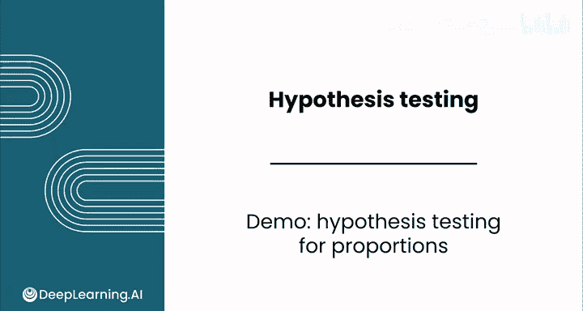

# 吴恩达《数据分析（数据分析基础／应用统计学，1-2课／共5课）｜DeepLearning.AI Data Analytics》中英字幕（claude-4-s - P146：75_演示：比例假设检验.zh_en - GPT中英字幕课程资源 - BV1SCXrYuEwr

Let's put what you just learned into action。You'll test proportions using the forestest firees data set you've worked with before。

 let's get into it。Suppose the Portuguese Park Service has been working to reduce the spread of fires by quickly containing them using a new method after implementing the new containment procedures。

 they're interested in investigating whether the proportion of very small fires now constitutes the majority of all fires。

 If so， they've met their improving goals and can be confident that the new measures are working well。

 This version of the data set includes the is small column， which takes on the value 1。

 if the burn area was below a half a hectare and0， if it was greater。

 recall from an earlier lab in this course， that the proportion of very small fires and other fires seem pretty balanced。

This chart confirms that the distribution of the I small feature is relatively balanced。

Your goal is to perform a hypothesis test to see if the proportion is in fact greater than 0。5。

 what should the hypotheses be？You can perform a righttail test where the null hypothesis is p equals 0。

5 and the alternative hypothesis is p is greater than 0。5。

 Let's get on to it for the proportions test， just as with the confidence interval。

 you will need to find the same set of descriptpto statistics to calculate the sample proportion。

 you can use the average function。Similar to the previous results。

 you get a sample proportion of around 0。478， you also need to calculate the complement of the sample proportion。

Next， you can calculate your sample size by using the count function。Next。

 as you did with the hypothesis test for the mean， you need to calculate the test statistic。

 Remember that the test statistic for the proportion looks a little bit different than that for the mean。

 you still need to subtract the hypothesized population proportion from the sample proportion。

 but the standard error that you divide by is equal to the square root of p， which is 0。

5 times 1 minus p divided by the sample size n。The test statistic is around -1。

 so the sample proportion is approximately one standard deviation lower than the hypothesized sample proportion。

 This test statistic follows a normal distribution。

 so you need to determine the probability of a more extreme value given your sample data and the structure of your alternative hypothesis Again。

 if you imagine the standard normal distribution， this test statistic will fall about one standard deviation below the mean。

 and you're looking for values that are rare on the right side of the test statistic。

 So what do you think the P value is going to look like in this case。So to calculate the P value。

 again， you can use the Nor dot S dot disk function and apply it to your test staistic。 And again。

 because of the structure of your alternative hypothesis。

 you want to calculate the probability that a Z score is greater than your test staistic。

 Given that this P value is greater than any reasonable level of significance。

 You don't have enough evidence to conclude the true proportion is greater than 0。5。

 The park service will need to continue their containment measures and gather more data to be certain that the new measures are effective at getting the proportion of small fires above 0。

5。 Note that you cannot use the Z test or T test functions for a test for proportions。

 That's because they use the standard deviation for means， not for proportions。

 which will lead to incorrect conclusions。 It's okay to fail to reject the null。

 Sometimes not finding an effect can be just as informative as finding one。 Com up。

 you'll learn how to conduct a two sample test。 which means comparing two means or proportions。

 See there。

