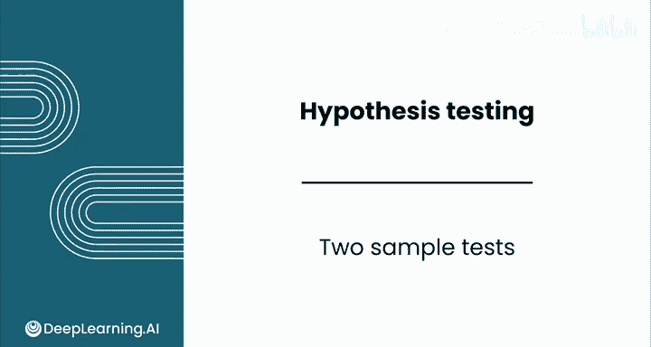
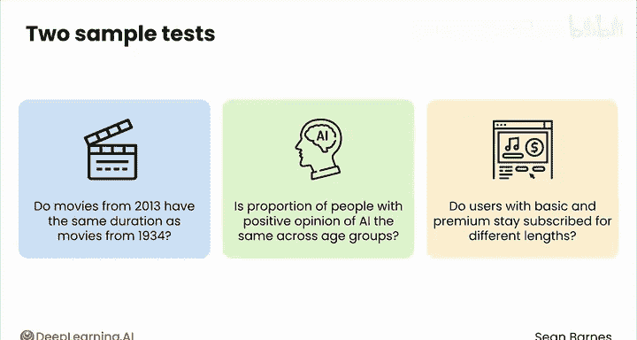
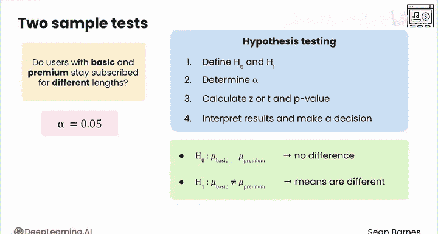
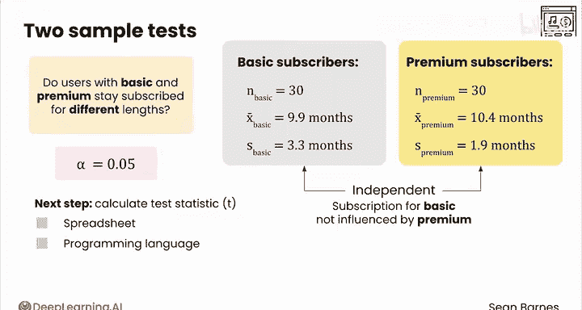
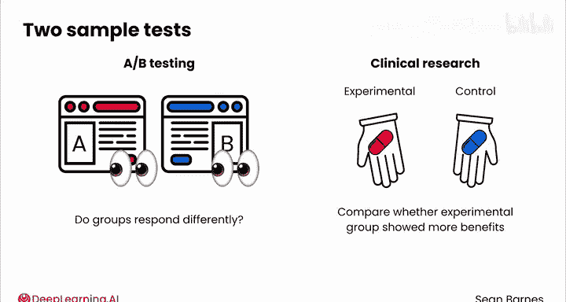

# 吴恩达《数据分析（数据分析基础／应用统计学，1-2课／共5课）｜DeepLearning.AI Data Analytics》中英字幕（claude-4-s - P147：76_双样本检验.zh_en - GPT中英字幕课程资源 - BV1SCXrYuEwr

Oftentimes you're interested in comparing two samples directly。

 rather than comparing one sample to a hypothesized value， for example。

 say you want to compare the mean delivery time on weekends and weekdays。

You've seen a few cases throughout this course where you might want to compare two samples directly。

 Do movies from 2013 have the same average duration as movies from 1934 is the proportion of people who have a positive opinion of AI the same and two different age groups。

 Do users with basic and premium subscriptions。 Stay subscribed for different lengths of time。

 Let's stick with the music subscription service。 Suppose you want to determine whether users with basic and premium subscriptions。

 stay subscribed for different lengths of time。 You're not certain what these values are。

 You just want to see if they're different。 You'll follow the same process as usual。 First。

 define your hypotheses。 then determine your significance level。 Next。

 calculate the test statistic and the P value。 And finally。

 interpret the results and make a decision。 Here's how you'd set up your hypothesistheses。 First。

 the null hypothesis。 Your status quo is that there's no difference between the groups。

 So you'll write that as H is mu of basic equals mu a premium。

 Your alternative hypothesis is that these two means are different。 so you can use。

2 tail test with the hypothesis H sub1 is mu of basic is not equal to mu of premium。

 or alternatively， if you had a hypothesis that the mean subscription length of one group was higher than the other。

 you could formulate a one tail test。 Sa you're comfortable with an alpha of 0。

05 with a 5% chance of false positives。 Now you are ready to calculate the test statistic。

 say you have two samples。 One of basic subscribers and one of premium。

 Each sample has 30 subscribers with the following descriptive stats。 sample mean of basic equals 9。

9 months。😊。

Sample standard deviation of basic equals 3。3 months。Sample mean of premium equals 10。4 months。

 and sample standard deviation of premium equals 1。9 months。 In this case。

 the two samples are independent， meaning that the length of a basic subscription is independent of the length of a premium subscription。

 The next step would be to calculate your test statistic， which follows the T distribution。

 You know the theory behind how to conduct this test already， but the math is a bit more involved。

 both for calculating the standard error and for determining the degrees of freedom in practice。

 you'll be using a spreadsheet or programming language to conduct this test。

 So let's see how to conduct this test at a spreadsheet。

Here's some generated data simulating 30 premium and 30 basic subscribers。 This time。

 you don't need to calculate any of the statistics like the mean standard deviation and so on because the spreadsheet function T dot test will do that for you。

 The output of the t dot test function is just the P value。

 So you won't need to do any of the intermediate steps to calculate the test statistic。

 T dot test has several parameters。 Remember that you can use the help menu to review them。

 So as a reminder， the null hypothesis for this test is that the mean subscription length for basic equals the mean subscription length for premium and the alternative hypothesis is that the two means are not equal for this test you can start with the default significance level of 0。

05 T do test has several parameters。 Remember that you can use the health menu to review them。

 You have four parameters Ra 1 represents the sample data for the first category。

 The subscription length for the basic subscription。

 range2 represents the sample data for the second category。 In this case。

 the subscription length for the premium subscription。 The tails parameter specifies where the。

Want to use a one tail or two tails of the t distribution for the P value In this case。

 you want two tails because you propose a twot test equal versus different。 And lastly。

 you have to specify the type parameter。 This one is very important because it sets some assumptions on your data。

 A value of one indicates a paired test。 you'll learn more about paired tests in the next video。

 but they're good for before and after data。 Like if you're testing the same person subscription length before and after getting premium。

 A value of two indicates a two sample equal variance test。

 This makes the big assumption that the variance is the same across both populations。

 you probably won't want to use that one often。 A value of three represents a two sample unequal variance test here you don't make any assumptions on the variance of the two populations。

 Which one do you think is most appropriate here。You will want thislash option  three representing a two sample test with unequal variant。

This T test gives you a P value of 0。604。 It's pretty convenient that you don't need to calculate any of the sample statistics or the test statistics。

 How would you interpret the P value， This P value is quite large。

 La than your significance level of 0。05。 So you fail to reject the null hypothesis。

 concluding that you don't yet have enough evidence to support the idea that the two different groups of subscribers tend to stay subscribed for different length of time。

 It's important to remember this test assumes the samples are independent。

It means that the subscription length for basic users is not influenced by the subscription length for premium users and vice versa in general。

 it seems fair to conduct this test， but it's possible that you could inadvertently introduce biases。

 For example， if your company offered a promotional rate to encourage basic subscribers to upgrade that might shorten the duration for those subscribers while extending the duration for premium subscribers。

 two sample hypothesis tests are more commonly used in practice than one sample tests since you're often interested in comparing two groups in AB testing。

 you create two different versions of your product and show those versions to different groups。

 then you calculate whether the groups responded to each version differently in clinical research you often have experimental and control groups。

You give your experimental group the new treatment。

 such as a new drug and give the control group a placebo。

 You then want to compare whether the experimental group showed more benefits than the control group。

So what happens if you're interested in comparing more than two samples like several age groups or pairs of samples like patient improvement before and after a treatment。

 there are many types of hypothesis tests beyond the ones you've seen so far followow me to the next video to learn more。

