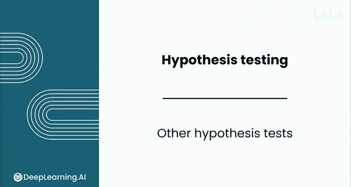
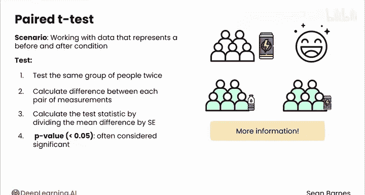
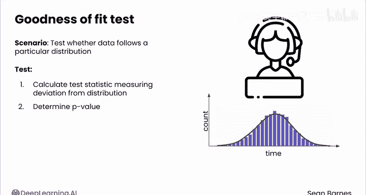

# 吴恩达《数据分析（数据分析基础／应用统计学，1-2课／共5课）｜DeepLearning.AI Data Analytics》中英字幕（claude-4-s - P148：77_其他假设检验.zh_en - GPT中英字幕课程资源 - BV1SCXrYuEwr

You've seen several kinds of hypothesis tests already。

 there are so many options out there and they each answer a different kind of question。

 you can't learn them all in a day， but in this video you'll see what kinds of questions to answer with which test。

Keep in mind that you don't need to memorize each of the tests in this video。

 because as you need them， you can look at their specifics。

 You already have the foundational knowledge needed to conduct and interpret them。Now。

 imagine that you're not just comparing two groups like basic and premium subscribers。

 but three or more groups。 For example， you might have a tiered subscription model with basic premium and business。

 This comparison gets tricky with the tests you saw earlier because the more tests you perform。

 the more the chance for error accumulates。 If you have a scenario like this。

 you'd want to use the analysis of variance test， also called a No。

 This test involves calculating the means for each group plus the overall mean。

 And then you compare how the group means differ from the overall mean。

 versus is how much individual scores differ from their group means。

 The P value in an Anova tells you how likely you'd see these differences between groups if there are no real effect。

 A small P value typically less than 0。05。 suggests the differences between groups are significant。

 It's possible you'll find yourself working with data that represents a before and after condition。

 which can take advantage of a special test。 say you're interested in testing whether students moods improve after drinking up。

😊，Particular energy drink。One option would be to take a random sample of students who had the energy drink and another random sample of students who just had water and compare their moods。

But you actually have a more powerful option。 You can test the same group of people twice。

 Have them drink water and assess their mood and then have them drink your energy drink and assess their mood again。

 In this case， you actually have more information about the strength of the effect。

 Since you don't have to account for all the possible variability between people。

 you can perform a paired T test。 You calculate the difference between each pair of measurements。

 after minus before， then you calculate the test statistic by dividing the mean difference by standard error。

 The P value here indicates how likely you'd see a difference this large by chance if the treatment had no effect。

 Again， a P value less than 0。05 is often considered significant。

 You may also find yourself working with categorical data。 The previous hypothesis test。

 you've learned have all operated on numerical data。

 Suppose you want to determine if customer satisfaction ratings differ by region to test this hypothesis。

 you can use a chi squared test。 Another good old Greek letter。

 The procedure involves creating a table of observed frequencies。 Then you calculate。😊。

The expected frequencies， assuming no relationship。

 The chi squared statistic measures how much your observed frequencies deviate from these expected frequencies。

 A small P values suggests that the observed frequencies differ significantly from what you would expect。

 if there is no relationship。 A lot of statistical methods assume that your data follows a normal distribution。

Or if you know it follows that distribution， then you can often get away with a smaller sample size。

 For that reason， you may be interested in testing whether that's actually true。

 You can use a goodness of fit test， say you want to know if customer service times at a call center follow a normal distribution and a goodness of fit test。

 you'll calculate the test statistic that measures how much the service time distribution deviates from the normal distribution。

Then determine the P value based on that test statistic again。

 a small P value indicates your results are statistically significant and that your sample data is likely not normally distributed。

 Great work learning all of those tests。 you're now equipped to answer a wide variety of business questions about whether an observed effect reflects the truth or is likely due to random chance after you finish the practice assessment and practice lab for this lesson。

 I hope you'll join me in the next and final lesson of this module to learn how you can use generative AI to perform and interpret hypothesis tests。

😊。

