# 吴恩达《数据分析（数据分析基础／应用统计学，1-2课／共5课）｜DeepLearning.AI Data Analytics》中英字幕（claude-4-s - P149：78_使用LLM进行结果解释.zh_en - GPT中英字幕课程资源 - BV1SCXrYuEwr

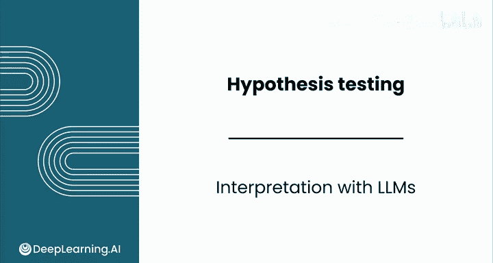

How can large language models help you with hypothesis testing， These tests are complex operations。

 There are a lot of different choices you as a data analyst have to make。

One thing I want to show you is using an LLM to help formulate your hypotheses。 These can be tricky。

 For example， supposeuppose you're comparing average delivery times between weekend and weekday orders for a food delivery service。

 You wanted to formulate appropriate null and alternative hypotheses for this scenario。

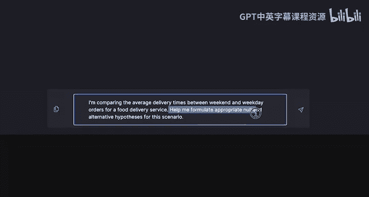

And the model is going to give you an null hypothesis。

 There's no significant difference in the average delivery times between weekend and weekday orders or the alternative hypothesis。

 There is a significant difference in the delivery times。 Okay， great。 You can follow up on this。

 For example， it says a significant difference。 Now， you can ask。

 is that H1 for a one tailed or two tail test。 It is a two tailed test。

 So let's say you want a one tail test to check if the average delivery time on weekends is longer。

 which is what you're hearing anecdotally from drivers。😊。

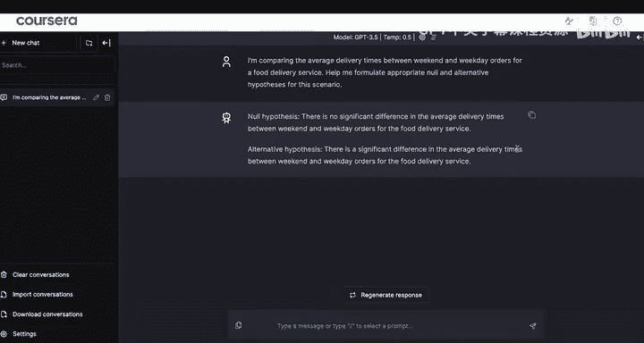

It will give you an alternative hypothesis the average delivery time on weekends is longer。

 say you really want this to be a notation， because this is what I just told it。

 it just repeated the same thing back to me。And it gives you a new set of hypotheses with the proper mathematical notation。

 The null hypothesis says that muu of the weekend is less than an equal to muu of weekday。

 and the alternative hypothesis says that muu of weekend is greater than mu of weekday。

 The less than or equal to and the null hypothesis doesn't affect how you conduct the test。 Now。

 here's another cool thing that you can do。 Interpreing results。

 I'm going to start a new chat so I can start the conversation over。 Here's an interesting case。

 Suppose you conducted a two sample T test comparing mean purchase amounts between two customer segments。

 The test statistic is 2。45 with a P value of 0。018。

 Explain what these results mean in business terms。😊。

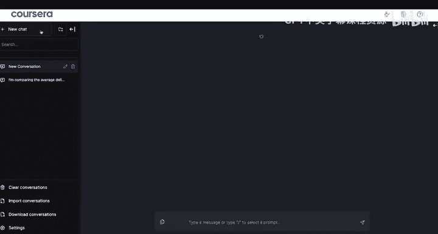

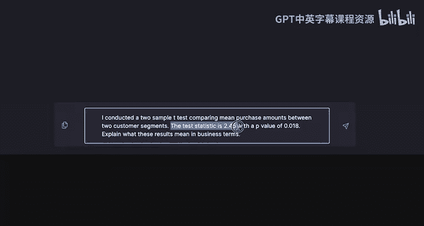

And it says the test statistic indicates that there is a significant difference in the mean purchase amounts。

 The P value of 0。018 suggests that there's strong evidence to reject the null hypothesis。

 And then you can follow up。 Let's say that you're curious。 Can you break down what the P value of 0。

018 means。It tells you that the P value of 0。018 represents the probability of observing a test statistic as extreme as 2。

45， assuming the null hypothesis is true。 It is quite wordy。

 it actually reinforces the same point multiple times。 but this overall matches your intuition。

 a couple other cool things I want to show you。 Let's start a new chat and get a clean slate。

 Lns can help you double check your work。 but you should also be very mindful of their potential for errors。

 So say you had this scenario。 your product lead asks you to investigate if at least 90% of production timeline state within budget。

 Suppose you review 25 budgets and plan to conduct a one sample T test for means with the null hypothesis that mu equals 0。

9 and an alternative hypothesis that mu is less than 0。9。 I just want to double check my work。

 So I'll say please evaluate the effectiveness of this approach on a scale of1 to 10 and provide evidence for your rating。

 This is a really effective way to get more than just yes or no feedback。

 It says the effectiveness is 7 out of 10。 Now， you may have spotted a moment ago that 90% is not。😊。

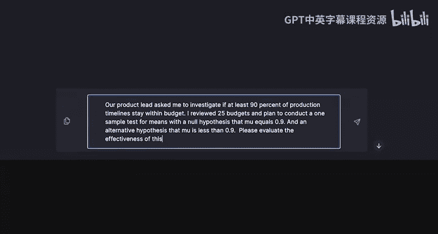

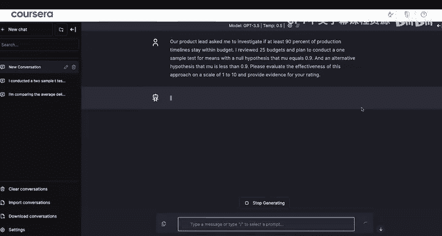

In factact mean this is a proportion， and yet our LLM goes on to say that the hypothesized population mean is 0。

9， which is not correct， This would not be the most effective way to approach this。

 so I'm not even going to continue reading， but I'm just going to say。

 are you sure that a test for means is appropriate？

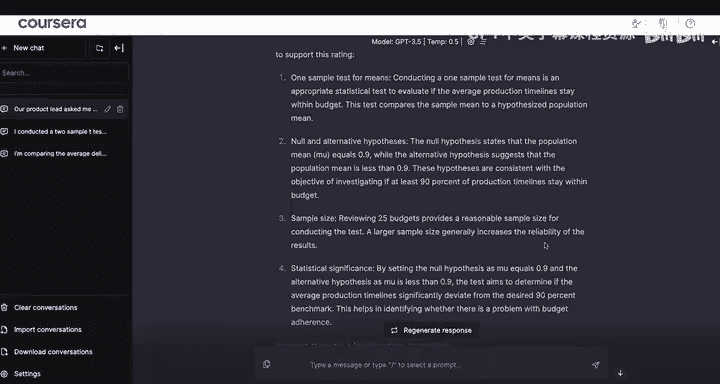

You're just nudging the model to think more deeply。 It says apologies for the confusion。

 You're correct。 So you need to watch out for this。

 When you're using LLMs to help you figure out what your approach should be。

 don't just take their answer at face value。 I can push it further and ask。

 would a test for proportions lead to a more accurate result。

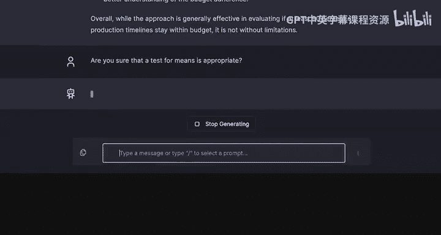

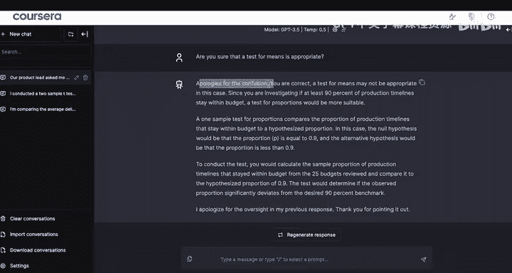

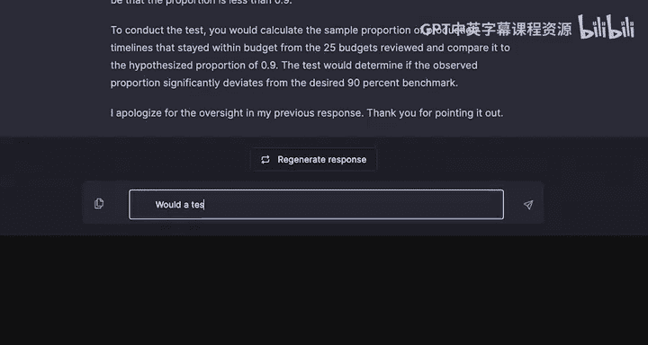

And it says yes， it would be more accurate。 The calculation itself is actually different for standard deviation and the test statistic。

 So you need to be on the lookout for that。 Keep in mind that in your work as a data analyst。

 there will be more capable models available to you than the one you saw in this demo。

 which is Cha E 3。5。😊，All right， LLMs can be very useful for helping you formulate hypotheses。

 set up tests and interpret results。 remember that LLMs are just a statistical representation of language。

 You have to make sure you're checking their output at every turn follow me to the next video to see how you can get an LLM that can write and run code to actually help you conduct hypothesis tests See there。

😊。

