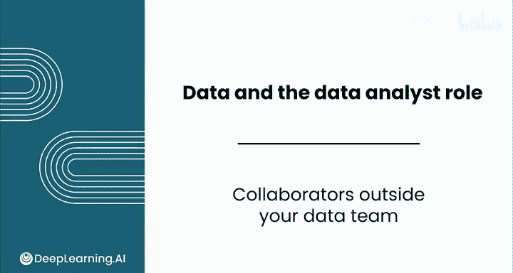
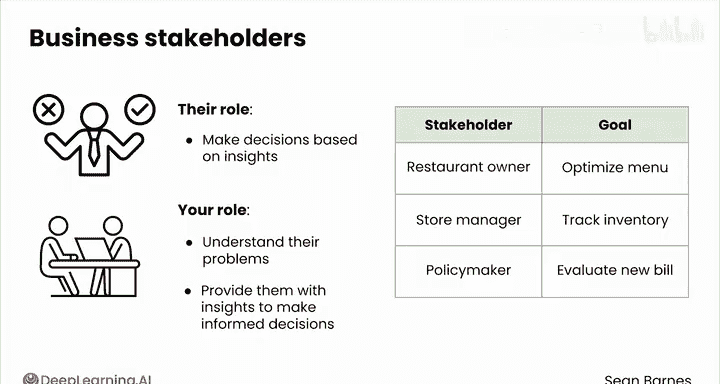
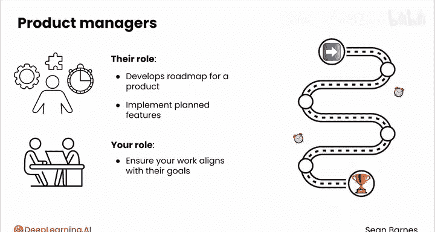
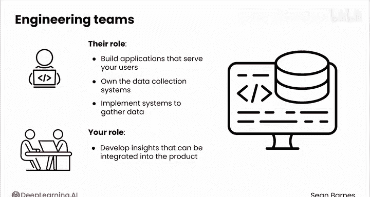
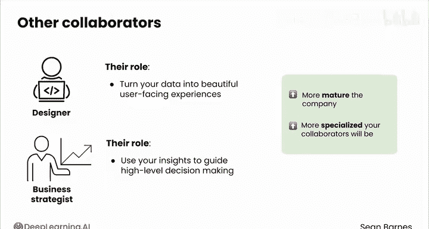
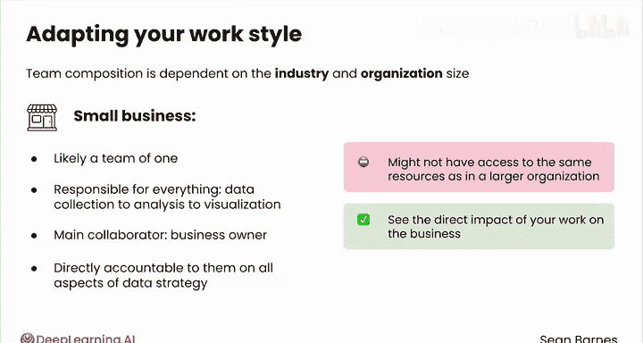
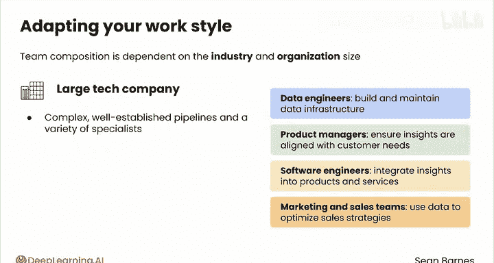

# 吴恩达《数据分析（数据分析基础／应用统计学，1-2课／共5课）｜DeepLearning.AI Data Analytics》中英字幕（claude-4-s - P14：13_跨部门协作伙伴.zh_en - GPT中英字幕课程资源 - BV1SCXrYuEwr

Data work involves people from every team within an organization Let's take a look at some of your key collaborators from outside the data team First。

 your business stakeholders who make decisions based on the insights you provide they could be anyone from a restaurant owner trying to optimize their menu to a store manager tracking inventory to a policymaker evaluating a new bill your job is to understand their problems and provide them with the insights they need to make informed decisions and many organizations especially in tech you'll work closely with product managers a product manager develops the roadmap for a product and works to implement planned features They define their business problems and priorities you'll need to ensure your work aligns with their goals as they'll often be the primary consumers of your insights They'll make decisions like which features to prioritize and how to personalize a product based on your insights。

 engineering teams are another crucial collaborator they build the applications that serve your users and often own。

The data collection systems your engineers will help implement systems to gather new and better data your role is to develop insights that can be integrated back into the product。

Depending on your organization， you might also work with designers who help turn your data into beautiful user facing experiences or business strategists who use your insights to guide highlel decision making。

 The more mature the company， the more specialized your collaborators will be。

 The team composition is heavily dependent on the industry and organization size。

 You'll have to adapt your work style to the environment。

 Here are some common team types you may encounter First， in a small business。

 you will likely be a team of one。 and responsible for everything from data collection to analysis to visualization。

 Your main collaborator would be the business owner and you'd be directly accountable to them on all aspects of data strategy。

 Agility and adaptability will be key。 You might not have access to the same resources and tools as in a larger organization。

 So you need to be resourceful。 The upside is that you can often see the direct impact of your work on the business。

 In a government role， your key collaborators are likely to be。😊。

Policymakers you will likely have less access to the complex engineering systems you would see in the tech world。

 The key challenge in this environment is ensuring your insights are communicated in a way that resonates with policymakers you might need to provide more context and guidance than in a business setting in a large tech company you'll likely be working with complex well establishedab pipelines and a variety of specialists Data engineers will build and maintain the data infrastructure。

 Product managers will work closely with the data team to ensure that insights are aligned with customer needs。

 Soft engineers will integrate those insights into products and services。

 Market and sales teams will use data to optimize sales strategies in this environment you'll often deal with large volumes of data and track the requirements of many diverse stakeholders Inights must be shared effectively across large sometimes globally distributed teams You'll need to stay updated with the latest technologies to keep pace with the rapid innovation in the tech industry。

Across all these team compositions， the more you can align with your stakeholders。

 the more impactful your data work will be。 You'll excel in your work by bridging the gap between the technical world of data and the practical realities of the business。

 In the next video， you'll see how this collaborative mindset translates to working within the data team。

 meaning there。😊。