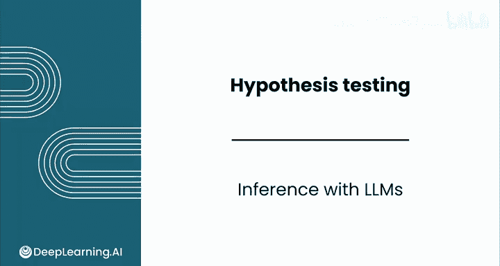
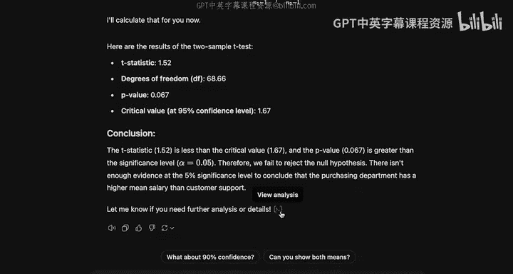
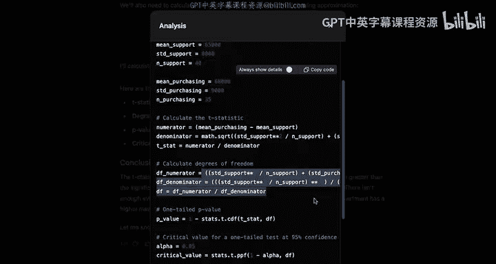
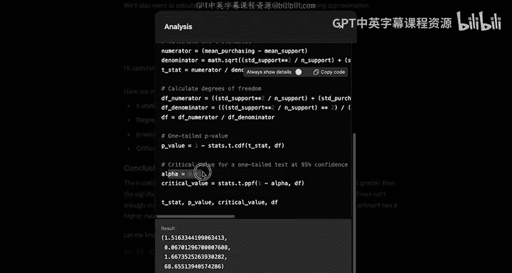
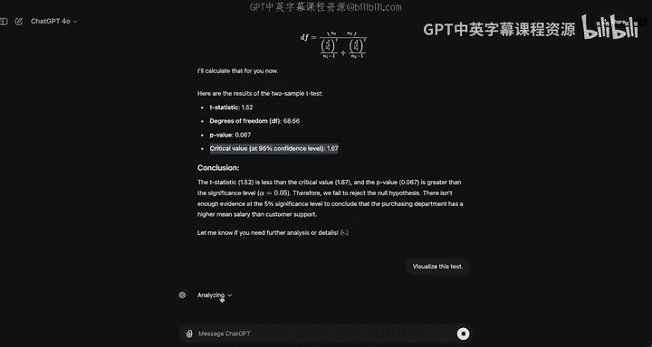
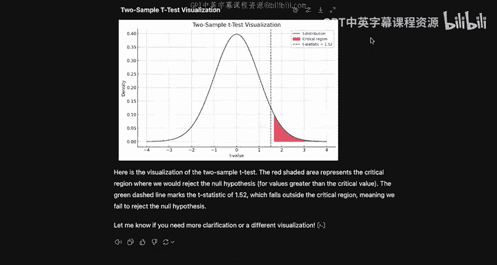

# 吴恩达《数据分析（数据分析基础／应用统计学，1-2课／共5课）｜DeepLearning.AI Data Analytics》中英字幕（claude-4-s - P150：79_使用LLM进行统计推断.zh_en - GPT中英字幕课程资源 - BV1SCXrYuEwr

How can you get a large language model to actually run a hypothesis task for you。

 let me give you a couple of examples。Say you're comparing salaries between two departments。

 Custom support has a mean salary of $65000 with a standard deviation of $8000 and your sample size n equals 40 while purchasing has a mean of $68000 with the standard deviation of $9000 and a sample size n equal to $35 perform a two- sample hypothesis test to see if the purchasing department has a higher mean salary performform here means that the LLM has to write and run code。

 it has to actually do math。 if you're working with a traditional large language model when you ask it to perform a two sample hypothesis test like this。

 it will just write out all the steps and you will have to go off and do the calculations yourself but since we are using chat G40 which can actually write and run code with its advanced data analytics feature。

 it will go ahead and do those steps for you It's going to use a two sample T test This is one type of hypothesis test you learn about in the previous videos It defines the hypothesistheses the mean salary of purchasing is equal to or less than that of customer support and the alternative。

is says that the mean salary of purchasing is greater than that of customer support。

 It also tells you that this will be a one-ted test because we're specifically interested in whether the purchasing department has a higher mean salary。

 It also gives you the formula for calculating the test statistic you'll see that the formula for calculating the test statistic looks pretty similar to other examples that you've performed earlier but wow look at that equation for the degrees of freedom aren't you glad you don't have the manually perform that yourself and down below it shows you the results it shows you the T statistic of about 1。

52 it shows the degrees of freedom which are around 68 a P value of 0。

067 it also tells you something called the critical value。

 This actually defines the boundary of the rejection region before you interpret the results you should also validate that the model actually ran code to cal these statistics。

 you can go down below to this view analysis button and open up to see the code that the model actually executed。

Here you can see that it actually defined a lot of the statistics that you need to calculate。

 and then it perform some calculations for the test statistic as well as the degrees of freedom。

 Finally， it calculates the P value with something that looks like it's applying the complement rule I also see some use of the CDF。

 which is the same approach that you've been using to conduct other hypothesis tests， and lastly。

 you see it defined the level of significance alpha。

 as well as calculating this critical value that I mentioned earlier。

So based on your own knowledge， if you have a significance level of 0。05 and a P value of 0。067。

 I this result statistically significant， It is a relatively low P value。

 but we're not hitting our significance level yet。 So the interpretation is we do not have enough evidence to reject the null hypothesis。

 We cannot conclude that the mean salary in the purchasing department is significantly higher。

 One thing I would like to do is to be able to see what this looks like。

 So I'm going to ask it to simply visualize this test。 We'll see what it comes up with。Again。

 you can see that it's writing code to visualize the test。 and eventually。

 it produces a graph that's very similar to the ones you've seen so far in this course。

 Here is the T distribution。 This red area is the rejection region with an alpha of 0。05。

 This vertical line is the test statistic 1。52。 And you can see that your test statistic does not fall within that rejection region。

 Visly， you can tell this test staistic is a relatively rare value。

 but not quite as rare as our significance threshold。

Okay， so you've seen how large language models can help you actually perform hypothesis testing。

 They're very useful， but you have to make sure you're double checking their output at every step。

Great work running hypothesis test using a large language model that takes you to the end of this module and you're almost to the end of this course。

 You've learned so much since histograms， Me， media and mode。

 I'm proud of you Com up you'll complete a practice lab with the large language model。😊。

Once you're done， you'll also complete the graded assessment and lab for this module。

 putting your hypothesis testing skills to the test to analyze diamond prices Finally。

 you'll complete the capstone exercise for this course。

 you'll act as a data analyst working with a group of cardiologists studying heart disease。

Your goal is to help analyze the risk factors associated with heart disease to help with prevention efforts。

 You'll combine everything you've learned in this course from descriptive statistics to probability distributions to inferential statistics to put together a comprehensive rigorous analysis once you're done with the graded assessment and lab as well as the capstone exercise。

 I'll see you in one final video to talk about your next steps as a data analyst。

 Keep up the great work and I'll see you on the other side of the graded assessments and capstone。😊。

