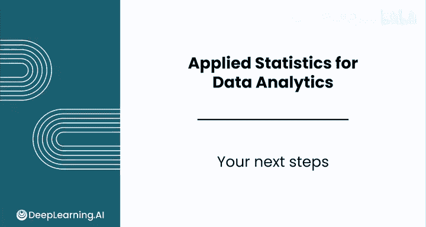

# 吴恩达《数据分析（数据分析基础／应用统计学，1-2课／共5课）｜DeepLearning.AI Data Analytics》中英字幕（claude-4-s - P151：80_你的下一步计划.zh_en - GPT中英字幕课程资源 - BV1SCXrYuEwr

Congratulations on completing the capstone and this course。

 you've made incredible progress in the field of statistics， which is no small feat。

 You've come a long way since you wondered if you can start a new birthday car tradition among your coworkers。

From calculating central tendency， variability and skew to simulating probability distributions and spreadsheets and using LLMs to calculating confidence intervals and hypothesis tests。

 you're prepared to run rigorous statistical analyses in data analytics。

 and there's a lot more to learn。😊，One of my favorite aspects of this work is how much I learn every day。

 even after years on the job。 So I hope you'll join me in the next course in this series。

 Data analysis at scale with Python。 You'll learn the fundamentals of the Python programming language。

 as well as how to use Python for analysis， data cleaning and visualization using both pandas and seaborn。

 You'll implement all the statistics you learn and more to create rigorous。

 scalable and beautiful analyses。 Wait， just one more question。😊。

Will I see you again in the next course？Without a doubt。

Congratulations again on completing this course and I'll see you in the next one。

 Python programminging for Data Analytics。