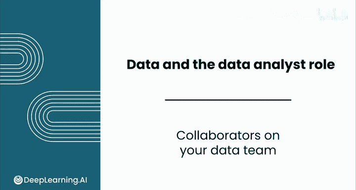
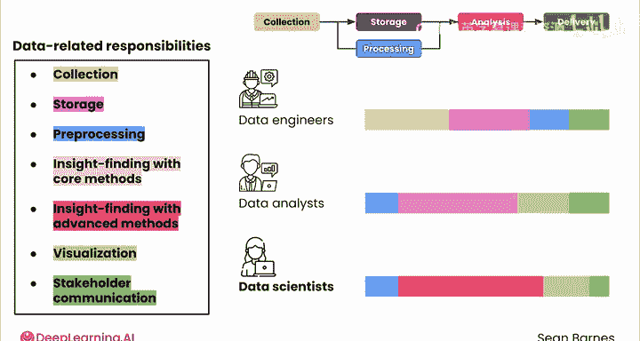
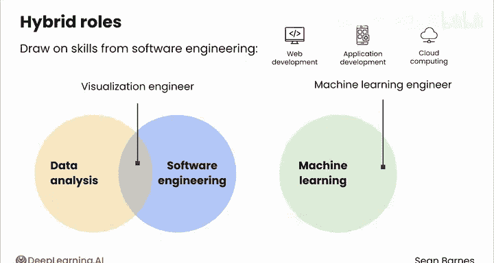
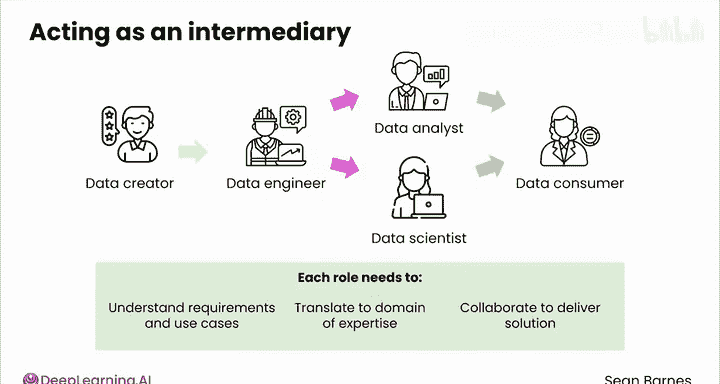
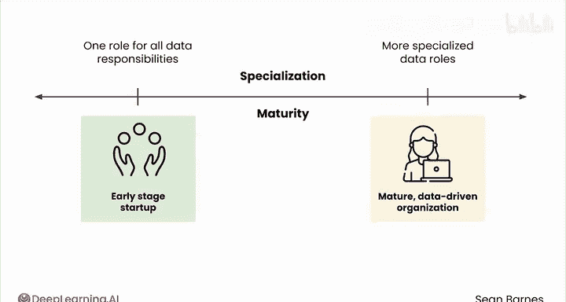

# 吴恩达《数据分析（数据分析基础／应用统计学，1-2课／共5课）｜DeepLearning.AI Data Analytics》中英字幕（claude-4-s - P15：14_数据团队内部协作.zh_en - GPT中英字幕课程资源 - BV1SCXrYuEwr

So what are the different roles that make up a mature data team。

 let's take a look at each one and how they work together Here are the high levelvel responsibilities of the data team collection storage。

 preprocessing Inight finding with core statistical methods In finding with advanced statistical methods and machine learning visualization stakeholder communication  Re like understanding the business problem belong to everyone so you won't see them here then there are the three core personas data engineers data analysts and data scientists how are these responsibilities divided up among them on the right you'll see a breakdown of the time spent by each role on each task with this gray bar representing100% of each roles time data engineers are primarily responsible for data collection and storage their primary job is to build data pipelines that capture data from various sources and move it to the right location for analysis data engineers may also work on some preprocessing to help get the data ready for insight finding Finally data engineers typically spent。

Sometime on stakeholder communication data analysts discover and communicate insights from data That includes some preprocessing to make sure the data is in the right format for analysis。

 you'll primarily focus on insight finding related to the business problem using core methods plus visualization to help explain the insights you're finding Then a big chunk of your job is communication to help your stake make informed decisions。

 data analysts often have the broadest skill set covering everything from SQL queries to data visualization to programming to stakeholder management data scientists often apply a deeper set of skills to their analysis。

 They'll likely conduct some preprocessing， They spend the majority of their time on insight finding this time focusing on more complex methods like machine learning techniques。

 data scientists might design experiments， build predictive models or develop new algorithms they do some visualization work to explain insights and are responsible for communicating with stakeholders as well you can see these roles can overlap in their responsibilities which is great。

It allows for lots of collaboration your team might also have members in hybrid roles which draw on skills from the software engineering domain like web development。

 application development， cloud computing and so on a visualization engineer for example。

 combines data analysis with software engineering skills or machine learning engineer bridges the gap between machine learning and software engineering each of these roles acts as an intermediary between different parts of the data ecosystem That is none of these roles creates the data or consumes the final analysis each one needs to understand the requirements and use cases from one side translate them into their domain of expertise and then collaborate with the next role in the chain to deliver a solution the more mature and data- drivenriven an organization becomes the more specializedize its data roles tend to be in an early stage startup you might be responsible for the full spectrum of data responsibilities from data engineering to analysis but as an organization grows。

 data needs become more complex specialization。

allowows the company to maximize the value of each step in the process The beauty of the data ecosystem is that people with all different types of skills。

 backgrounds and personalities collaborate towards the same end goal no matter which role you're in you're part of a team You're now at the end of this lesson and there's just one more to go in this module Com up you'll learn all about large language models for data analytics including their strengths and limitations plus you'll build your prompting skills with the hands-on practice lab I always find working with AI to be an adventure so I hope you'll join me in the next lesson to check out this exciting new technology。

