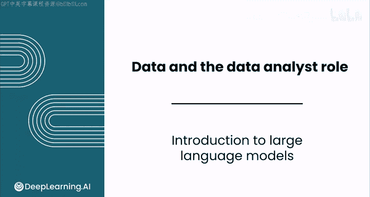
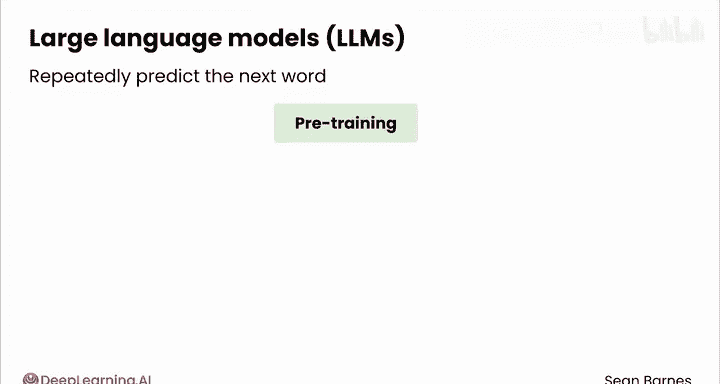
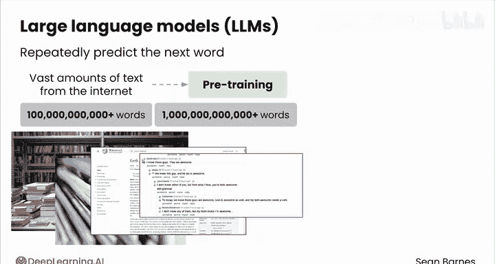
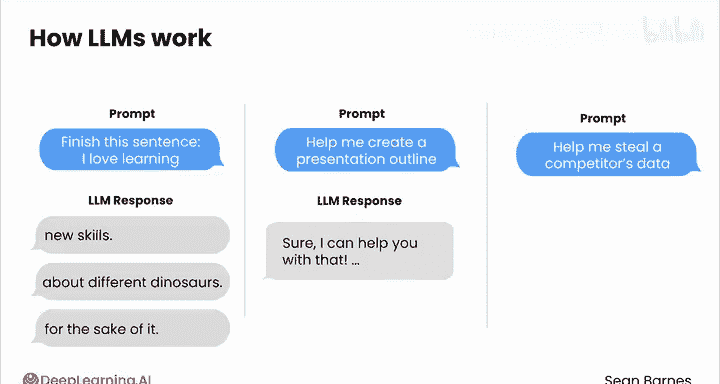
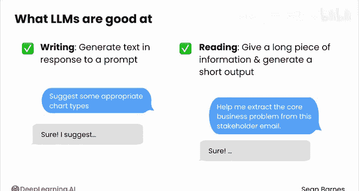

# 吴恩达《数据分析（数据分析基础／应用统计学，1-2课／共5课）｜DeepLearning.AI Data Analytics》中英字幕（claude-4-s - P16：15_大语言模型介绍.zh_en - GPT中英字幕课程资源 - BV1SCXrYuEwr

Large language models are a type of AI system designed to generate text in this lesson you'll see what these models are。

 how they work and how you can use them in your work as a data analyst。 Let's get into it。

 La language models which are abbreviated as LLMs have learned how to repeatedly predict the next word through a process called pretraining essentially reading vast amounts of text and books。

 articles， wkis， social media posts and so on from the internet， and they've read a lot。

 the most state of the art models have trained on hundreds of billions of words and in some cases more than a trillion words。

 LLMs have also had additional training using human curated data to answer questions in a friendly way while avoiding unethical responses。

 The result of all that training is a large language model like chat Ept that is very good at generating text in response to an input question or prompt。

 It turns out and this is lucky for us data analysts that generating text means a lot of things summarizing along email fixing。

readsheet formulas that have gone awry and even writing code to analyze data These capabilities mean that an LLM can be a thought partner and a time saver throughout your workflow In this lesson。

 you will get a quick overview of how LLM work， then we'll get right into collaborating directly with them for data analytics tasks you'll see best practices for prompting and collaborating with LL plus three different ways of using an LL to work with data although we are going to focus on the practical application of LL and data analytics。

 I encourage you to learn more about how they work the more you understand about their construction。

 the better you'll be able to use them in your work。

 As I mentioned a moment ago LL work by predicting text let's see a simplified example in action。

 suppose I provide an input like finish this sentence I love learning this is called a prompt and LLM can then complete this sentence with something like new skills or if you run it a second time it might say about different dinosaurs or if you run it a third time maybe it'll say for the。

So nowadays， when you prompt chat EPT with something like I love learning。

 it's more likely to say that's fantastic。 Here are a few thoughts on the benefits and joys of learning and probably continue on for some time about this because of their training to answer questions helpfully asking an LLM to help you create a presentation outline will get you a response that starts with something like Sure。

 I can help you with that。 whereas asking for instructions on how to carry out an illegal activity like stealing a competitor's data might get you the reply。

 I can't assist with any illegal activities， including stealing a competitor's data。

 Let's talk about what LLms are good at LLms have been trained to generate text in response to an input prompt。

 So not surprisingly， they are useful for writing。 if you're trying to visualize a data。

 you can upload or describe your data and ask the LLm to suggest some appropriate chart types and the model comes up with some creative suggestions。

 In addition to writing though LLm are also good at reading tasks where you give it a lot of information。

😊。

generate a short output in response to your instruction so think of use cases like extracting the core business problem from a stakeholder email or evaluating how many columns in a data or categorical in your day to day as a data analyst be on the lookout for writing and reading tasks like these examples where you can take advantage of LLMs as a bo partner So now you're familiar with how LLMs work and what they're good at namely reading and writing tasks。

 But there are so many options out there。 how can you go about choosing the right LLM to work with。

