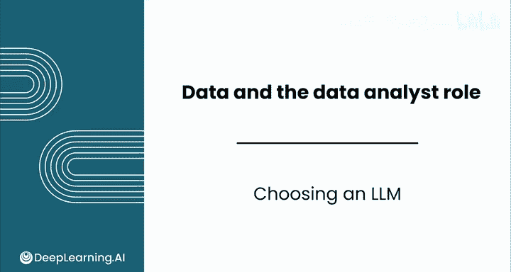
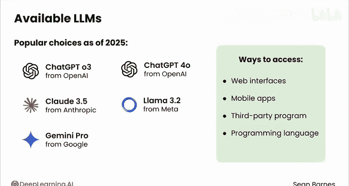
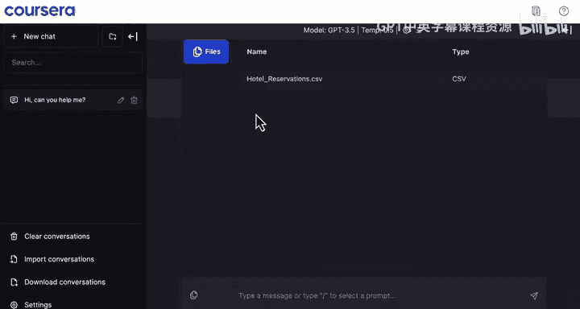
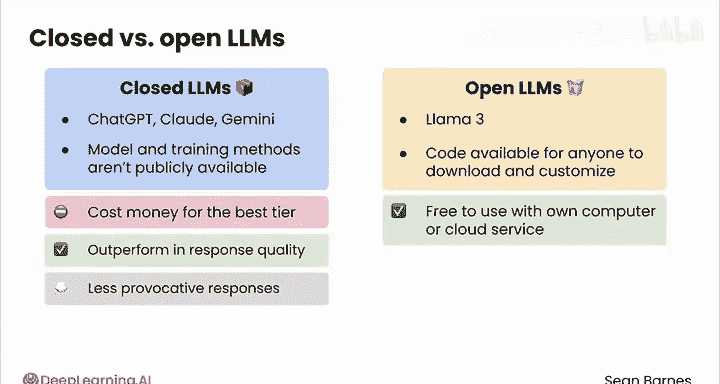

# 吴恩达《数据分析（数据分析基础／应用统计学，1-2课／共5课）｜DeepLearning.AI Data Analytics》中英字幕（claude-4-s - P17：16_LLM选择策略.zh_en - GPT中英字幕课程资源 - BV1SCXrYuEwr

Now that you know what LLMs are capable of you should try them out and see what works well for you in this video。

 you'll get familiar with some of the most popular LLMs out there and how to use them。

 There are a lot of LLms available to you and that number is growing just like you might go to different colleagues with different types of questions you have a choice in which LLM you work with Some popular choices include models from Open AI Anthropic meta and Google at the time of recording chat Gpt03 and 40 from OpenaiI Cloudd 3。

5 from anthropic Lma 3。2 from Me and Gemini Pro from Google are strong choices when it comes to response quality Each one has different strengths and a different communication style。

 you may prefer the tone of 1 over another。 Some of these LLms have web interfaces or mobile apps which are convenient for everyday use and others are more tricky to use requiring a thirdpart program or the use of a programming language like Python。

😊。

In this course you'll be using Coursera's builtin webbased interface to chat with the LLMs。

 The interface has a pretty standard setup。 You have a place to enter your prompt here and when you submit your prompt。

 you will be able to read the response from the LLM in this section in the middle So for example。

 I might type in a question Hi can you help me and then you'll see the response up above in addition to your actual prompt on the left now you can see any previous conversations that you've had or you can start a new chat and then down below you have some options for how to manage the conversations you've had as well as configure any settings you may also notice this file icon on the left of your prompt you can see in this case we have the option of the hotel reservations data which is something that will' work with in future videos in this interface you can only work with the preselected files that are relevant to each activity。

One more note about access the models and training methods for chat G Clade and Gemini are available to the public。

 which means they're called closed LLM Lama 3 on the other hand， is an open LLM。

 Le that its code is available for anyone to download and customize a closed LLM is essentially a black box You know what technology was used to create it but not the specifics both closed and open models have their merits。

 You should consider these differences between closed and open LLMs when choosing the right one for a given task closed models cost money for the best tier and typically outperform open source LLMs when it comes to response quality you may also find that they tend to give safer or less provocative or controversial responses On the other hand。

 open models are free as long as you use your own computer to run them or they can be run on the cloud using a thirdpart service they have good but not stated of the art response quality though the gap is trending smaller and they can sometimes generate more edgy or unpredictable。

I'd encourage you to experiment with both types of LLMs。

 both closed and open to see which ones work best for you。If you treat LLMs like a thought partner。

 they can become almost like trusted colleagues， with LLMs like Chat EPT。

 millions of people around the world are interacting with the most sophisticated AI systems ever built。

 let's head to the next video to see what some best practices are when using LLMs for data analytics。

