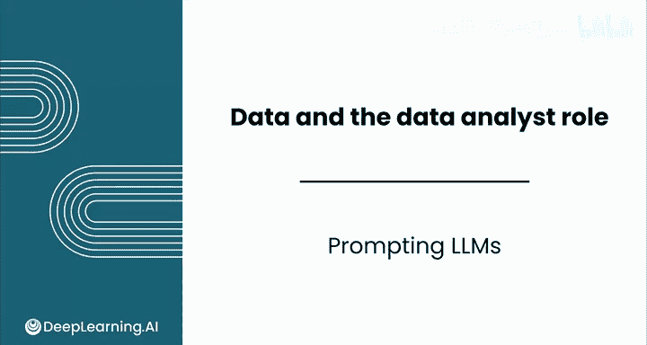
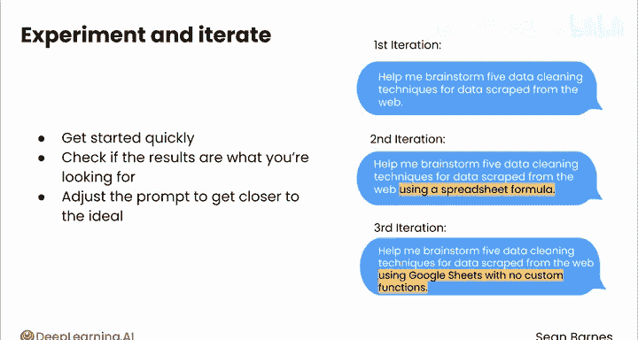

# 吴恩达《数据分析（数据分析基础／应用统计学，1-2课／共5课）｜DeepLearning.AI Data Analytics》中英字幕（claude-4-s - P18：17_提示词工程.zh_en - GPT中英字幕课程资源 - BV1SCXrYuEwr

Working with LLMs can seem mysterious What does it really mean for an AI to act as a thought partner Let's talk specifics about how to work with LLMs for reading tasks。

 writing tasks and beyond as a data analyst working in modern times you should develop proficiency and two key skills for working with LLMs first writing good prompts and second recognizing the limits of the LLM you'll learn three main tips for prompting Be detailed and specific guide the model to think through its answer and experiment and iterate Let's start with the first tip Imagine you need help with the spreadsheet problem and you go to ask your coworker do you just run up to them and yell it's not working that's probably not going to be a successful approach you probably explain your goal what you tried and what the result was just like your coworker- and LLM needs sufficient background information or context to complete the task ask yourself。

What information would a colleague need to be able to answer my question or brainstorm with me your prompts should also guide the model to think through its answer if you ask it to brainstorm five data cleaning techniques for data scrappe from the web。

 it will do an all right job。But suppose you want some information about each technique as well as the spreadsheet formula to accomplish it。

 plus an emoji to help you remember each option， the best approach would be to instruct the LLM to develop this more detailed response in a series of steps for step1。

 ask the LLM to come up with five data cleaning techniques for data scrape from the web for step2。

 ask the LLM to write a corresponding spreadsheet formula for each technique， and for step 3。

 ask the LLM to add a fun， relevant emoji for each technique you might get a result like this where the LLM follows your instructions So if you already have a process in mind for what you want。

 prompting the LLM with clear step by step instructions can be quite effective。Finally。

 expect to experiment and iterate， try something quick at first。

 like help me brainstorm5 data cleaning techniques for data scrape from the web。

 and if I don't like the result， I might clarify and add this to the prompt。

 using a spreadsheet formula and if it still doesn't give me exactly the result I want。

 I might clarify even further to say， using Google sheetets with no custom functions。

 Prompting is not about starting with the right prompt。 It's about getting started quickly。

 checking if the results are what you're looking for and knowing how to adjust the prompt to get closer to that ideal response。

You should regard LLMs like a group of diverse creative colleagues。

 not a replacement for all of your responsibilities。 In fact。

 join me in the next video to take a look at LLM limitations， what these models get wrong and why。

