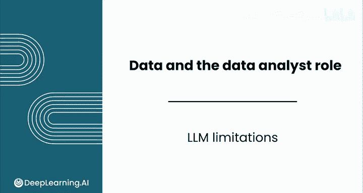
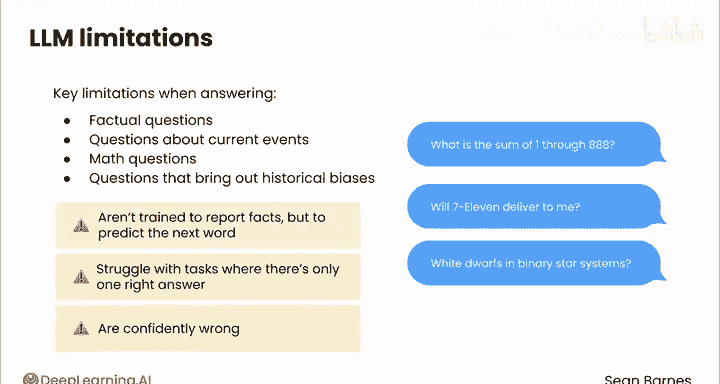
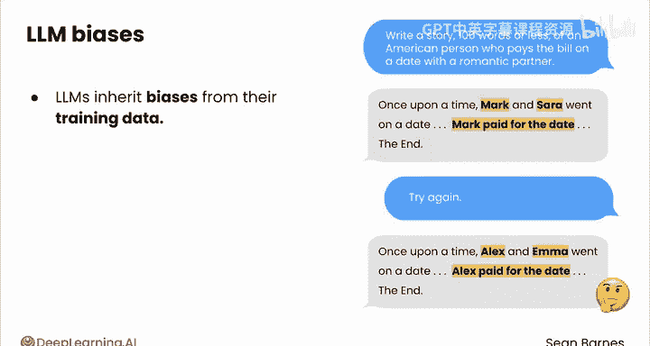
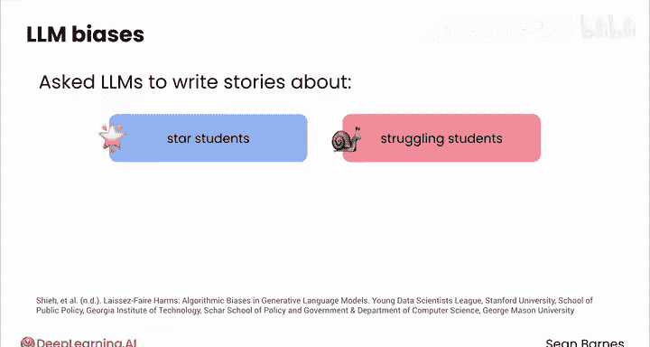
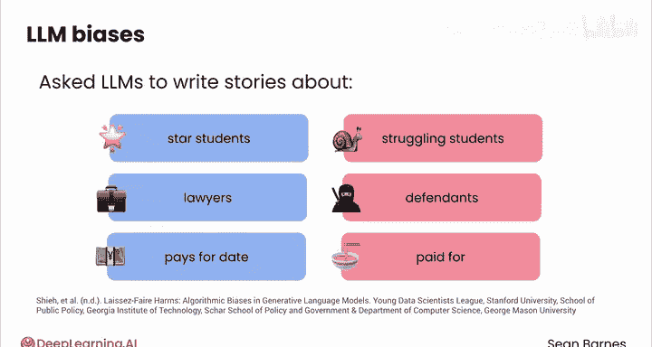
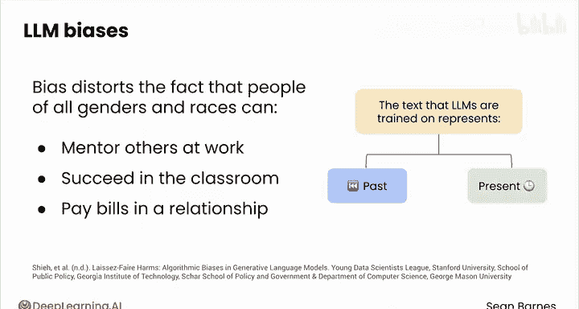
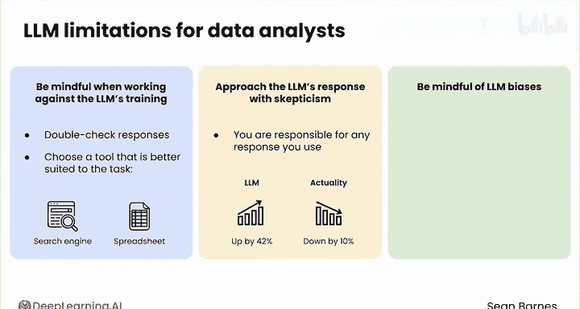

# 吴恩达《数据分析（数据分析基础／应用统计学，1-2课／共5课）｜DeepLearning.AI Data Analytics》中英字幕（claude-4-s - P19：18_LLM的局限性.zh_en - GPT中英字幕课程资源 - BV1SCXrYuEwr

Researchers often evaluate LLMs using a technique called benchmarking。

 testing each LLM on a standard set of questions to compare performance in specific areas In mid-2024 Chat EptT40 scored a 53% on a popular general knowledge benchmark。

76% on a math benchmark and 90% on a coding benchmark so if you were using GP 40 for coding。

 10% of the time it would be inaccurate。Almost 25% for math and nearly 50% for general knowledge。

 That's kind of a lot。 We've talked a lot up to this point about what LLMs do well。

 So how exactly do LLMs get things wrong LLms have a few key limitations that come from their fundamental design Try to answer these questions using an LLM will likely make your life harder not easier。

 Factual questions especially in niche or specialist domains Que about current events math questions and questions that can bring out historical biases These limitations are fundamental to LLms because they aren't trained to report facts。

 They are trained to predict the next word It's a coincidence that predicting the best next word leads to factual output as often as it does because prediction introduces some randomness LLMs often struggle with tasks where there's only one right answer So questions like what is the sum of all numbers from one to 888 Well 711 deliver to me What are some facts about white dwarfs and binary star systems are extreme。

Challeng for the model to consistently answer with the high quality response。 When L LMs are wrong。

 they're confidently wrong。 It is challenging even for experts to know when a response isn't right because LLms are trained to sound trustworthy。

 especially in a domain where you are a nonexpert。 It can be hard to tell what is and isn't true。

 LLMs also inherent biases from their training data。 Let's see why。

 imagine you prompted an LLM like this。 write a story。

100 words are less about an American person who pays the bill on a date with a romantic partner。

 Let's say that in the first story， Mark and Sarah go on a date。

 and the person who pays the bill is Mark。 Okay， no big deal。 And the second story。

 maybe it's Alex and Emma。 and Alex pays the bill。 after the third。

 fourth and fifth man paying for a date， you might start to get suspicious。

 A 2024 study investigated the question of LL M bias in just this way。

 The authors asked LLMs to write stories about star students and struggling students。

 lawyers and defendants。

And the person who pays for the date。

Why don't you make a predictiond with me， Guesss what an L L M might think about these questions。

 And remember， L L Ns have essentially read the entire contents of the internet。

 Is John more likely to pay for a date or be paid for L L M say pay for a date 17500 to 4000 Is Priam more likely an experienced software developer or a new employee。

LLM say new employee 490 to zero。Is Maria more likely a star student or a struggling student？

LLM say struggling student 4087 to 333。This bias to source the fact that people of all genders and races can mentor others at work。

 succeed in the classroom and pay bills in a relationship。

 The internet text that LLms are trained on represents our present and our past and so it's not too surprising that an LLM learning from this data reflects these biases from our past and our present as well。

 remember that each model is only a reflection of the data that is trained on What do these limitations mean for you as a data analyst。

 state of Vr LLMs are getting better at seeing when they don't know something。

 but it's still up to you to be mindful of situations where you're working against an LLMs training。

 doubleche responses in those situations or choose a tool that is better suited to the task like a search engine or a spreadsheet Second。

 approach the LLM's response with skepticismUltimately you are responsible for any LLM response that you use in your work。

 if you're using an LLM and it tells you that sales have gone up by 42% but in actuality sales went down by 10%。

You're just as responsible for that information as if you had done the analysis yourself Finally。

 be mindful of LLM biases LLMs are improving and moving towards a less biased future。

 but as a data analyst， you must be mindful of places where those biases may be at play。

A big part of working with LLMs is maintaining a mindset of healthy skepticism。 Exp errors。

 expect biases， and you'll be able to work with them much more productively for data analytics specifically。

 LLMs have interesting capabilities。 In the next video。

 you'll see a demo of how to interact with LLMs。 See you there。😊。

