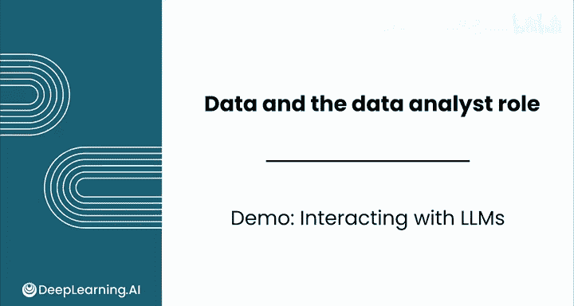
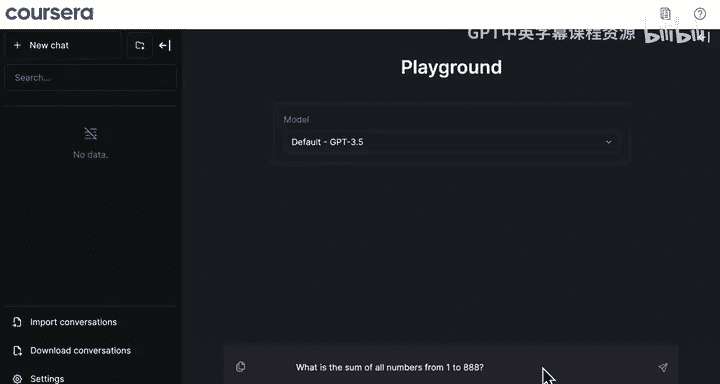
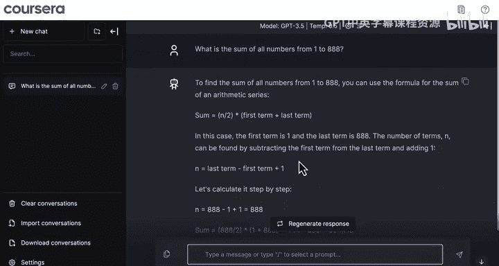
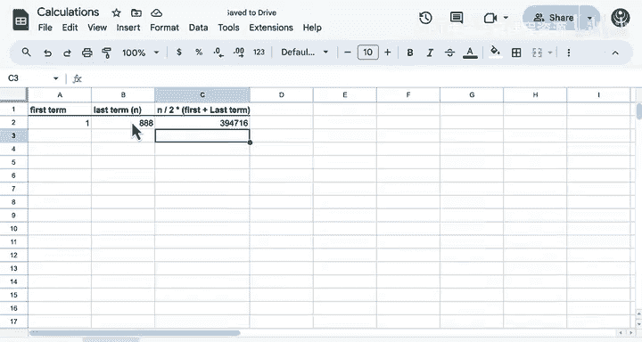
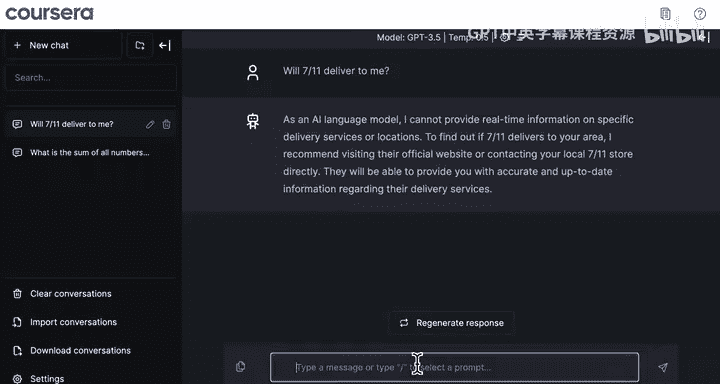
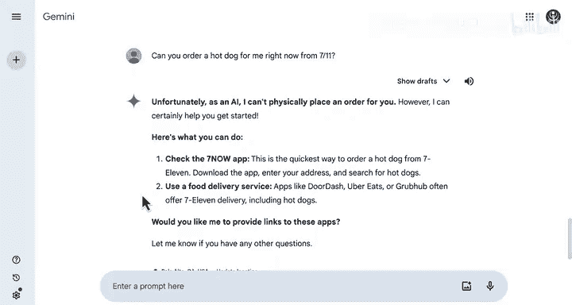
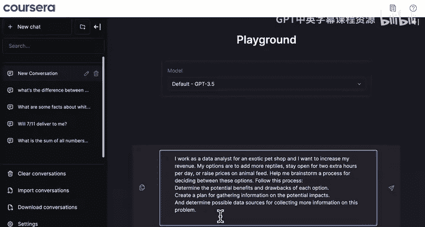

# 吴恩达《数据分析（数据分析基础／应用统计学，1-2课／共5课）｜DeepLearning.AI Data Analytics》中英字幕（claude-4-s - P20：19_演示：与LLM交互实践.zh_en - GPT中英字幕课程资源 - BV1SCXrYuEwr

Let's take a look at how to interact with an LLM。 you already took a look at Coursera's LLM interface in an earlier video。

 and now you'll see it in action。 First off， I'll try some of the prompts you saw in the previous videos。

Let's start with the first prompt you saw。 What is the sum of all numbers from 1 to 888。

 when we review the response， it gives us a formula to actually calculate this sum sum equals n divided by 2 times the first term plus the last term where n is the number of total terms So now we're going calculate this formula exactly plug in 888 divided by2 times the first term plus the last term。

 The result is 394716。 Compare that to the result from the LLM。

 you can see that the result was 394116。 So in fact， the LLM did get this calculation incorrect。

 When you're trying to do math it's much better to use another tool like a calculator a spreadsheet or a programming language rather than an LLM。

 Let's also try another prompt。 What if you want a hot dog and you want it right now。

 will 711 deliver to me The LLM tells us that it cannot provide realtime information on specific delivery services or locations。

 and then it gives us some advice。

About how to find this information I want to quickly show you that same question in a couple of different commercial LLM interfaces。

 so this is anthropics Cla， and I'm currently using 3。5 sonnet。

 but there may be a better model available to you and let's see what it says711 offers delivery services in some locations。

 but the availability depends on your specific area。

 It gives us some advice on how we can actually find this information for ourselves。

 Let's ask Gemini Gemini is created by Google and it does have access to web search So essentially I can Google in the same way you could。

It tells us that 711 delivers in many areas and that there is a few different ways to get 711 delivered Let's ask it what about in my area Chaman I actually detectt the location of your account and offers a more specific answer about whether it delivers in your area in this case from Palo Alto the answer is yes。

 Let's also try to see if it can submit the order for us As an AI it cannot place the order for you so there are limitations on what LLM can do for you today Let's go back to Coursera and start a new chat。

 What are some facts about white dwarfs and binary star systems It gives me a bunch of information how they're formed what the mass is temperature density and so on The problem here is that I don't actually know whether these are actuallyually true or not and for that reason I probably wouldn't ask the LLM about the subject I would go to a more authoritative source like a search engine or textbook You might want to ask the LLM some questions to help you study for this course So for example。

 what's the difference between continuous。

And discrete numerical features。It responds with continuous numerical features are variables that can take on any value within a certain range and discrete numerical features are variables that can only take on specific values within a certain range。

 Since you've learn a bit about continuous and discrete numerical features already。

 you can actually verify if this information is correct。

 It also provides examples of each type of numerical data So for continuous numerical features it offers age height。

 weight and for discrete numerical features， it offers the number of children in a family the number of cars own and the number of pets。

 you can trust this information more because you know a little bit about it but it also gives you additional information be the examples and because this is a common topic on the internet rather than an obscure one I'm not as worried about fact checking as I would be with the white dwarf star systems。

 let's give the LLM a more complex prompt。 So in this case your data analyst working for an exotic pet shop and you want to increase your revenue。

 you ask it to brainstorm process for deciding between these three options。

 you also give us some details about the。

Pro that you would like it to follow it lists out each option and then some benefits and potential drawbacks for each option。

 So for option1， it mentions adding more reptiles and that it would increase the variety and selection for your customers attract new customers who might be interested in these different reptiles it also highlights it requires additional space and resources to housing care for those reptiles。

 it increases the workload for staff。 So there's a lot of information here。

 some of its a little bit redundant。 So the potential benefits and drawbacks that it mentions seem reasonable but for gathering additional information these suggestions are a little bit vague。

 So for example， when it tells you to visit other exotic pet shops。

 it doesn't give you much information on what those stores are or how you might evaluate how that store's operations to your own Don't just take the LM's word for it。

 Ask it more about what it's thinking。 For example。

 how might I evaluate other exotic pet shops for my analysis。

 you can see it offers a lot more detail than the original response to consider。s as the location。

 product range， pricing and so forth to compare other shops and help me make a more informed decision to summarize this section。

 make your chat a true back and forth。 ask the LLM questions and followups and keep a skeptical mindset。

 you shouldn't take its word as truth。 Now you've seen how to work with the large language model。

 the kind of questions it excels at the kind of questions it might struggle with and how to maintain a skeptical mindset you'll practice these skills in the upcoming lab where you can try all of these props and more。

 Well， that's almost a wrap on module1 Great work coming to the end of your first module for this course Com up。

 you'll take your final assessment for the module and complete the graded lab exercise where you'll explore a bakery related case study。

 I can't wait for you to get some more handson experience with data。 when you're done。

 follow me to the next module where you'll explore working with data and spreadsheets。

 I'll see you there。😊。

