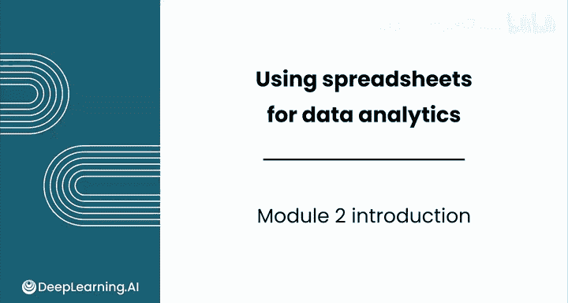
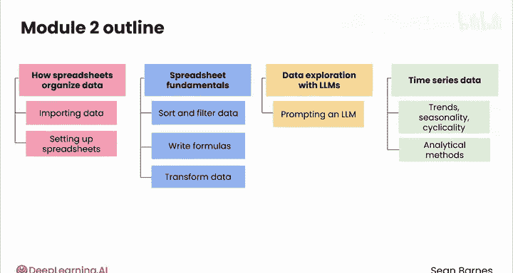

# 吴恩达《数据分析（数据分析基础／应用统计学，1-2课／共5课）｜DeepLearning.AI Data Analytics》中英字幕（claude-4-s - P21：20_模块2 简介.zh_en - GPT中英字幕课程资源 - BV1SCXrYuEwr

Welcome to module2 of data analytics foundations In this module。

 you'll dive into one of the most powerful and versatile tools in a data analyst toolkit spreadsheets We'll start off in lesson1 by exploring why spreadsheets are such an effective tool for working with structured data you'll get handson practice importing data into Google sheets and setting up your spreadsheets to enable analysis In lesson2。

 you'll see how to process your data and spreadsheets to extract valuable insights。

 you'll learn how to sort and filter your data， write formulas to create new features and calculated fields and even transform your data to make it easier to analyze we'll work through a real-world example together Under customer booking behaviors by analyzing hotel reservation data in lesson3。

 you'll practice prompting a large language model to really get to know your data and conduct data analysis。

 Les 4 is all about time series data a specific type of data measured over consistent time intervals you'll spot the key。

😊。

onents of time series， including trends， seasonality and cyclicality。

 and you'll get lots of practice with analytical methods and spreadsheets。

 using a cool real world data set of popular US baby names。 By the end of this module。

 you'll be well on your way to becoming a spreadsheet power user。 Let's jump right in with lesson1。

 and learn how spreadsheets help bring order to the chaos of raw data。 See you there。😊。

