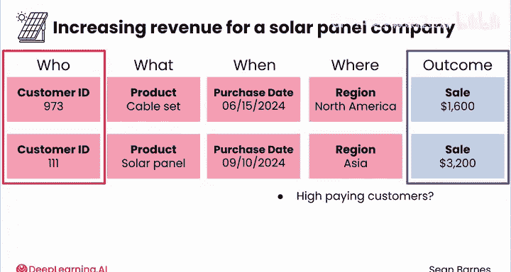

# 吴恩达《数据分析（数据分析基础／应用统计学，1-2课／共5课）｜DeepLearning.AI Data Analytics》中英字幕（claude-4-s - P22：21_用数据解决问题.zh_en - GPT中英字幕课程资源 - BV1SCXrYuEwr

Data is a fantastic tool for solving problems in a principled way。 You might have a hunch。

 but data will help you understand whether that hunch is likely to be correct。

 in order to generate these powerful insights， you will need to pick the right data to analyze。

 In my experience， there are two key considerations for selecting the right data。

 focusinging on the problem that inspired your analysis。

 The first question you should ask yourself is what outcomes that are interested in。 For example。

 if you are trying to increase profit at a solar panel business。

 Then you will want to see a positive change in sales or a negative change in expenses。

 you can pull your sales and expense reports for this analysis。

 or suppose you're working with the hospital to improve patient outcomes。 In this case。

 your outcomes of interest might be an increase in patient satisfaction and a decrease in the length of hospital stays you can gather data from patient surveys to analyze patient satisfaction and admission and discharge dates can help you figure out whether hospital stays are increasing or decreasing in length。

😊，Next， identify data that provides context for your outcomes of interest。 By provide context。

 I mean that this data tells you more information about the outcomes that were observed。

 such as the4 Ws， the who， what， when and where For example。

 if your outcome of interest is sales data， which data points provide context for those sales。

 Perhaps your sales data is associated with a specific customer I， the who product。

 the what purchase data， the when and region， the where all of this information can help contextualize the sales data so you can compare sales data across different products and regions。

 Let's zoom in on the example of increasing revenue for a solar panel company。

 and suppose that we only have the sales data on the right hand side。 remember。

 sales is your outcome of interest。 It's great that we have sales。 but unfortunately。

 we don't know a lot more than that。 we need context about these sales so that we can better understand the driving factors behind the sales for the solar panel sales。

 contexts could look like。😊，Customer ID 973 purchased the cable set on June 15。

2024 and North America。 Here is another observation to give you a sense of the range of values。

 In this case， you can use other data points to answer questions like Are there any high paying customers who should be targeted for additional purchases。

 Custom I and sales can help answer this question Are there specific products that are driving a high proportion of sales product and sale will be relevant here。

 how sales trending over time。 This time the purchase date combined with sale will answer my question Does the total amount of sales vary across regions。

 Now region and sale can help with the analysis。 It would be impossible to answer any of these questions without this contextual data。

 It's just as important as the outcome of interest。

 you can actually dig quite deeply into each of these data points too， for example。

 you might notice that customer 111 made the largest purchase。

 if you want to understand why you can ask questions like is this customer of business or an individual if it's a business。

 how large is it。

How many orders have they placed you've now seen how to identify useful data in order to tackle a business problem。

 What tools can you use to organize and analyze that data once you've identified it in the next video。

 you'll learn more about how spreadsheets can be a powerful ally in the world of data analytics。

