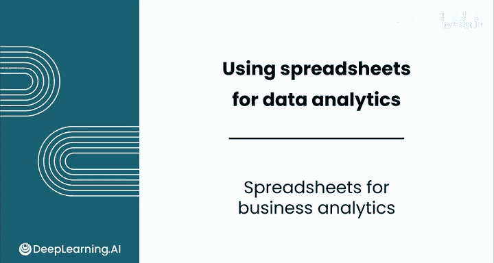
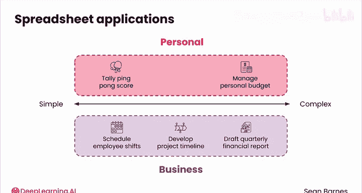
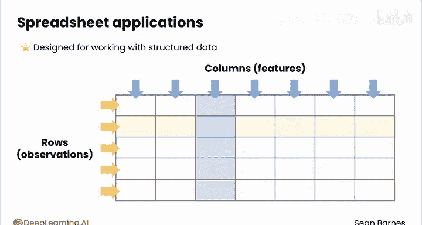
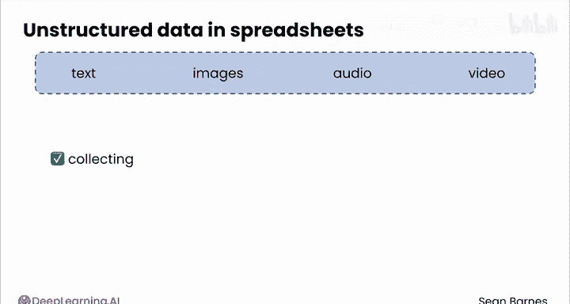
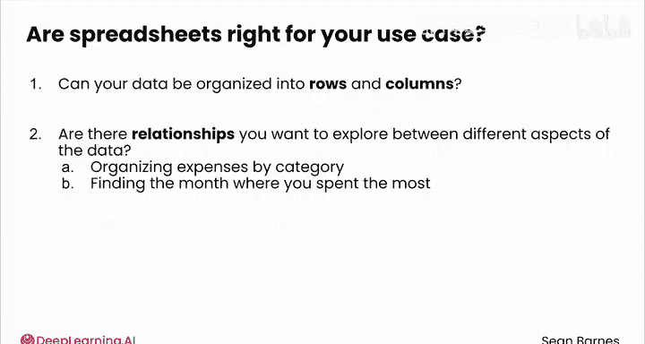

# 吴恩达《数据分析（数据分析基础／应用统计学，1-2课／共5课）｜DeepLearning.AI Data Analytics》中英字幕（claude-4-s - P23：22_商业分析中的电子表格应用.zh_en - GPT中英字幕课程资源 - BV1SCXrYuEwr

Spreadsheets bring interactivity to structure data。

 they are an industry standard tool that I've used consistently throughout my career even as Ive learned more complex tools。

 not only is the spreadsheet and industry standard tool used regularly at Google。

 Netflix and more but you can open up a spreadsheet right now in just a few seconds and for free。

They have a broad range of use cases， whether your goal is to analyze your household finances or calculate year over year revenue growth for a company spreadsheet applications range from the very simple to the fairly complex and for both personal and business use cases for example。

 on the personal side you can utilize spreadsheets to tally scores in ping pong or manage your personal budget on the business side。

 spreadsheets can be used to schedule employee shifts。

 develop a project timeline or draft a quarterly financial report the use cases are nearly endless as long as you have a mechanism to collect the data and a structured fashion and store it spreadsheets are designed primarily for working with structured data。

 which as you learned in module1 means data that can be organized into rows representing the observation and columns that represent various features an observation is a single instance in your data like one customer or one transaction while a feature is a characteristic that you measure for each observation like age。

 price or color。

When it comes to unstructured data like text， images， audio， and video。

 spreadsheets can be used for collecting and organizing it。

 but their capabilities for analyzing this type of data are limited。

 Imagine trying to write an essay in this interface。

Or organize your photos。Where would you even start it would probably make your task a lot harder so if you identify a need to work with unstructured data。

 you may need to rely on a computer programming language such as Python or generative AI tools。

 both of which you should explore as you expand your data analytics toolkit Here are two questions you can ask yourself to identify as spreadsheets are right for your use case First can your data be organized into rows and columns This organization is fundamental to spreadsheets a budget can be organized into one row for each expense and columns for features like the amount transaction date and so on Meanwhile。

 unstructured data like an essay can't easily be organized in the same way What are the columns of an essay It just doesn't work Second are the relationships you want to explore between different aspects of the data Spsheets can effectively calculate these relationships like organizing all the expenses in your budget by category or analyzing purchases to find the month where you spent the most if the answers to both questions are an enthusiastic yes then spreadsheets will be。

Fantastic tool for solving the problem you're trying to tackle Now that you've seen how powerful spreadsheets can be。

 I hope you'll join me in the next video to get hands on with the renovation project in Google Sheets。

