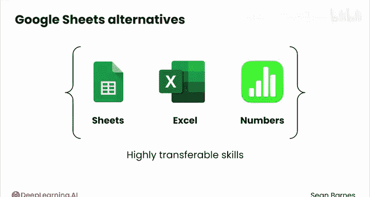
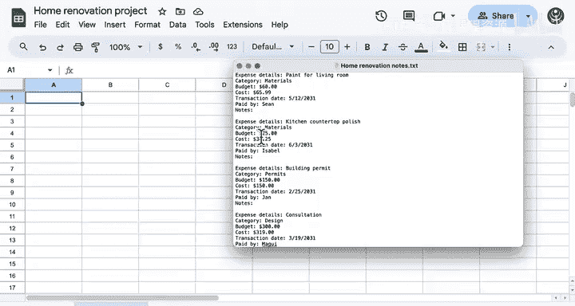
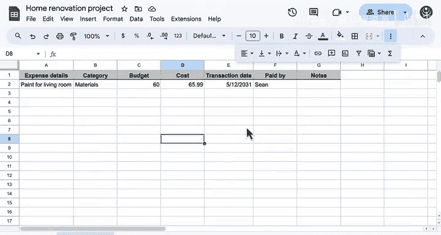

# 吴恩达《数据分析（数据分析基础／应用统计学，1-2课／共5课）｜DeepLearning.AI Data Analytics》中英字幕（claude-4-s - P24：23_Google Sheets导航.zh_en - GPT中英字幕课程资源 - BV1SCXrYuEwr

One of the most common spreadsheet applications is Google sheetets。

 It's both accessible and useful and best of all， it's available for free to individuals and you can share your spreadsheet to collaborate with friends and teammates。

 while Google Sheets is widely used， you have other options such as Microsoft Excel Apple's numbers and more the skills that you will develop in this course using Google Sheets are highly transferable to each of these other tools let's take a tour of Google Sheets to see how it works。

 by the way， for this and any demo in the course， if you'd like to follow along。

 you can access a copy of this spreadsheet and any other relevant files in the downloads tab below this video I already have a new sheet open here but in order to create a new sheet you could go to sheetets new or open a new Google Sheetss instance from your Google Drive So in Google sheetets you have all of your menu options which we will explore over time there's also an entire ribbon of formatting options that you can apply to your spreadsheet we will explore some of those as we go as well So suppose my friends have been helping me。

The home renovation project I have some data here that summarizes some of the transactions so just looking at this data it's really hard to tell any overall trends did I go over budget what item was the most over or under what was the first transaction it's really difficult to identify any of those insights with the data in this form Each of these transactions I've been taking notes on has several features such as the expense details category budget cost and so on let's copy one of these entries into the spreadsheet。

So I'm going to start by actually transforming this data into a table that we can use for deeper analysis。

 so I'm going to start with my column headers。And then I'm going to enter the information for this particular entry。

 So each of these intersections between a row and a column is a cell。

 so notice that I can both click a cell and I can click into a cell either by double clicking it or clicking into the edit box above I can also select multiple cells by clicking and dragging。

 I could also select a row or column or even multiple columns by clicking and dragging。

You can also navigate across cells just by using your arrow keys right left down and up。

 and you can also either move to the end of a row or column using the command key and an arrow so command right will take me to the end of the data command down will take you to the bottom and shift will allow you to select multiple cells you can also command shift and select all of the items in a row or in a column Okay so let's make it pretty don't worry too much about all of these individual steps but this will just help organize your data and make it easier to review So first now that I've entered in all this data I'm going to remove it so now let's organize our data a bit to make it a little easier to read that will click the boundary between any column headers and it will automatically expand it so that you can see all of the information contained in the cell select the header row here and turn it a bold and add a lower boundary so that you can differentiate between the header row and the rest of your data add a background row。

Color just to make it even more obvious that this is the header row center in all of the header rows。

 expand the transaction date so that we can see the full header。

 Now that we formatted our data a little bit， I'm gonna copy the rest of the data into this table I've added some more formatting here just for from this point on in the video。

 Don't try to memorize all the different steps you see Just focus on the different capabilities you have a spreadsheets。

 So now I can answer， did I go over budget So one easy way of doing this is just by selecting all of the cells in the budget column and then you get a nice summary in the lower right hand corner to see what the total budget is for the project。

 which is $1860。 you can also compare this to the cost sales total 1663。

44 so you can see comparing these two totals that I am in fact under my budget you can also use formulas to compare these two numbers So now below I've added a total row and I can insert a sum function to add up all of the budgets for the individual items。

 You'll learn more about function。

In an upcoming video the name of this function is sum and the values inside the parentheses represent the range of cells that you want to sum。

 I can also repeat this for the cost column， and now I can directly compare those two numbers together and again confirm that in total I'm under budget I just remembered another transaction for the whale soapholderer。

 So let's add in a new row I'm going to right click on any row header and you can insert a row either above or below。

Notice how the column totals updated for both the budget and the cost when I added the whale shaped so holder Now I want to answer what was the first transaction so now I want to sort these by transaction date so I'm going to add a filter which is this funnel button and that enables me to sort by transaction date so I can click this button on the right of the column header and I can sort from a to Z which is increasing order now I can easily see that the first transaction was the building permit next suppose I wanted to analyze which items joy purchased so again I can select the filter now by the paid by column and I can filter out all the individuals except for joy so I'm going to clear all the filters and then select Jo and head ok I can see that Jo purchase three items electrical outlet covers plants and the bathroom mirror so let's go back and now look at the labor costs so I'll select everyone to bring all the data back and then filter down to just the labor category so to calculate the total labor cost to select。

These two items and see that the total labor cost was $839 Now I'm wondering what was the most over budget purchase and in order to actually calculate what was the most over budget。

 insert a new column to calculate the difference between the budget and the cost so right click on the cost column and add a new column to the right。

This is going to be the difference call and to calculate the difference。

 I'm going to take the budget。Minus cost copypy this formula down by selecting this fill handle and dragging it all the way down to the bottom sort to find the most or least over budget items Plan went the most over budget whereas the plumbing repair we actually saved a lot of money Okay。

 I've answered all my questions this would have been much more effective than working with that original tax file。

Now you're in a fantastic position to work with any spreadsheet。

 joining me in the next video to see how to import data， I'll see you there。

