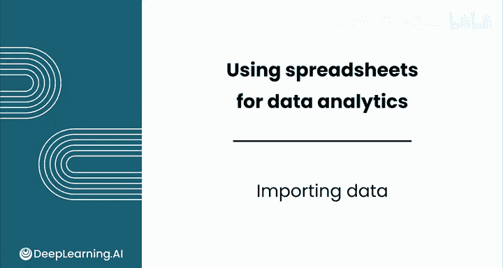
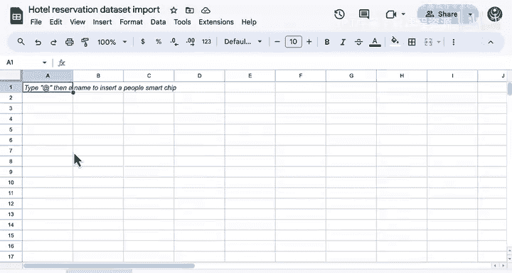
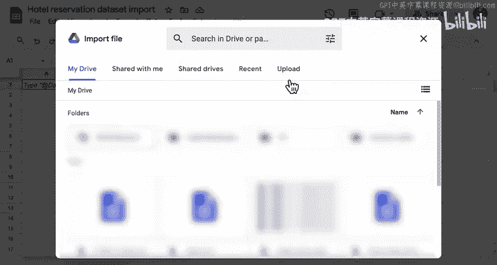
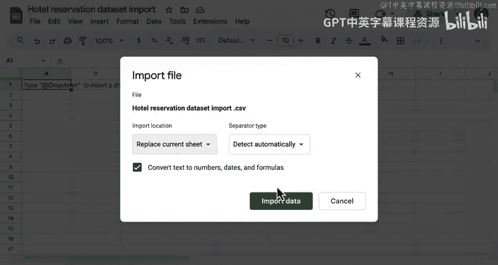
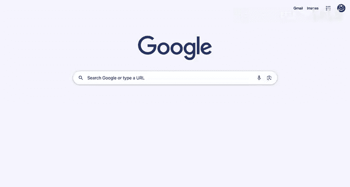

# 吴恩达《数据分析（数据分析基础／应用统计学，1-2课／共5课）｜DeepLearning.AI Data Analytics》中英字幕（claude-4-s - P25：24_数据导入.zh_en - GPT中英字幕课程资源 - BV1SCXrYuEwr

There are several common ways to load data in Google sheetets。 It depends on your use case。

 Let's see how First， you can generate data directly in the spreadsheet。

 essentially typing in your data， it's pretty common for smallscale personal applications and you just saw that approach in the previous video's home renovation budget you can also open an existing file you'll use this approach when you've already been working with some data in Google sheetets。

 and you just want to pick up where you left off。 Most often you are going to access data using the third approach。

 which is importing a structured data set。 Most data starts out in a CSv or Excel file rather than a Google sheet。

 These are two types of spreadsheet files that work with most software it's helpful to see this in action So let me show you how it's done。

 Quick， if I wanted to reopen my budget from the previous video here。

 I can just go to the spreadsheetss homep page and either select it it's my most recent as I was just working on it or search for it。

Now most of the time you'll be working with more complex data sets， for example。

 if you're studying booking patterns for a hotel， you might look for a data that's already been collected like this one。

 you'll work with this data throughout this lesson and the next it's quite interesting。

This article describes two data sets with hotel demand data。 One of the hotel's H1 is a resort hotel。

 and the other is a city hotel H2 Both datas share the same structure with 31 variables describing 40000 observations of H1 and 79000 observations of H2 Each observation and the data represents a hotel booking。

 both datas contain data about bookings arriving between the 1 July and 2015 and 31 August and 2017。

 Since this is real hotel data all data elements pertaining to hotel or customer identification were deleted If you scroll all the way to the bottom。

 you'll see that this data is publicly available and if you want to download the data you can download it via this link。

 Now I want to work with this data in Google sheets。

 First I'll create a new sheet which I've already done here。

 I've also download this data from the website so we are ready to import the data。

 The data is actually quite large。 So we've created a smaller version that's just a subset of these reservation and。

😊，To make it easier to work with。 Let's go ahead and try to import this data。

 go to file and import and then upload the data where I have it stored on this computer。

 So drag this data in。 import this data and replace the current sheet。

 I'm also going to enable Google sheets to detect the separator automatically。

 The separator is a character like a comma or tab that separates values in the same observation。

 Now the data has appeared。 let's review it。 As a reminder， if you want to follow along。

 you can access this sheet in the downloads tab below this video。

Boold it on border below。Add the filter so that we can easily sort and filter this data。

 Okay there are a lot of rows。 One trick when exploring this data is to actually freeze the top row so that you can always see the header as you're exploring the data So this is available in view where you can freeze select the first row So now you can see the header is always visible select the first column and evaluate how many rows are in the data。

 you can see that there's around 36000 rows in this data It's much larger than our home renovation data supposeupp I also want to share this data with collaborators on the data team。

 This is a major plus for Google sheets so I can click the share button at the top。

 and then you can type in any one at your company that you want to share the data with you can select whether you want them to have editor only commenter or only view access and then you can also send them a message and then hit send or you can copy a link that you can email directly。

 you can see that the access has been updated for the file and now others will be able to access your data。

 if you wanted your analysis。Be public， you could also go back into the share settings and change the restricted access into anyone with the link or anyone at your company my gosh suppose Ive closed my file by accident。

 how do I get back into it Well since I already copy my link I could just open a new tab paste in that link and it'll take me right back to the file The good news is your Google spreadsheets will always be automatically saved so you won't lose your work you can also revert back to other versions So if you make a mistake you can go back to this clock here and select any previous versions that you've had for this file now you're ready to start your analysis。

Now that you've seen how to import data， you can work with any data set on the internet。

 joinin me in the next video to work with powerful sorting， filtering and analysis techniques。

 I'll see you there。