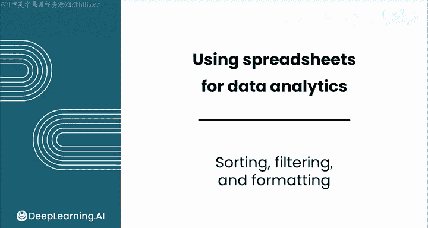

# 吴恩达《数据分析（数据分析基础／应用统计学，1-2课／共5课）｜DeepLearning.AI Data Analytics》中英字幕（claude-4-s - P26：25_排序、筛选与格式设置.zh_en - GPT中英字幕课程资源 - BV1SCXrYuEwr

Now that you've imported this massive real world data set， let's investigate it a bit further。

 You've been tasked with examining hotel bookings to understand which bookings are the most profitable。

 when they occur， who's making them and anything else you can find out when you're exploring a data set。

 your first goals should be to understand it and make sure it's formatted correctly。 Let's do that。😊。

Let's review some important features you'll notice that we have the number of adults and the number of children we also have the arrival year。

 month and date of the booking。Required car parking spaces lead time。

 which is the number of days between when a guest bookss a hotel room and their actual check in date。

 the average price per room， which is a currency and the booking status。

 whether the booking was canceled or not canceled you'll also notice that there's a mix of numerical and categorical features Suppose you want the date information towards the left so that you can more easily see when the booking actually was So I'm going select all three of these columns just by clicking and dragging across。

 and then I'm going to slide these columns all the way to the left of the data。

So now I don't have to scroll to the right to find when the booking actually occurred。

Notice that all of these years are mixed up， we have 2017， 2018 and so on。

 say I want to order the rows by date， unlike reordering columns。

 organizing the rows of your data is not typically a manual exercise since you're likely to have many more rows than columns。

 so let's use a sorting operation to order the rows。

 so I'm just going to select this filter option for the year column and sort from A to E。

 Now we have all the data sorted from 2017 all the way through 2018。

How do you think we would sort by month in order to start by month。

 we have a more complex sorting operation， select all the data， go to sort range。

 and then go to advanced range sorting options。Check the box because the data does have a header row and select arrival year and sort that from A to Z add another sort column to add the arrival month and sort that from A to Z。

 Lastly， I'm also going add the arrival date and sort that by A to Z。

 Then I'm going to click sort So now this sorts all of my data according to the full arrival date。

 Why do you think the data might be stored this way with separate features for year month and date。

 maybe you want to conduct analysis across months like examining the summer months but a full date column would be helpful to make the sorting operation easier。

 Now let's say you're only interested in repeat bookings。

 you can filter your data to reduce it to this subset So let's find the bookings column The repeated guest feature is house in column N filter this data and only select the subset of one All the data has now been filtered to only repeat bookings。

 click the full column I'm also going to control click to remove the header and now I see that there's 930 repeat bookings in the data。

I noticed that a lot of these customers are corporate customers。While I'm here。

 what do you notice about the average price per room， it should be in euros based on the data。

 so let's format this feature as a currency， so I'm going to select this column and while dollar signs is an option。

 if I want to select euros， I need to go into more formats and then when I scroll down Ill be able to select Euro I use this format recently so it appears here for me。

 but you may need to select it from the list of custom currency options。

You'll notice that it gives me the symbol in the front。

 but also formats the number with two decimal places I don't see any other special formats。

 but you'll see a lot more tools in the next lesson。Great work developing your spreadsheet skills。

 It's fun， right， You have a lot of capabilities already。

 Once you've finished the practice assessment for this lesson。

 join me in the next one to learn more about where data comes from。

 how to get to know it and how to write formulas and spreadsheets to enable meaningful analyses。😊。

