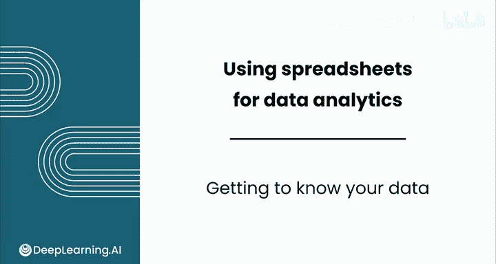
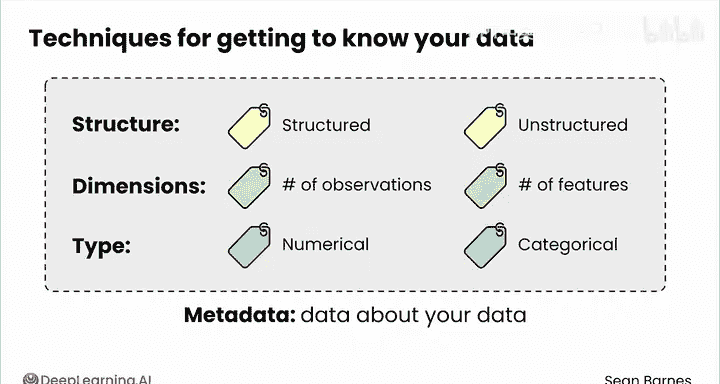
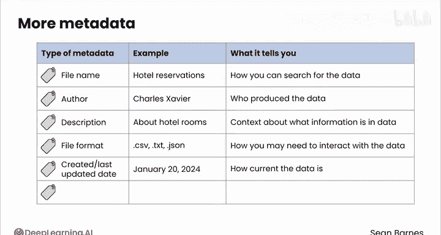
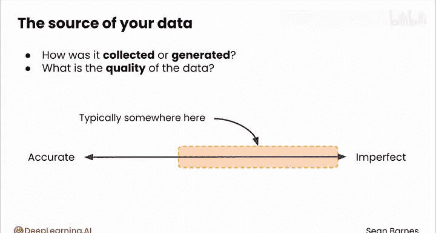
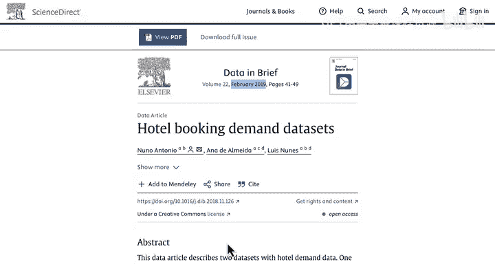
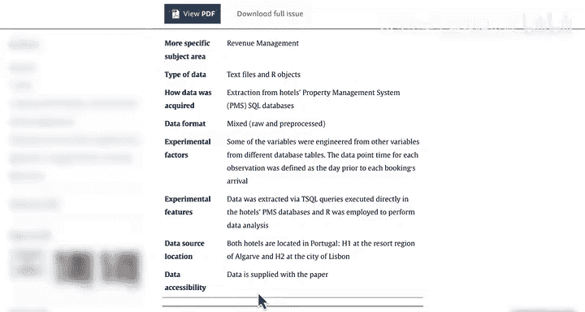
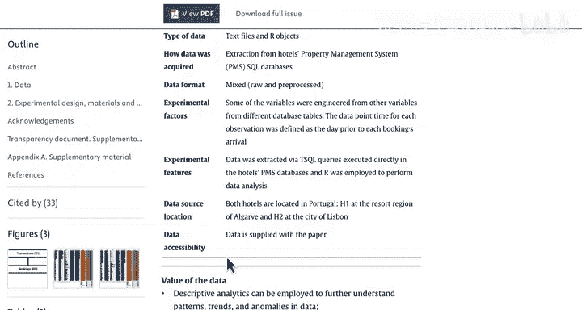

# 吴恩达《数据分析（数据分析基础／应用统计学，1-2课／共5课）｜DeepLearning.AI Data Analytics》中英字幕（claude-4-s - P27：26_数据初探.zh_en - GPT中英字幕课程资源 - BV1SCXrYuEwr

Before you can perform impactful analysis， you must get to know your data。

 The first time you open up a data set， it's kind of like meeting someone new data sets have history and personality。

 What are some questions you might want to know about a new acquaintance， maybe how old they are。

 where they're from， and what kind of work they're in。

You've already seen some strategies for getting to know your data。

 determining whether it's structured or unstructured。

 counting the number of observations and features and differentiating between numerical and categorical features。

 this type of information about your data is called metadata or data about your data which is a very met concept let's look at some more metadata that you'll commonly encounter and I'll show you the type of metadata and example and what that metadata can tell it first you have the file name of the data such as hotel reservations。

 which tells you fundamentally how you can search for or find the data。

 the original author of the data， which tells you who produced the data so you can follow up with questions a description of the data which provides context about what information is contained in the data the file format CSV TxT。

 JSsonN， etc， which inform how you may need to interact with the data When the file was created or last updated which tells you how old or current the data is access controls which tells。

Who can access the data and how they can interact with it？

You'll want to understand the source of your data or its origin story。

 How was it collected or generated， Was it generated by humans or was it generated by a software system。

 If you know your data was collected by survey， you'll want to consider the fact that everyone you sent the survey may not actually respond。

 If you know is collected via software you may want to look for systematic errors。

 What is the general quality of the data， Is it accurate or are there imperfections， Typically。

 it's the latter and understanding the source may help you identify likely issues。

 Let's ask some of these questions to explore the origin story and personality of the hotel reservation data set you met in the previous lesson。

Here's the journal article with the source of this data。 There's a lot of text here。

 Let me walk you through it。 First of all， how old is this data。

 you can see that it was published in February of 2019。

 so you shouldn't expect bookings newer than that。 Let's read on。

 Let's take a look at this specifications table。

Where does this data come from， Both hotels are located in Portugal H1 at the resort region of Algarve and H2 at the city of Lisbon。

 Here's a map that shows you where those two locations are。 down in the south is Algarve。

 which is the southernmost region in Portugal， which is also known as the far district。

 You could also see Lisbon， the capital is over here on the west Coast。

 Notice that these two locations are far away from each other and therefore might have different characteristics。

 How is this data collected。 This highlighted text mentions that the queries were executed directly in the hotel's property management system databases。

 extraction from the property management system is a signal that this data is reliable。

 The records may be generated automatically with minimal human error。

 It also signals that this data is owned by the hotels themselves。 Auto extraction。

 also often leads to large data sets like this。36000 observations spanning two years to over 50 bookings per day。

😊。

Create work， analyzing the source of your data。 Foow me to the next video to see how to explore some key summary information。

