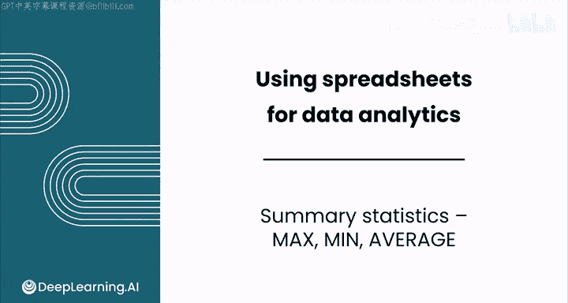
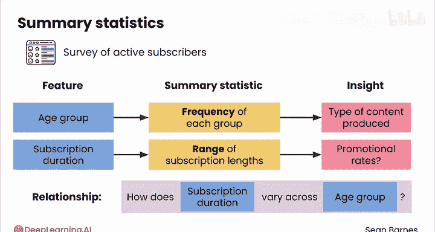
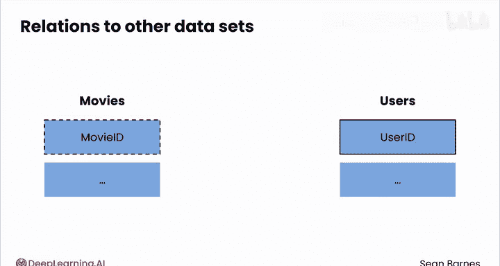
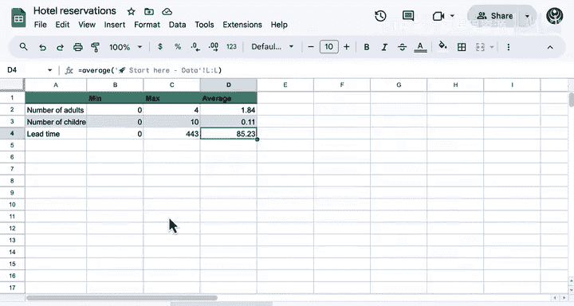

# 吴恩达《数据分析（数据分析基础／应用统计学，1-2课／共5课）｜DeepLearning.AI Data Analytics》中英字幕（claude-4-s - P28：27_摘要统计：最大值、最小值、平均值.zh_en - GPT中英字幕课程资源 - BV1SCXrYuEwr

You know where your data is from and how it was collected， but do you know what's in it。

 It's fun to explore looking for trends and unusual values that can help you answer your business question。

Once you know your data source， you should calculate a few summary statistics to better understand the features。

 Consider a survey of active Netflix subscribers。 You may have a feature for age group like 18 to 2425 to 34 and so on。

 The frequency of each group forms the subscriber age distribution。

 Does your subscriber based lean younger or older and how does that information factor into the type of content you produce Your data might also include active subscription duration。

 What is the range of these durations。 Perhaps the minimum subscription length is three months because you offer a promotional rate for new signups。

 and maybe the longest one is only two years because that goes back to when you first launch the service。

 You'll also want to understand the typical duration So you can figure out how to lengthen it。

 You should also understand relationships between features。 For example。

 consider the relationship between age group and active subscription duration。

 How does duration vary across different age groups。 why。😊。

Your dataset may also relate to other datasets， often connected by one or more common features。

 For example， a dataset set of movies may relate to a data set of users linked based on movies watched by each user。

 Let's take a look at some of the features and the hotel reservations data set to get to know it better。

 Let's explore some of these features。 starting with the number of adults。

 I'll create a new sheet to store the values。 These are some of the summary statistics we're going to calculate for the number of adults feature。

 So first we're going to calculate the minimum value for the number of adults Start a formula with equals This tells Google sheets that you're going to enter in a function and we're going start with the minimum function。

 Each function should be followed by an open parentheses and later on will be closed and then we're going to go back to the data tab and select the number of adults column and then close the parentheses and hit return。

 The result is that the minimum number of adults is in fact I wonder what that's all about。

 Next I'm going to write a formula to calculate the max start that formula。

With equals， reference the max function， go back to the data and again select the number of adults call。

 close the parentheses and hit return。 you can see that there are some bookings in the dataset that actually have four adults and lastly。

 I want to calculate the average number of adults So again。

 I'm going to start with equals type in average I'm going to ignore the autofill that it's offering go back to the original data select the number of adults close my parentheses and hit return。

 There's about 1。8 for adults per reservation in the data。

 So how can a booking have zero people Well， there are children in the data as well。

 So how many children only bookings do we have Let's go back into the data and sort the data by the number of adults and ascending word you can see that there's quite a few bookings in the data that actually have zero adults and all of the reservations that have zero adults have children up to row 140 inner our data there are zero adults so we nose。

Data is sorted that there's actually 139 reservations that have zero adults and have some children。

 Could it be a mistake So let's look at children then I'll copy over the same formulas this time for column F the number of children copypy this row and replace it with the number of children and then I'm going update these formulas to represent the children's feature。

 or you can also replace it with column F There's a minimum of0 children across the bookings that makes sense。

 but who had 10 children in a room。 The average is quite low0。11。 So most bookings have 0 children。

 Let's investigate some of those bookings with many children sort the data by the number of children from most to least or descending order and you can see that there's just a few of these outlier scenarios that have many children1099 and then it goes down to three So just a few outlier reservations。

 Last up， let's check out lead time This is the number of days before the check in time that the reservation was book。

Okay， interesting， The max lead time is much higher than the average。

 I'm also surprised by the last minute bookings that have zero lead time at all。

 Let's investigate these bookings of over 400 days。 Go back to the original data。

 sort the data and descendsenting order from highest to lowest lead time。

 There's quite a few bookings of lead time of 443 days。 That's interesting。

 I wonder if that's the maximum lead time at which the bookings are listed。

 I also notice that there's quite a few that are 433 days，418 days。 I wonder what's going on there。

 It turns out if you go back to the left side of our data。

 you can see that the arrival date of all these bookings is the same as well。

 So these must be some type of bulk reservations， like maybe a wedding or a business conference。

 It's valuable to take a look at features this way。 I encourage you to check out more of them。

 As you advance your skills。 You'll work with programming languages that can get this type of summary quickly。

 So you have a good sense of what's going on in the hotel reservations data set。

 How can you analyze what's happening here。 join me in。😊。

Next few videos to see some cool techniques for analyzing your data。

 starting with conditional formatting。