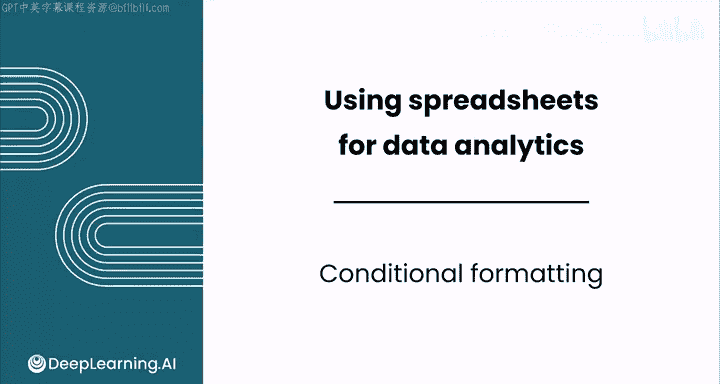
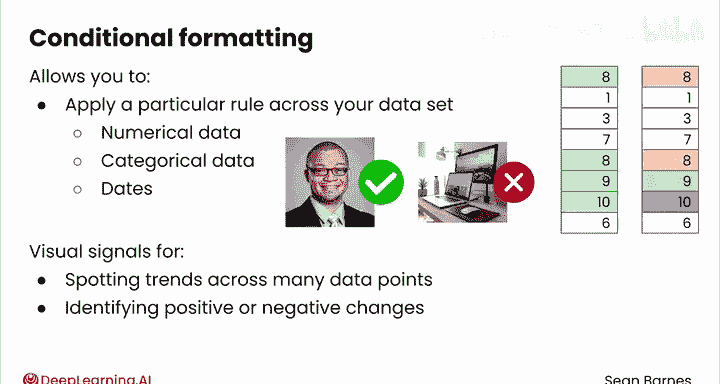
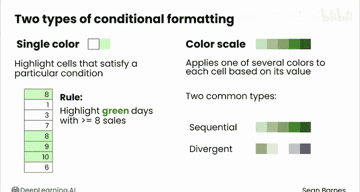

# 吴恩达《数据分析（数据分析基础／应用统计学，1-2课／共5课）｜DeepLearning.AI Data Analytics》中英字幕（claude-4-s - P29：28_条件格式.zh_en - GPT中英字幕课程资源 - BV1SCXrYuEwr

One powerful visual tool for quickly understanding your data is conditional formatting。

 it can help you discover meaningful insights more easily than just looking at raw data。

 let's see how it works。Conditional formatting in a spreadsheet looks like this or this and allows you to efficiently apply a particular rule across your data。

 including for numerical data， categorical data and even dates。

 It main benefit is that it provides a visual layer on top of your data so that you don't have to mentally evaluate how each data point compares with the rule。

 As a human and not a computer I appreciate the visual signals that conditional formatting provides because it makes it easier to identify patterns and data。

 such as spotting trends and patterns across many data points identifying positive or negative changes identifying outliers or identifying which specific values fall above or below a threshold。

 There are many types of rules that you can apply to your data。

 The two main types of conditional formatting are single color which highlights yes no conditions and color scale。

 which shows a range of values in a range of colors apply single color formatting when you want to highlight cells that satisfy a particular condition。

 For example， you can highlight the days with eight or more solar panels。

Which you may classify as a great day。 Applying conditional formatting would enable you to easily identify which days were great。

 Sing color formatting also allows you to choose font styles。 Your other option is a color scale。

 which applies one of several colors to each cell based on its value。

 You can't apply other styles like bold and italics。

 since there's no way to scale those across many values。 There are two common types of color scale。

 including sequential and divergent。 sequentialequ uses increasingly darker shades of the same color。

 While diverging uses different colors on each side of essential value。

 Let's take a look at each of these in a spreadsheet。 So you can see where each one is useful。😊。

Let's see how each of these color scales could work in the hotel reservations dataset。

 Let's say I want to identify the most valuable bookings with conditional formatting。

 One idea is whether each booking has children。 You saw that bookings with children are relatively rare。

 The average was around 0。11 In this case， we have two conditions。

 One is that we have more than 0 children and the other is that we have 0 children。

 So for this type of condition we can apply a single color scale。 Select column F。

 the number of children feature。 go to format， then conditional formatting， which opens this sidebar。

 There are two tabs， single color and color scale， we're going to start with single color。

 So in order to apply this condition， we need to select a different format rule。 And in this case。

 the rule that we want is going be greater than 0。😊。

And I'm going to select blue just to make it a little easier to see。

 I'm also going to bold the result and then click done The bookings with more than zero children are highlighted in blue。

 And also the text is bolded。 In general， bookings with children are fairly rare。

 Most of these values are0。 and only the occasional values are more than 0。

 Another idea is to show the range of lead times。 The number of days booked in advance。

 That may help you identify at a glance unusual values。

 Let's choose a scale that emphasizes the higher values。 Select a color scale。

 We want to make sure that in the format rules we select a color scale that goes from light for lower values to dark for higher values。

 So the default selection here is what we want。 In this case， we're happy with green Therefore。

 we can just apply the color scale。😊，The short lead times are very light colors and the longer lead times like this one。

 224， 211 or 346 are all much darker shades of green Okay interesting。

 so now suppose I want to take a closer look at the corporate reservations by filtering the market segment。

 clear out all the other options and just select corporate。

You mostly see lighter colors than some of the darker shades of green that we saw across all of the reservations。

 So perhaps the insight here is that corporate reservations on average have shorter lead times。 Next。

 average price per room。 say your breakeven point is 45。 So anything lower than that。

 and you're losing money， and the lower the price is below that。

 you lose more money above that is profit and higher profit is better。

 you can use a diverging color scale。 select a color scale， select a diverging color scale。

 So these are the ones that clearly have a neutral value in the middle。

 one color to one side and another color to another side。 In the case of the diverging color scale。

 you'll want to select a midpoint value that represents the center of your data。

 So I'm going to select a number since there's a specific number of 45 that we want to represent the center of the data。

 So we chose the red and green color option。 but this option may be hard to see for folks who are colorblind。

 So I'll make a custom。 I'm going to select orange for the lower scale of values and blue for the higher scale。

😊，Most of these bookings are profitable， I see lots of blue here and only the occasional orange value for which the average room rate was less than 45s。

Suppose I want to also filter this data and look at a specific market segment。 So， for example。

 I may want to look at the complementary market segments。

 So I'm going to select the complementary and you'll see that most of the average prices for room for these options。

 Many of them are0 and most of them are less than $45。

 So these are all examples of not profitable bookings。 Great work。

 applying conditional formatting to your data。 conditional formatting is quite powerful for exploring your data and communicating insights。

 Now that you've seen how to apply it to real world data。

 follow me to the next video to see how you can extend these insights to summarize data in a spreadsheet。

😊。