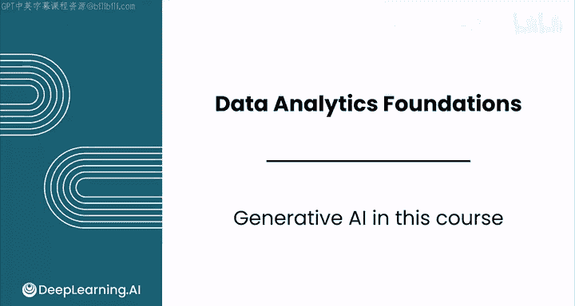
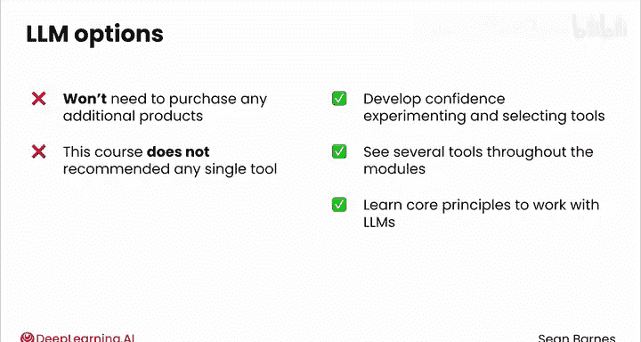

# 吴恩达《数据分析（数据分析基础／应用统计学，1-2课／共5课）｜DeepLearning.AI Data Analytics》中英字幕（claude-4-s - P2：1_本课程中的生成式AI.zh_en - GPT中英字幕课程资源 - BV1SCXrYuEwr

One of the key elements of this course is learning to use generative AI。

 in particular large language models or LLMs like Chat EBT， CD， Jmin I， and so on。

 I can't wait to share with you how these tools can fit into your work as a data analyst Sometimes they feel like magic you'll learn how to use LLMs to synthesize information from your stakeholders。

 explore data set and its metadata， automatically run data analysis by writing code for you。

 interpret images of data visualizations。And create data visualizations。

 You'll also learn about LLM's key limitations， including the tasks they can't do for you。

 Teaching such a new technology has its challenges。

 I'd like to take a moment to share our team's philosophy about generative AI in this course。 First。

 this course demonstrates the most up-to- date capabilities as of 2025。

 and we expect changes in the coming months and years。

 Our team has designed this course to teach evergreen principles。

 how to think about and use generative AI and your work regardless of which specific product you end up working with。

bove all， you will develop a mindset of iteration and experimentation。

 the progress in LLM products since their launch in late 2022 has been astounding。

 Their abilities have advanced rapidly， and new features are constantly being released。

 Here are some changes you should expect in the near future。

 First Gen AI tools with more advanced and specialized features like the ability to use apps for you。

 expect cheaper tools and faster tools and higher quality outputs over。😊。

It can be difficult to follow all the changes in a rapidly progressing field like this。

 but don't worry in this course you'll develop the metacognitive skills you need to harness those advancements in your own work This course also demonstrates some paid features of LLMs but you won't need to purchase any additional products to complete the assignments It's important for you to see the available options including paid options so that you develop confidence experimenting and selecting the best tools in your work as a data analyst This course does not recommend any single tool you'll see several throughout the modules and remember that the core principles you'll learn will prepare you to work with LLMs both free and paid now and in the future LLMs are an incredibly useful tool but they are not a replacement for your skills and judgment they can't replicate your decisionmaking ability and complex situations especially when experience intuition and adaptive thinking are required you'll get your first taste of working with generative AI for data analytics and lesson4 of this module。

Including a hands on lab。 for now， join me in the next video to see all the exciting topics in this module。

 I'll see you there。😊。

