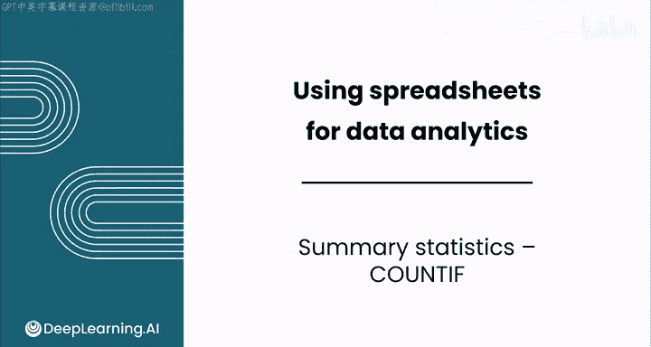
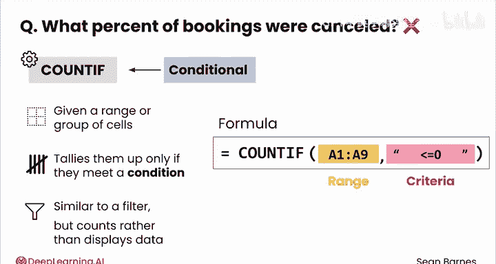
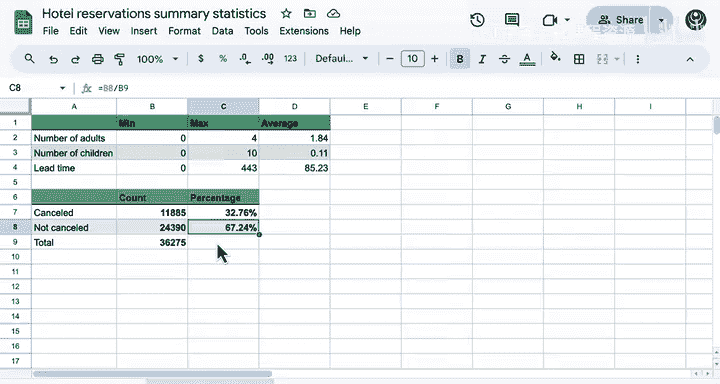

# 吴恩达《数据分析（数据分析基础／应用统计学，1-2课／共5课）｜DeepLearning.AI Data Analytics》中英字幕（claude-4-s - P30：29_摘要统计：COUNTIF函数.zh_en - GPT中英字幕课程资源 - BV1SCXrYuEwr

When a data has a lot of features to analyze like the hotel reservations dataset。

 you might wonder where to even begin。 One strategy is to segment your data to try to understand the different underlying groups。

 Let's see how starting with the outcome variable booking status。 Here's a question。

 What percent of bookings were canceled。 it might be difficult to tally up using your current tools。

 You can use the count if function to help answer this question。

 Given a range of cells or a group of cells， count if tallies them up only if they meet a certain condition。

 Count if is similar to a filter， which only displays data that meets a certain condition。

 except it counts up that data rather than displaying it， So count if is a type of conditional。

 take some action only if a certain condition is met。 your formula will look like this。 First。

 in equal sign formulas have to start with an equal sign。 If you don't include it。

 whatever you type here will typically be treated as plain text。

 then count if the name of the function， open parentheses。 count if has two inputs， range。😊。

Cter select the range and then in quotes， add the criteria Ex criteria could be hot pocket if you want to count the number of cells in the range that contain simply hot pocket。

 or if you're checking numbers， you could have greater than 100 or less than or equal to0。

 Let's see that function in action First， let's count the number of canceled reservations So start with my equal sign and then type the countif function Notice that you don't have to capitalize the function name go back to the data and then I'm going to select the column at the cancellations which is all the way over here to the right。

So first select the booking status column and then check if it's equal to canceled。

 close parentheses， and you can see that there's almost 12。

000 reservations that were canceled in the data set that's almost 17 cancellations a day。

 How about not canceled， start with equals， count if。Select the booking status， not cancelanceled。

Okay， there's just over 24000 reservations that were not canceled in the data that's about twice as many。

 So if I sum of these two values， what should I get about 36000 reservations in the data set if you remember this is exactly the total number of observations in the data。

 so these are two categories that should add up to the total amount of bookings One note about count if and formulas in general。

 case doesn't matter but characters do so in the case of not canceled it would work if I had a lowercase N and lowercase C。

But it would not work if I didn't have the unsure character。

It's a little hard for me to gauge what these numbers mean。

 I'd like to see the percent of all bookings that are cancellations。 I don't know about you。

 but I'm not going around dividing 11，000 by 36，000 all the time in my head。

 so I'm going to calculate the percentage of observations for each of these categories in the dataset So for canceled。

 take the 11000 divided by the total。 This is a proportion out of one。

 you could multiply it by 100 to convert to a percentage。

 but an easier way with is be a format that result as a percentage。

 Could you guess the formula for calculating the percentage of the not canceled reservations take the count again divided by the total format this is a percentage。

What should these two percentages sum to， Let's find out。

100%， exactly。Cool summary。 There are a lot of cancellations。

 perhaps more than you would have expected。 I mean， I do cancel stuff a lot。 In any case。

 follow me to the next video to sum up the number of children who stayed with and without an adult。😊。

