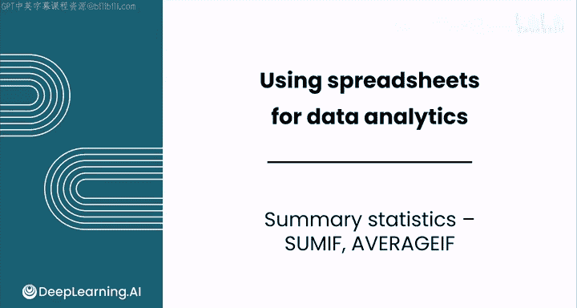
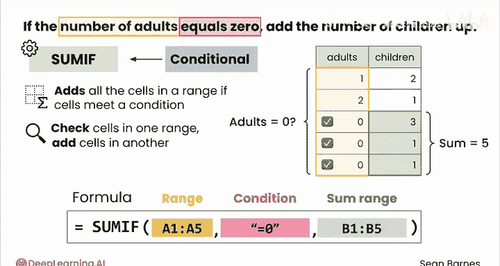
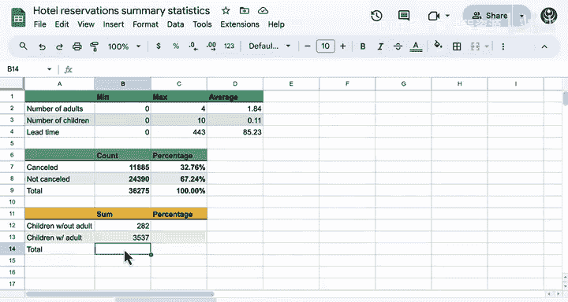
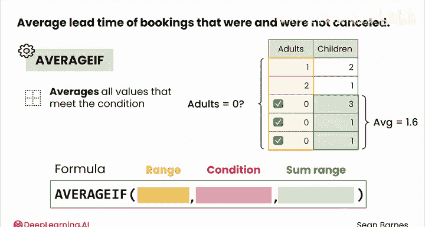
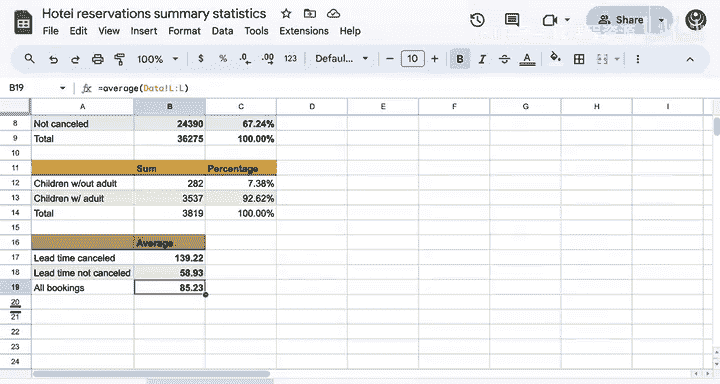

# 吴恩达《数据分析（数据分析基础／应用统计学，1-2课／共5课）｜DeepLearning.AI Data Analytics》中英字幕（claude-4-s - P31：30_摘要统计：SUMIF-AVERAGEIF函数.zh_en - GPT中英字幕课程资源 - BV1SCXrYuEwr

Say you want to look at the relationship between the number of adults and the number of children staying in the hotel。

 Let's see a powerful way to do that。 In other words。

 what you want to do is if the number of adults equals 0。

 add the number of children up for this purpose， you can use some if， another useful function。

 some if adds up all the cells in a particular range。 if those cells meet a certain condition。

 you can also check cells in one range and add cells in another。 like count if。

 some if is also a conditional。 Some these values only if a certain condition is met。

 Here's how it works。 first in equal sign。 Then sum if the name of the function， open parentheses。

 some if has three inputs， range condition and some range。 select the range you want to check。

 This is what comes right after your if。 So in this case， number of adults。 and then in quotes。

 add the criteria you want equals0。 and then the column you want to add up is children。

 Let's see that in action。😊。

Let's sum the number of children who stayed with and without an adult。

 so let's start with the children without an adult， start with the equal sign。

 start the sum if function， and then select the number of adults and then add the condition which is equals zero and then lastly add up the number of children and hit return okay so in this case you can see there's about 282 children who stayed on their own how does that compare with the accompany and children。

 let' sum if adults are greater than zero， so I'm going to start a new formula sum if select the number of adults。

Add the condition greater than 0， and then select the number of children。

 Close parentheses and hit return。 There's over 3500 children who were accompanied by an adult。

 Let's total up the children in this data set。 In this case， I'm going to tab to accept。

 since this suggestion looks correct。 Let's calculate what percent is 282 children。

 So I'm going to do equals and divide the number of children without an adult by the total。

 There's about 7。38% of children who traveled without an adult。

So about 92% of children traveled with an adult interesting。

 and you can also total these percentages， which should add up to 100%。

 So now you've segmented your data about children based on whether they were with an adult or not say you wanted to take the average of one column rather than the sum based on a particular condition。

 For example， you might want to investigate the average lead time of bookings that were and were not canceled for that purpose。

 you can use sum if's cousin average if average if has the exact same inputs as summif。

 except it will take the average of all the values that meet the condition rather than adding them all up。

 Let's get right into it。 Maybe lead time can give us a hint about what kind of person cancels。

 What's your prediction， Do you think people who cancel tend to book farther in advance or closer to the date start by calculating the average lead time for bookings that canceled So I'm going to select the canceled row Since that forms our condition type in canceled。

And then calculate the average lead time。 On average。

 bookings that were canceled were booked about 139 days in advance。 formatat this as a number。

So that we don't have so many digits。 let's see how that compares to reservations that are not canceled。

 start with equals average if。Select the booking status。 We want to check for not canceled。

 and then again， calculate the average lead time。 again， format as a number。 On average。

 for not canceled reservations， the lead time is much shorter only around 58 or 59 days。

 That's a big difference。 What's the overall average。

 This will wait more heavily towards not canceled bookings since they make up about two thirds of bookings overall。

 So for this， we can just use the average function and select the lead time。So on average。

 all bookings had about 85 days of lead time。 What do you think could explain this difference。

 Here's one potential interpretation。 cancelanceled bookings were reserved， on average。

 about four months in advance， which suggests to me that these were planned vacations where the plans must have changed。

 On the other hand， bookings that were not canceled were only booked about two months out。

 At that point， plans were probably more stable，Regardless。

 lead time seems to be related to cancellation in some way。

 although we can't know exactly how without further analysis。

Great work on that segmentation task。 Follow me to the next video to learn a similar technique that counts and sums based on multiple conditions。

