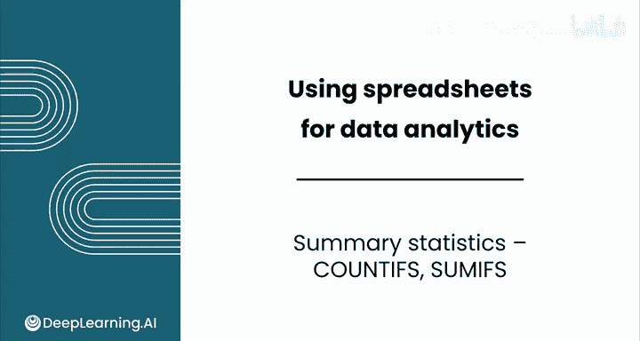
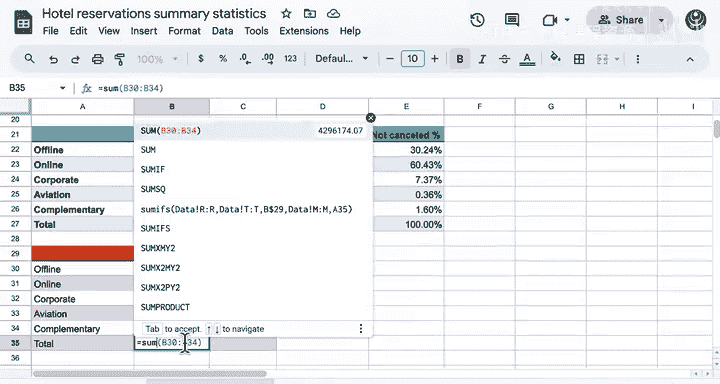

# 吴恩达《数据分析（数据分析基础／应用统计学，1-2课／共5课）｜DeepLearning.AI Data Analytics》中英字幕（claude-4-s - P32：31_摘要统计：COUNTIFS-SUMIFS函数.zh_en - GPT中英字幕课程资源 - BV1SCXrYuEwr

In the previous videos， you use conditional formulas including countif， sumif and average it。

 these only check one condition， what if you wanted to calculate based on multiple conditions like comparing counts based on cancellation status and market segment。

 let's take a look。

For market segments， I'm not sure at a glance how many there are。

 use the unique formula to identify all of the unique categories in the market segment column。

 but I don't want to select the header column。 So I'm just going to start this data range from M2 onwards。

 You can see now that I got all of the unique categories for market segment。

 And I just applied some formatting。 I'm also going to add a total row down below。

 So now in this first cell， I want to count the number of canceled bookings if the market segment is also offline。

 you use the count ifs function。Let's take a quick look at the help。 So if you get stuck。

 you can always go here。 It will show an example of how to utilize this function。

 go to the data and select the booking status column。

And I want to include only the rows that are canceled。 select the market segment。 And in this case。

 rather than typing offline。 I'm going to select the cell。 A22 has the value offline。

 This will make it easier when I copy the formulas later。 Good work。

 So 3153 are canceled and offline。 noticeice that a22 is a relative cell reference。

 If you use the fill handle。 you can calculate all the counts for each market segment。

 The fill handle allows you to copy a formula to many cells。

 and relative cell references will update So I'm going to take the fill handle and drag it down。

 and that will update these counts for each category。 Great。

 most of the cancellations occur with online reservations。

 Then offline otherwise cancellations are pretty rare across the other categories。

 I accidentally included the total row here。 I'm just going delete that。 Okay。

 now let's calculate the total number of bookings。 So here I'm going to do a sum。

 You can see that it detected what I wanted to do。 In this case， it's correct。

 I want to sum all of the rows above in the table。😊。

So I can just hit tab here and complete the total canceled reservations equals the total that we calculated previously。

Let's calculate the percentage。 So here I'm going to take equals the cancel count for offline and divide by the total。

 And then I'm going to change the format to present。 Can we use the fill handle here。

 Let's try it out。You'll notice that I get the divide by zero error for each of the rows below。

 Something must be wrong。 So let's investigate。 Let's take a look at the all line。

 You can see here that the formula is trying to divide the cancel count for all mine by the blank cell below。

 You'll notice that when I applied the fillhand were downward， Both references moved。

 but we only want to move the cell reference for the first entry。

 we want the second one to say the same。 So what we actually want is to divide by the total。

 So I'm going to clear the cell out。 And then we want to add an absolute reference to the formula。

 You can use the dollar sign to prevent a row or column reference from changing。 In this case。

 I want to stop the row 27 from changing。 So I'm going to add a dollar sign in front of 27。

 which will keep that reference fixed。 So now when I fill this formula down the rows。

 you will see that each cell references。 the cell where our total is contained。

 This is a little bit of an unusual notation， it might take a little bit of time to get used to。 So。

 for example， if you want the row to stay fixed。😊，You would put the dollar in front of the row number if you want the column to stay fixed。

 you would put the dollar side in front of the column。 And if you want the whole cell to be fixed。

 you can put a dollar in front of both the row and the column。 you can also calculate our total sum。

 which again into text。 So I'm going to tab to apply it。 I'll do the same quickly for not canceled。

 You can try this on your own， but I just want to do a quick comparison。 So offline。

 corporate and compliment bookings make up a greater proportion of not canceled bookings compared with canceled bookings。

 Now， let's say I want to investigate the total revenue for all of the bookings in the data again。

 across different categories of market segments And based on whether it was canceled or not。

 So I've added a new column here called total value。

Which is calculated by the average price per room times the number of weekdays plus the number of weekend days。

 So now we want to use the sum ifs function to total up the total revenue associated with different booking statuses and market segments。

 So let's start again with the canceled reservations for the offline category。

 Write the sum ifs function， open parentheses for the sum range。

 I'm going to select the total value for the criteria range。 We want to evaluate the booking status。

😊，For the criteria， I want to be equal to the canceled cell。 So in this case。

 I want the row name to be fixed。 So I'm going to add a dollar sign in front of the 29。

 and then I want to add my next condition， which is to check the market segment。

 which is going to be column N。 And I want to compare that to the category to the left。 Then lastly。

 close the parentheses。 return。 So you can see the total revenue for canceled offline bookings is about 900000s。

 So let's drag this formula down and see what results we get。

 So similar to the count data you can see that we have the highest number for the online category。

 but the categories below are much smaller。 Let's calculate the sum of these results。😊。

And then let's format all these results in euros。 That's a lot of potential revenue。

 More than 4 million。 How about for not canceled bookings。

The only difference in these formulas is that they're going to reference not canceled for booking status。

 Now， you can do all sorts of analyses and business predictions and planning。 Given these numbers。

 Not the difference between these results。 Overall。

 there's over 7 million and not canceled reservations。 but compared to the 4 million。

 there's a lot more revenue that was left on the table from these bookings。

 You saw that countifs and sums give you a ton of flexibility in the practice lab for this lesson。

 You will calculate the revenue per booking not just total revenue。 Remember。

 if you forget about which parameters the function uses。 You can always check the help menu。

 You're almost done with this lesson。 Foow me to the next video to learn about data processing techniques and spreadsheets。

😊。

