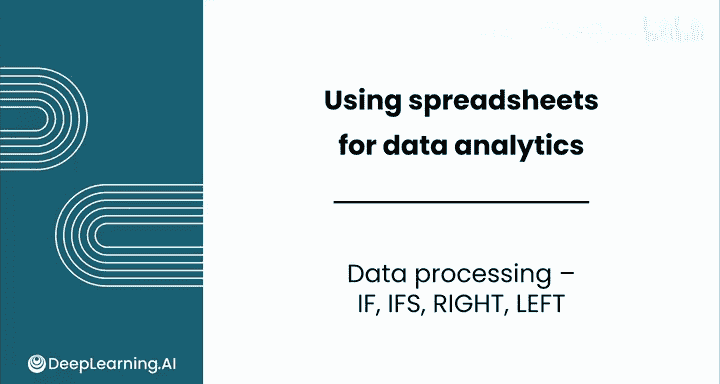
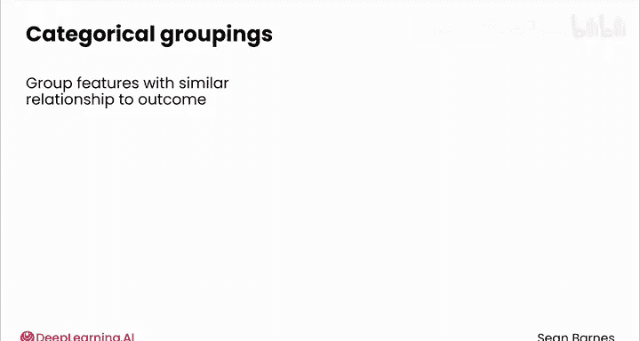
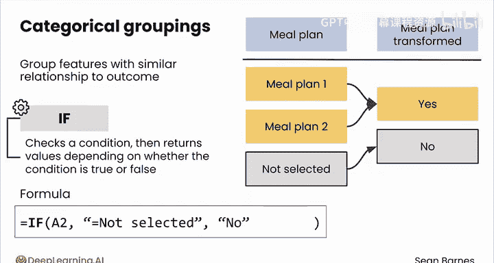
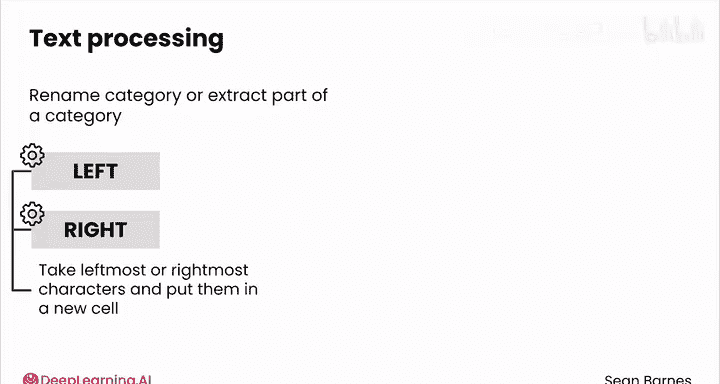
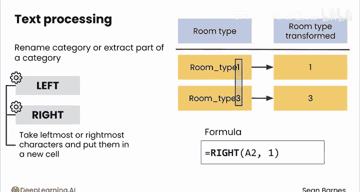
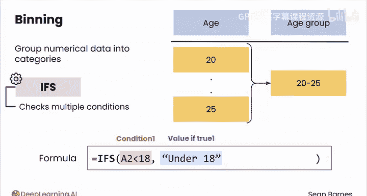

# 吴恩达《数据分析（数据分析基础／应用统计学，1-2课／共5课）｜DeepLearning.AI Data Analytics》中英字幕（claude-4-s - P33：32_数据处理：IF-IFS、RIGHT-LEFT函数.zh_en - GPT中英字幕课程资源 - BV1SCXrYuEwr

So far， you've been working with the hotel reservations data set as you found it。

 but there's no rule that you have to use data as it comes。

 You can process the data as much as needed to solve your problem as long as the changes are valid。

 let's see how to apply common data processing techniques。 let's start with categorical groupings。

 combining multiple categories into one。 Why you can group features with a similar relationship with your outcome。

 or maybe there's too low a frequency across some categories。

 and you just want to group them into other。 in the hotel dataset， for example。

 you can collapse the meal plan feature into just two categories。 Yes and no。

 that may help make your analysis cleaner。 if there is no difference in cancellation rate between meal plans 1 and 2。

 the if function is one powerful tool for categorical groupings。

 It's another conditional function like count if It checks the condition and then returns a different value depending on whether the condition is true or false。

 Here's an example。 If this cell is not selected， we just want to return no， and otherwise， we want。

😊。

Return， yes， let's do some data processing on the hotel reservation dataset set to prep for more analysis in the upcoming practice lab。

 I mentioned how we may want to group the meal plan categories together into just yes or no。 In fact。

 let's take that idea further and just make it zero for no meal plan and one for any type of meal plan。

 create a new column to house our new data feature。

 Let's call it has meal plan write a new formula using it function。 So equals if open parentheses。

 select the corresponding value to the left and if it equals not selected， we will return0。

 otherwise return one。 So in the case of this first result， it does not say not selected therefore。

 it returns one。 and the second row， it says not selected， therefore it would return0。

 you can see that it suggested the autofill for us。

 So I'm going to select check and now our formula is copied all the way down。

 noticeice that instead of having the cell and condition a separate inputs to the function if takes the full。

Lo expression Now， at a glance， I can tell it much more easily that most people got a meal plan of some kind。

 most of the values in this column are1。 I could add conditional formatting more easily too。So again。

 the conditional formatting makes it even easier to see the reservations within the meal plan。

Your next tool for data processing is text processing。

 renaming a category or extracting a part of it so that the text is easier to read for text processing you can use the left and right functions these functions take the leftmost or rightmost characters and put them in a new cell。

 for example， say you just want to extract the number of the room type you can use the right function to extract the single rightmost character of the original feature which makes the data more readable。

 let's try that。

Call it room type number。 In this case， we'll use the right function。 Select the value to the left。

 and we want to choose the single rightmost character。

 And then I'm just going to double click the fill handle to copy the formula all the way down through the data。

 Nice， The result is so much easier on the eyes。 for numerical data， you'll often use it as is。

 but grouping into categories is useful。 A process known as bidding。

 It's useful if the direct relationship between a numerical feature and your outcome is unclear。

 A common example of bidding is the use of age groups。 Oftentimes。

 there is not much of a difference between income earnings or health outcomes of a 22 year old versus a 24 year old。

 You can simplify your analysis by grouping people into age groups and reanalyzing this strategy can help you discover new insights。

 For this technique， it's quite useful to employ the ifs function。 Can you guess what it does。

It checks multiple conditions ifs also uses the same logical expression idea you saw with if you'll put the whole condition together as the first input。

 then the value you want displayed if the cell meets that condition， then repeat。

 let's see that in action on the hotel reservation data set。

Let's go through an example where we bend lead time into bins of less than 50 days。

50 to 100 days and greater than 100 days。 I'll create a new column and I call it lead time bin。

 Now what I want to do is check this cell。 if it's less than 50， I'll put less than 50。

 then I can check if it's less than 100 and so on。 So I'm going to use the ifs function to do that So first I'm going to select lead time。

 if the lead time is less than 50， then I'm going to return short。

 then if it's less than 100 going to return medium。

 then if it's greater than or equal to 100 then I'm going to return long。

 It offers to autofi my results， which I will accept and you can see that our formula seems to be working correctly。

 for short lead times we are getting the short category for medium lead times between 50 and 100 days。

 we're getting medium and for lead times greater than 100 days， we are getting long。

 So everything seems to be working correctly。 One thing this allows me to do is easily filter by these conditions。

 before it would have been a lot harder。 This makes it a lot easier。😊。

than filtering all of the individual lead times that you have in the original data call Great work processing that data these techniques will make further analysis in the practice lab much easier followow me to the next video to zoom out a bit and talk about where all of this data is coming from and how that affects your analysis。

