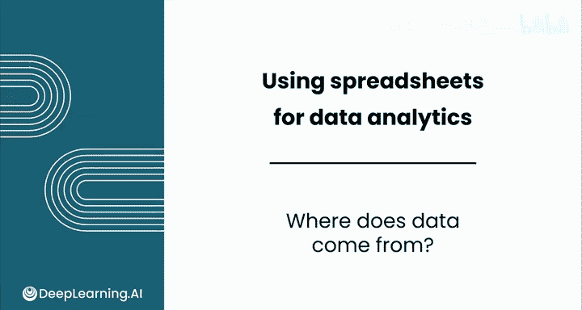
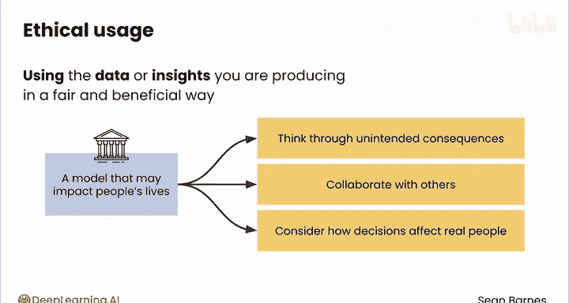

# 吴恩达《数据分析（数据分析基础／应用统计学，1-2课／共5课）｜DeepLearning.AI Data Analytics》中英字幕（claude-4-s - P34：33_数据来源分析.zh_en - GPT中英字幕课程资源 - BV1SCXrYuEwr

We've been working with data for a while。 numbers， dates， categorical data。

 Let's take a step back for a moment。 I'd like to take a few minutes to talk to you about where data comes from。

 Yes， we're gonna have the talk。 As you learn in the previous module data can come from almost anywhere a customer leaving a review about the magic Aball they just purchased a casino that tracks spending down to each square meter。

 the hundreds of weather satellites currently in orbit。 Each of these data sources is distinct。

 let's see how to describe those differences。 First， data can be collected via direct input。

 which means that the data is explicitly provided through a structured process such as a customer feedback survey or a registration form at a doctor's office。

 Your magic Aball review data falls into this category。 Second。

 data can be collected via behavioral observation which means a system that gathers data by passively observing individuals actions This type of data includes website analytics。

 mobile app usage or social media engagement Ca monitoring also。😊，Into this category。Third。

 data could be collected via physical sensors that continuously monitor some phenomenon。

 smart thermostats that measure temperature vehicles that track driving patterns or environmental sensors like satellites all fall into this category。

 Even when you know how a certain data was generated。

 there is still more information you should know about where it comes from。 For example。

 who collected the data。 Firstpart data is owned by you or your company directly。 For example。

 a casino installs its own cameras throughout the gaming area to monitor patrons。

 Secondpart data is collected by another company as their own firstpart data。

 you typically acquire this data from a trusted partner。

 a casino might partner with a neighboring hotel to share customer data to gain insights about big spenders A third party may collect the data for the general purpose of selling the data to multiple buyers。

 a casino could buy a large data set of people who have visited online gambling websites for a new marketing campaign。

 If you had to guess which type of data would you have。Most control over。

You have more control over first and second party data and can usually make sure it will serve your specific purpose for thirdpart data。

 you may have to work with a low number of observations or relevant features or systematic and acuracies。

 A lot of data is also publicly available such as data published by government agencies resource organizations and open source databases This data is often intended to enable research that benefits society at large publicly available data is a great resource for you as a data analyst because it's typically free to access and it's often real-word data。

 Some of this data is directly downloadable from public facing websites and in other cases you may be able to scrape data using a programming language such as Python as you advance your skills as a data analyst you'll learn these more sophisticated methods for acquiring data programmatically Lastly。

 let's talk about ethical usage。 These are important aspects of your work as a data analyst。

 you'll do more than just crunching numbers。 Oftentimes you'll act as a steward of truth and an。

For the people that exist in your data you should only analyze data that you are authorized to access data is often legally protected such as financial data or personal health information。

 you may have to take training to access sensitive data or operate with the secure computing environments In some cases it may be necessary to strip data of personally identifiable information such as names addresses or social security numbers the hotel reservations data is one example where personally identifiable information was removed ethical usage means that you use the data or insights that you are producing in a fair and beneficial way for example。

 are you training a model that may significantly impact people's lives such as in criminal justice decisions how can you make sure the model is fair and not perpetuating historical discrimination Think through potential unintended consequences of your work which may require you to collaborate with others you must consider how the business decisions derived from your insights will affect real people。

concludeludes the talk about where data comes from and also the videos for this lesson。

 I encourage you to look for sources of data in your everyday life。

 even in the smallest and strangest places in the practice lab for this lesson。

 you'll explore the hotel reservations data set yourself to find some cool insights and practice what you've learned Once you've completed the practice lab and assessment。

 I hope you'll join me in the next lesson to learn how to explore data using LLms。

 I'll see you there。😊。

