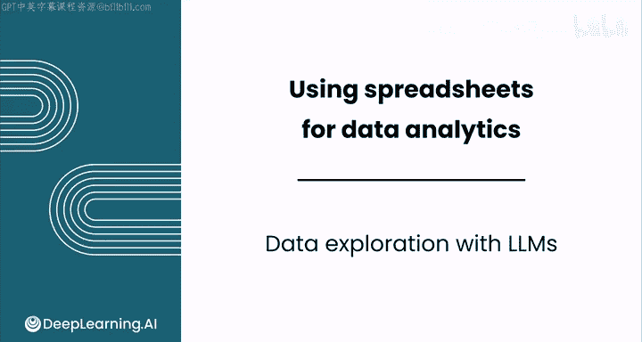
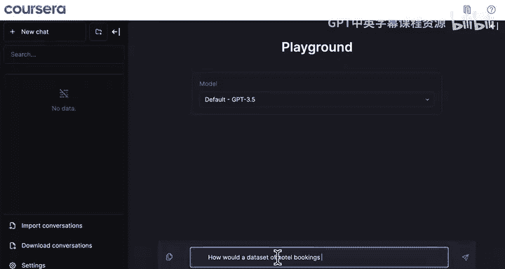
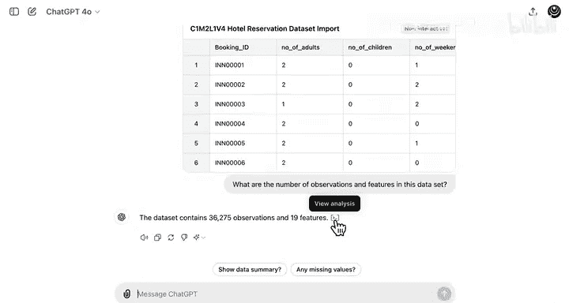
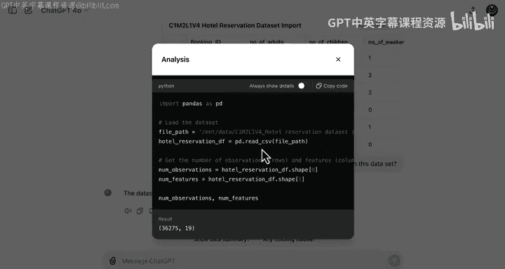
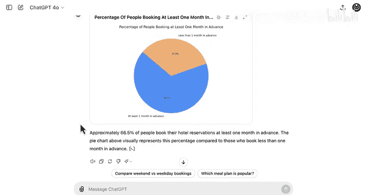

# 吴恩达《数据分析（数据分析基础／应用统计学，1-2课／共5课）｜DeepLearning.AI Data Analytics》中英字幕（claude-4-s - P35：34_使用LLM进行数据探索.zh_en - GPT中英字幕课程资源 - BV1SCXrYuEwr

In this video and accompanying lab， you'll use an LLM to explore a data。

 you'll learn prompting techniques and practice a skeptical mindset using the hotel reservations data。

 Now let's ask some questions here we're just brainstorming with the LLM since it doesn't have the ability to understand the entire data How would a data set of hotel bookings be generated Let's ask the LLM。

So let me review these results so first it talks about defining the structure of the data。

 and then it talks about collecting the data that didn't really answer the question I was looking for so let me follow up with an additional prompt。

 so let me respond and clarify the question。I told the LLM you misunderstood me I have a real world data set of hotel bookings。

 and I wanted to know where such data might come from。

 You can see the LLM apologizes to me it feels really bad。

 and then it offers several potential sources for real world hotel booking data。

 It mentions hotel booking systems， online travel agencies。

 hotel chains or franchises and other options。 This could be useful if I didn't have any information on where the actual hotel reservations data came from。

 However， we do have that information。 which is located on the original article website that we discuss in a previous video。

 So now let's give it some more information to work with。

 Let's ask it to summarize the information contained in the abstract and the specifications table。

 note that I can combine multiple questions into a single prompt。

 ask it to summarize information from the website and then let's see what it says。

 So notice that I copied all the information。 It doesn't matter that we pick up some extra information from the website。

 Let's just throw it in there and see what happens。😊。

Okay let's take a look at the results here it tells me that the dataset described in the abstract consists of two data sets containing hotel demand data。

 One of those represents a resort hotel H1 and the other represents a city hotel H2 It also talks about the number of observations and variables or features in the dataset It also highlights that each observation in the data represents a hotel booking including both bookings that were canceled and bookings that were actually fulfilled Hopefully a lot of these pieces of information sound familiar to you since we've already worked with that data It also gives us some information about the date range of the data and information about where the data was likely extracted from so this is actually a lot longer than reading the original one thing you could actually do is type in a new prompt to say this is helpful。

 but can you summarize the information more concisely。

The LLM has shortened the information significantly and now highlights most of the main pieces of information from the article。

 Let's try the next step up， uploading our data so that the LLM can see more of the data for itself。

 Let's ask Claude to upload a data click on the paperclip and select your data In my case。

 I'm just going to drag the data right into the interface note that the LLM has to read the entire data every time you ask a question so the larger the data。

 the slower your conversation will be all using a bridge data of 200 rows。

 LLms are good at reading and writing not math so I'll play to its strengths while asking specific questions about the data Let's first ask what is the data about it tells me this data appears to be about hotel reservations it contains information on various bookings made at a hotel or in it also gives me some information about the type of file it is and some of the various details about each reservation in the data it also gives some commentary on the range of dates in the data and lastly gives some suggestions about how you might analyze the data。

Such as analyzing booking patterns， cancellation rates， pricing and customer preferences Next。

 let's ask about whether there are any missing values it's not able to systematically analyze this data。

 but it does give you a few observations worth noting such as taking a look at different features that might be mostly zero or cases where the data seems highly unusual like seeing an observation in the data where the average price per room is only one Lastly to be absolutely certain about missing values。

 you would typically load the data into Python and run different functions to actually truly assess the missing values Let's do that with chatGT For this example I'll use chatGT pro which has the advanced data analytics feature that will write and run code for you I'll upload the entire data as well rather than a subset since chattT Pro can handle large files as it doesn't directly read them as part of the prompt each time here I've uploaded the data note that I'm only uploading this anonymized publicly available data you shouldn't upload proprietary data as you can。

what open AI does with this information。 First， I'll ask about the number of observations and features in our data。

This analyzing section writes code to answer the question you don't need to understand all the details in this code just as long as you recognize it does have the capability to run code and analyze mathematical questions It answers factually that the dataset contains over 36000 observations and has 19 features Great now let's get into some more sophisticated analysis that will require actual calculations First are these observations in chronological order。

This data set is not sorted in chronological order。 Okay。

 now I can ask for the range of the number of children feature from 0 to 10。

 you may recall that extreme case where there were 10 children staying on a hotel reservation。

 Let's get to a quick visual for that using the prompt。

 Please visualize the range of the number of children。Now that's pretty interesting。

 Nearly all the bookings were made with zero children。

 and there are very few bookings made with more than one children。

 Our outcome of 10 is barely visible in this histogram because there's only a small number of bookings。

 Okay， final question， What percent of people book at least one month in advance。

 I'll ask it to show me a graph 2。Interesting， about 66。5% of people book one month in advance。

 Only about a third of these bookings are more spur of the moment I encourage you to explore some more questions using LLMs that can write code if you have access to one the LLM isn't guessing at its math。

 It's actually making accurate calculations Now you've seen three different ways to use LLMs for data analytics and the following practice lab you'll continue to develop your prompting skills I hope you continue to the lab and check out how you can partner with LLMs in your data analytics work Once you're done join me in the next lesson to learn all about time series data。

