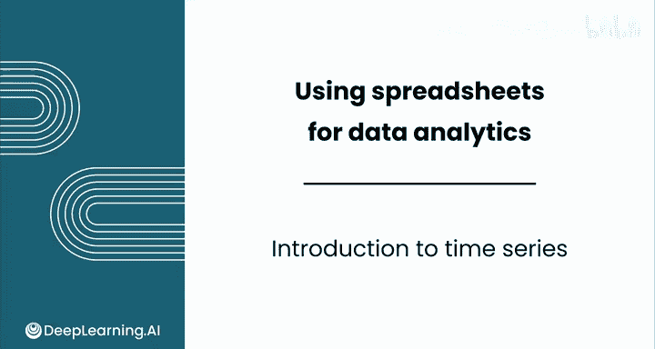
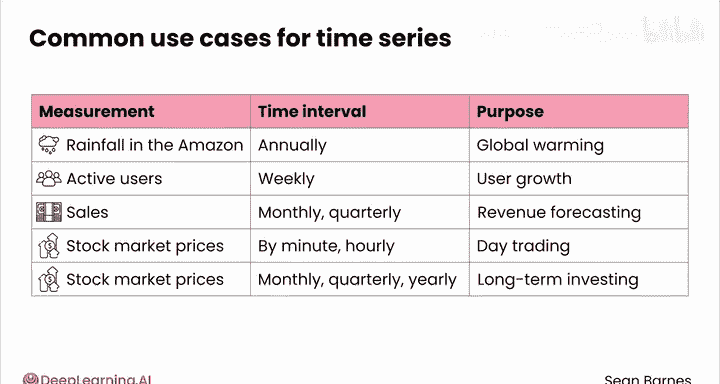
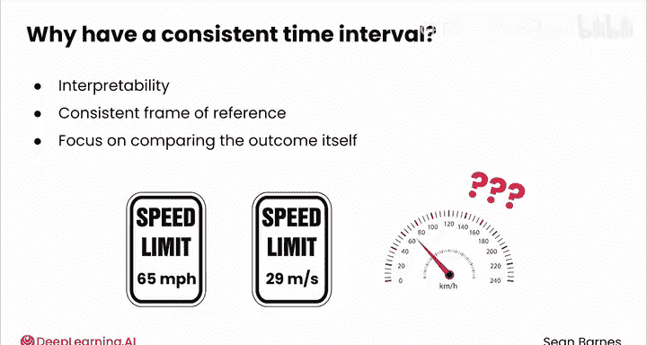
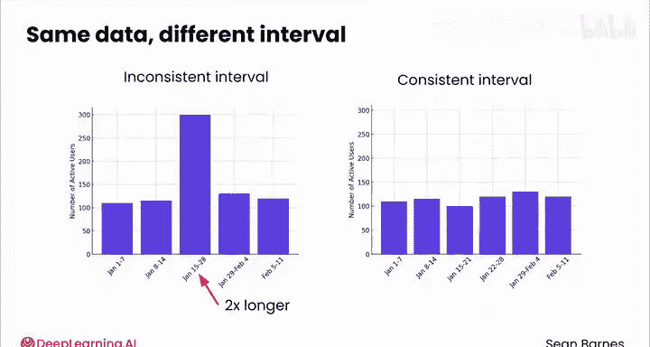
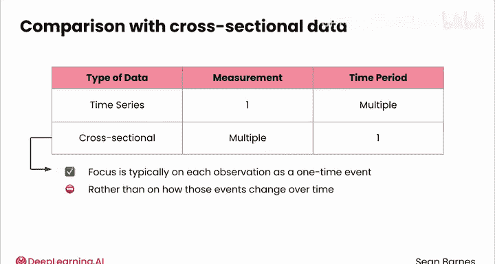
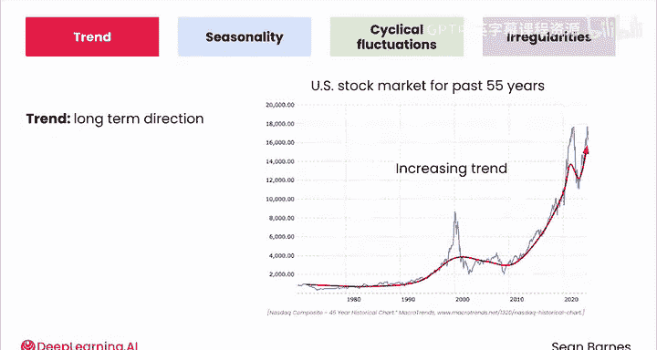
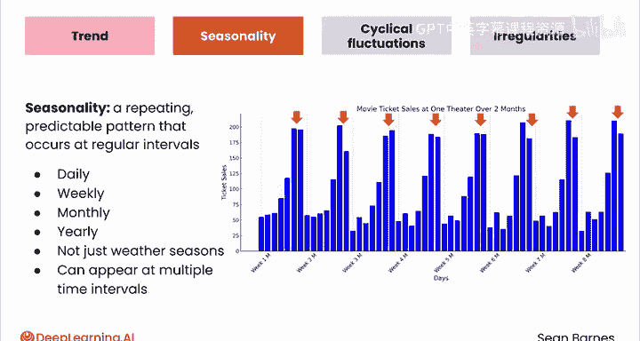
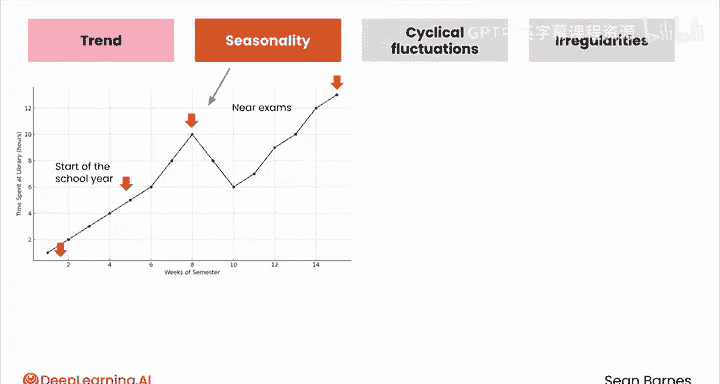
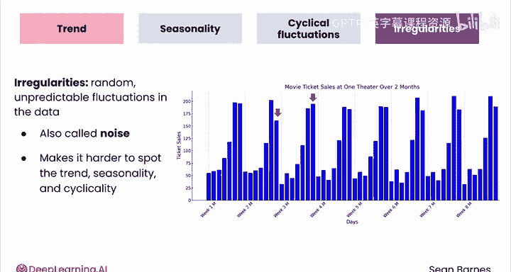

# 吴恩达《数据分析（数据分析基础／应用统计学，1-2课／共5课）｜DeepLearning.AI Data Analytics》中英字幕（claude-4-s - P36：35_时间序列分析入门.zh_en - GPT中英字幕课程资源 - BV1SCXrYuEwr

Understanding climate change， tracking animal populations， even predicting earthquakes。

 all of these tasks rely on analyzing data over time time series data is a fundamentally different type of data。

 Let's take a look。

Time series data is generated by measuring one or more outcomes over fixed time periods。

 such as minutes， hours or days。 The goal with time series analysis is to understand how these outcomes change over time。

 You can use it to identify increasing or decreasing trends discoverover unusual events or forecast future outcomes。

 Many industries use time series data， capturing the same measurement over a consistent time interval。

 and environmental group might measure rainfall in the Amazon annually to better understand global warming trends。

 Tech companies often measure the number of active users each week to see how many people regularly use the product。

 which can help them forecast user growth。 Most companies have some type of sales。 As a data analyst。

 you'll often measure sales monthly or quarterly to help understand trends over time。

 stock market prices are often analyzed across multiple time intervals。

 D traders may be interested in how a company's stock varies per minute or per hour。

 whereasas longterm investors are probably more interested in intervals。😊，Of months。

 quarters or years time series data requires you to have a consistent time interval because of the interpretability provided by a consistent frame of reference that way。

 you can focus on comparing the outcome itself， rather than calculating different lengths of time。

 Imagine seeing a speed limit sign that says 65 miles per hour one day and 29m per second the next。

 Meanwhile， your speedometer is measured in kilometers per hour。 It would be chaos。

 your focus would be on converting between all the units rather than obeying the law。

 Here's an example of interpreting inconsistent time intervals。

 I'll show you two graphs of time on the X axis and number of active users on the y axis In the chart on the left。

 the middle period is twice as long as all of the others。

 which may lead you to believe there is a spike and user activity。 However。

 when the intervals are consistent like the chart on the right。

 the overall trend does not include such a spike。

You saw a moment ago that time series data is a measurement of one outcome over multiple time periods。

 If you invert that definition。 you get data that is collected over a single time period but across different measurements。

 This type of data is called cross-seional data cross sectionional data can also be collected over time。

 but the focus is typically on each observation as a onetime event rather than on how those events change over time in the hotel reservations data。

 Each booking is treated as a onetime event。 You're not attempting to track individual bookings over time。

 Time series data is often analyzed based on four components trend seasonality cyclical fluctuations and irregularities。

 check out this graph of the US stock market over the past 55 years with time on the X axis and the size of the market on the y axis。

 a higher value is better What can you say about the size of the market over time。

 There are ups and downs， but in general， what direction is it going。

 This graph has an increasing trend。 The trend is the longter direction of the data on the whole is it going up down。

The sameTrends can be increasing。 The values tend to go up over the observed period。

 decreasing values generally go down as time progresses or stationary。

 No consistent long term increase or decrease。 This is also called having no trend。

Take a look at this graph of movie ticket sales at a local theater over two months。

 The X axis shows time and the Y axis shows the number of tickets sold with each bar representing one day。

 What repeating pattern do you notice？The movie ticket sales are higher on the weekend compared with weekdays。

 This is seasonality， a repeating， predictable pattern that occurs at regular intervals。

 Season can occur daily， Weekly， Mon or yearly。 It doesn't have to be across weather seasons。

 It can even appear at multiple time intervals。 For example。

 movie ticket sales often increase during summers or holidays。

 with that pattern repeating year over year。 Let's return to this graph of the stock market you saw a moment ago。

 Can you spot any patterns of increases and decreases that seem to repeat at irregular intervals。😊。

You're identifying stock market bubbles and crashes like this do co bubble。

 the financial crisis of 2008 and the pandemic。These are called cyclical fluctuations。

 The stock market undergoes repeating ups and downs that don't occur at regular intervals like weekends or seasons。

 The sizes of increases and decreases are often not the same。

 These irregularities make cyclical patterns harder to predict compared with seasonality。

 It's tough to know when the next stock market bubble will happen。

 Here's a more relatable example to help you remember the difference between seasonality and cyclity。

 Think about the time you spend studying at the campus library。 At the start of the school year。

 you might be studying a bit less。 Since classes have just started。 Then near your exams。

 you'll spend a lot of time studying at the library。 Are these seasonal or cyclical patterns。😊。

These are seasonal patterns since they happen at regular， predictable intervals。 each semester。

 you would expect the same pattern。 Now， consider an event like construction at the library。

 which happens every two to three years， but not on a thick schedule。

 The construction may make it difficult for you to study there due to the noise and dust。

 Is this event seasonal or cyclical。

It's cyclical since construction does periodically happen at the library。

 but not at regular intervals， Real world data often doesn't fit into clear cut categories of seasonality and cyclicality on a spectrum of predictability from highly regular to completely unpredictable。

 Many events fall somewhere in the middle。 Let's return for a moment to the graph of movie ticket sales。

 Why is the Sunday value for week 2， much lower than the other weeks。 Why is week 3。

 the only week where Sunday has the most sales。 These are random unpredictable fluctuations in the data。

 So they are called irregularities or noise。 Think of noise as the data version of static in the background of the phone call。

 randomand sounds that make it harder to hear the person on the other end。 Similarlyly。

 noise and time series data makes it harder to spot the trend， seasonality and cyclity。😊。

Great work identifying the different time series components and movie ticket sales and the stock market As a data analyst。

 you will often analyze the trends， seasonality and cyclicality of time series data。

 Join me in the next video to see some specific examples of real world Time series data。😊。

