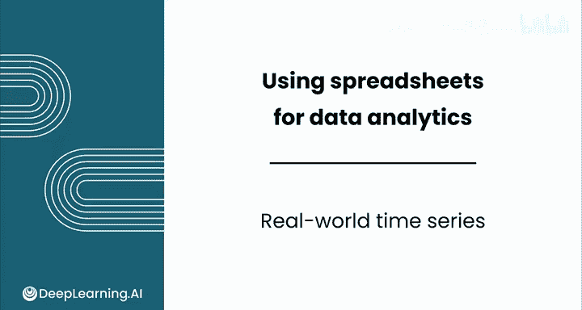
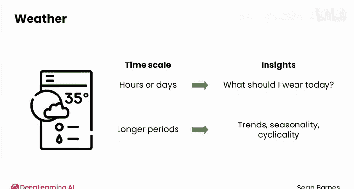
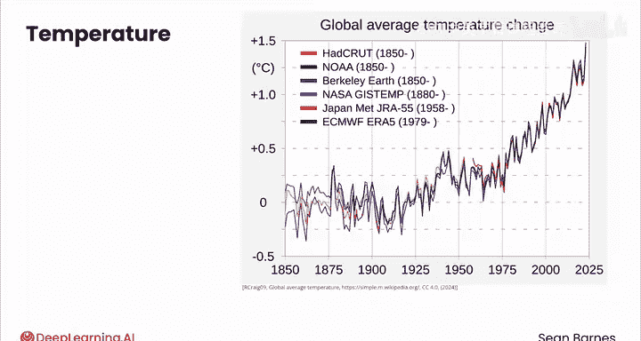
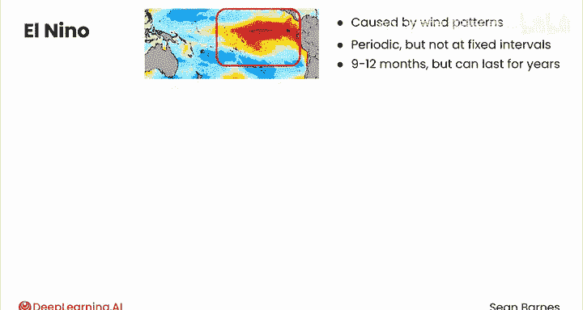

# 吴恩达《数据分析（数据分析基础／应用统计学，1-2课／共5课）｜DeepLearning.AI Data Analytics》中英字幕（claude-4-s - P37：36_现实世界中的时间序列.zh_en - GPT中英字幕课程资源 - BV1SCXrYuEwr

Time series data can exhibit all or none of the components you saw in the previous video。

 How do they combine in real world situations， Let's see how you can analyze graphs of time series data to identify these components visually。

When you open the weather app on your phone， you're often looking at a temperature forecast for the next few hours or days。

 that can help you answer questions like what should I wear today？ However。

 when you look at longer time periods， you can analyze that longterm trends。

 seasonality and cyclicality of temperatures， rainfall and other weather measurements Consider this graph of average global temperature since 1850。

 The Y axis's values represent the temperature and degrees Celsius。

 relative to the average temperature between 1850 to 1900。

 which is used as a reference for the preindustrial age。

 The multiple time series plotted on this chart。 the different colored lines。

 are measured from different types of temperature sensors。

 you can see that the trend is flat from 1850 to 1925。

 but then starts to increase fairly consistently on average。

 perhaps with a bit of a pause between 1940 to 1975。 Throughout the time series。

 you can also see a combination of seasonality patterns that move up and down with the weather seasons。

 and also。😊。

Noise that makes the patterns look not quite perfect。

 It's difficult to determine what cyclical patterns are present using this chart。

 since there is a lot of seasonality that could be obscuring them and weather patterns are often local。

 Here's a weather related example of cyclricicality El Nino El Nino refers to the warming of the Pacific Oceans surface caused by particular wind patterns。

 It happens periodically， but not at fixed intervals。 It often lasts for 9 to 12 months。

 but can lasts for years。 Here's a graph of El Nino。

 And this shows on the X axis time from January 1990 to January 2024。

 with each vertical gray line representing a year and on the Y axis is a measurement related to the ocean's surface temperature。

Sustained values above this 0。0 baseline are El Nino years。

 The 97 to 98 El Nino was very strong and lasted about a year。

 while the 15 to 16 El Nino was even stronger and lasted almost a year and a half。 Meanwhile。

 there are many smaller examples such as this one from around February to July 2017 that would only be classified as week。

 El Nino is considered cyclical， because it does happen periodically。

 but the strength and duration are difficult to predict。

 You know El Nino will happen again but it's hard to say exactly when for how long and how strong it will be。

 Let's move on from weather to a more sophisticated version of the stock market graph you saw in the previous video。

 This data is often analyzed to make investment decisions。 In this case。

 you are looking at a line chart of the S& P 500， which is a combined measure of stock prices across the 500 largest US companies。

 Take a look at the trend。 General， it's increasing。 However， over the short term。

 These trends are nearly impossible。😊，To predict most investors aren't looking to keep a stock for 120 years。

 Imagine if you were to zoom in to different time periods on this chart。

 the trend could be increasing。Decreasing。Or flat， depending on where you start and stop。

But when you zoom out， the trend is clearly increasing over time。

 and even some of the largest recessions in the last 30 years， such as the dot com crash in 2000。

 the Great recessioncession in 2008， or even the Covid-19 pandemic seem relatively insignificant。

 despite the impact they had on the world at the time。

 These are cyclical patterns that correspond to broader economic conditions。

 The other half of these cycles are periods of economic growth， such as the 2010s。

 stock market prices also demonstrate a lot of noise。 Price are impacted by many factors。

 not all of which are perfectly understood。 Now that you've seen real world time series examples。

 join me in the next video to learn about some concepts we can use to work with time series data。😊。

