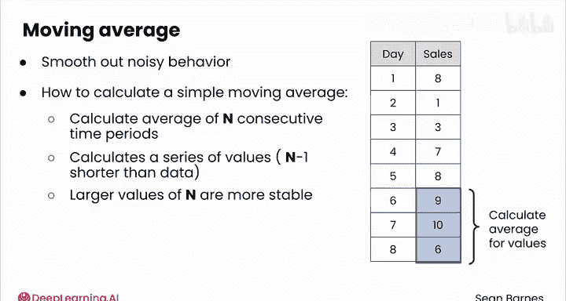
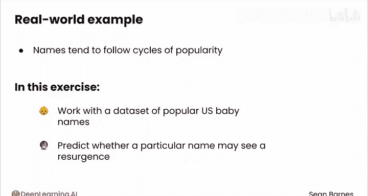

# 吴恩达《数据分析（数据分析基础／应用统计学，1-2课／共5课）｜DeepLearning.AI Data Analytics》中英字幕（claude-4-s - P38：37_移动平均线.zh_en - GPT中英字幕课程资源 - BV1SCXrYuEwr

Some of the more interesting analyses are unique to time series。

 One of these called moving averages allows you to smooth out potentially noisy data。

 It's especially useful for data collected over small intervals。 Or when you have a lot of data。

 let's take a look。 Let's refer back to our solar panel sales exercise。

 Suppose you have a time series for the number of units sold each day。 In this example。

 you would calculate the average of 8 time series values to be 6。5 units。

 And now you have a reference to know how each individual value compares to this reference。

 For example， on day 1， you sold8 units。 which was above average， but on day 2。

 you only sold one unit， which was well below average。 As you saw a moment ago。

 time series data can be noisy。 making it difficult to clearly identify the data's overall behavior。

 Moving averages smooth out this noisy behavior and can bring clarity to your analysis。

 let's take a look at how to calculate a simple moving average。

 Sple moving averages calculate the average outcome over several consecutive time periods。

 The number of。😊。

Time periods is represented as N。 Imagine placing a window over your data N units tall。

 and then calculating the average of the values inside the window。

 you can then slide this window along our data one period at a time until you get all the way to the end。

 Each window pools the total solar panels and redistributes them across end days as if you sold the same number each day。

 So instead of calculating a single number to summarize the data。

 A moving average calculates a series of values。 This series is n minus-1 units shorter than the size of our data。

 You can't calculate a simple moving average with fewer than n data points in the window。

 larger values of n tend to be more stable over time where a smaller values of n tend to be more noisy。

 Let's refer back to our solar panel sales exercise from lesson than one。

 Sose you have a time series for the number of units sold each day。

 Here's how to calculate a simple moving average for this data。 Let's pick n equals 4。

 a window size of4。 start by placing the window over the first end value。😊。

And calculate the average within the window。 So in this case， the numbers 8。

13 and 7 appear within the window， which average out to 4。75。 Then slide the window one placed down。

 Now it contains the values 137 and 8 which also average out to 4。

75 and so on until the window reaches the end of the time series。

 Notice that the length of the simple moving average series on the right is three periods shorter than the original time series。

 You can calculate this length as the number of periods8 in this case minus the window size or n minus-1。

 Let's take a look at how to apply moving averages to a real world data set just like fashion trends。

 Na tend to follow cycles of popularity older names often come back into vogue in this exercise。

 you'll see how to work with the data set of popular US baby names to predict whether a particular name may see a resurgence in the coming years。

Let's have a look at this data source。 This data source comes from datagov。

 The data comes from the Social Security Administration。

 which registers the name of each baby when they are born。 This data was last updated in 2022。

 so you should understand that there's not going to be any additional data after that date The description also tells us that this is a 100% sample of Social Security card applications for 1880 and onward。

 so this contains all babies that were born in the US。

 You should also ask yourself if there's any potential biases in this data。

 Perhaps it's missing any undocumented immigrants who would not be registered in the database。

 Let's take it over to the data。 The data set contains the name of the baby， the sex。

 the year there were born and in the last column is the number of babies who were born with the same name sex and year there were 9655 male babies named John who were born in the year 1880 So how many observations are there in this data。

 I can select the count column command shift all the way to the bottom。

And you'll see that there are about 106，000 observations in this data notice that these are already sorted by the count in the year giving us the most popular names in each year。

 that's a lot of names， let's look at just one my dad's mom Ruby， filter the name column。

 clear everything out and then just search for Ruby。

 copy this data to a new sheet so that I don't have to worry about how it might impact the rest of the data。

How is the data changing over time， it's hard to see at a glance。

 so I'll add some conditional formatting。The default format rule is appropriate here because we want to have lower values associated with the lighter color and higher values associated with the darker color。

 This conditional formatting allows me to easily scroll through the data and identify patterns when the popularity。

 a female baby's named Ruby is increasing overtime。

 like in the early 1920s and also when it's decreasing over time。

 Ruby has experienced a resurgence and popularity。 Let's visualize this。

 You'll learn how to do all of this in the next module。

 But for now I'm just going to insert a chart to help visualize this data。😊，Interesting trend。

 You can see the increasing popularity of the name Ruby， all the way into the 1920s。

 which I highlighted earlier， and then a rapid decline over the middle of the 19th century and beyond until the more recent resurgence in popularity after the year 2000。

 My grandmother was born around the 1920s， which is when the name was most popular。 Now。

 let's see what's happening numerically。 starting with the average。On average， each year。

 there were around 2560 babies assigned female at birth who were named Ruby。

 How helpful is this one number。 It's kind of general。 Let's calculate a moving average。

 So in this case， I'm going to calculate a 10 year moving average。

 So I'm going to start my formula here in the 11th row Use the average formula and select the 10 values that are to the left or above this cell。

 So the moving average for the first 10 years and the data set is around 260 babies。

 I can then fill this formula all the way down to the end of the data。

It's hard to tell that this data is actually smoother。

 so let's visualize that by adding the series to the line chart。Okay， it's much smoother。

 especially in recent years。 The upward trend is clear， but it seems to be leveling out。

 You may also notice that the moving average lags behind the actual data。

 This is because the moving average can only look back into the past。

 So it's always gonna to be a little bit behind of the overall data trend。

 Great work analyzingly the moving average of Ruby names。

 You can see how moving averages reveal the overall trend。

 Fo me to the next video to learn another powerful tool for time series analysis。 Per change。

 I'll see you there。😊。