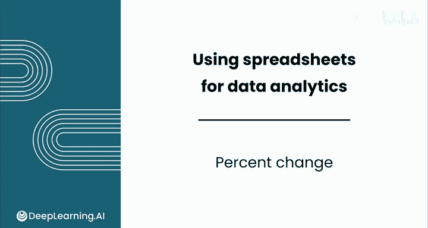
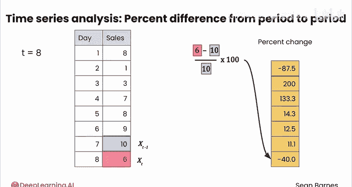

# 吴恩达《数据分析（数据分析基础／应用统计学，1-2课／共5课）｜DeepLearning.AI Data Analytics》中英字幕（claude-4-s - P39：38_百分比变化.zh_en - GPT中英字幕课程资源 - BV1SCXrYuEwr

If you want to identify when a time series is changing steadily or suddenly。

 you can calculate the percent change from period to period， let's see how to do that。

 then apply this technique to the baby Na dataset。

Percent change can be more consistently interpreted compared with raw differences。

 Take a look at your solar panel sales again。 If they change from 8 one day to one the next。

 how big of a change is that。 the difference is -7 sales， but as numbers get bigger。

 It is easy to lose your sense of what constitutes a big or small change。 For example。

 you might have sold 108 panels one day and 101 the next， the difference is still -7。

 but it is much less significant compared with overall sales。 to standardize these differences。

 you can convert from your original units to percentages。 First。

 calculate the difference as you just did。 subtracting the previous day sales from the current day than divide by the number of sales from the previous day。

 what you're essentially doing is answering the question。 compared with the previous days sales。

 How big of a difference is the current day sales。 In these two cases。

 you get -7 over 8 and -7 over 108。 That gives you a proportion。 So multiply by 100 to get a percent。

 You get -87。5%。😊，And the second is -6%。 At a glance， it's easier to tell which one is a bigger deal。

 Forly， you can assign variables X T-1 to the day before and X T to the current day where X is the number of you that sold and the T is the day you are referring to The final equation is X T X T-1 divided by X T-1 times 100。

 This is exactly what you just calculated for your solar panel sales。

 but generalized to any time series。 Don't worry too much about this expression we'll get to an example when we move to the demo。

 Notice that percent changes can be negative or positive。 If your values are going up。

 percent changes will be positive。 if they're trending downward percent changes will be negative。

 Let's work through the solar panel sales example。 you already calculated the percent change for the second value in this time series relative to the first。

 Subtract the previous day sales from the current day sales and divide by the previous day's sales。

 Times 100 gives you a -87。5% change。😊，Which represents a pretty large drop in sales。

 slide the window one time period down and repeat the calculation。 Now。

 with the value of one representing the previous day's sales， the percent change is positive 200%。

 Your sales increased by 200% from day 2 to day 3。 Great work。

Repeat this process until you get to the end of the series。 And there you have it。 As you can see。

 the sales data is fairly volatile。 It changes significantly day over day。

 which is common for smaller numbers。 Some days you sell a lot and some days you don't。

 Let's return to our ruby baby name data。 You already calculated the moving average。

 Now you can see how the percent change can help you identify sudden spikes and drop offs。

 Here's where we left off。 Remember that last time we had our original data。

 and then we calculated the moving average and added it to the visualization we see here on the right。

 Suppose we want to see the percent change， which will help identify decreasing and increasing periods or short changes。

😊。

So I'm going to insert a new column here to the right and then starting with the second observation of the data。

 apply the percent change formula， so I'm going to do equals， open parentheses。

 select count for this period， subtract the count from the last period。

 and divide by the account from last period。I'm going to format this result as a percent。

 so from 1880 to 1881， the number of female ruby babies increased by 29%。

 so now I'm going to fill this formula all the way down。So again。

 note that we don't have a value in the first cell because there's no result from the previous time period to compare。

 Let's make these changes even easier to spot。 What kind of color scale do you think would be good for conditional formatting。

 Let's take a look。 and go into conditional formatting。

 and let's take a look at the different format rules that we have。

 Remember that you can have increasing sequential scales decreasing sequential scales and diverging scales。

 In this case， we do have a clear value that fits in the middle of percent change。

 Do you have any idea what that might be。 of 0%。 This is the boundary between positive and negative changes。

 So I diverging color scale would be appropriate。 Choose again， the red and green dirging scale。

 because we want to capture percent changes that are above and below this midpoint value。

 Configure the midpoint to be 0。😊，Apply a more inclusive color scale by selecting blue on the lower end。

And orange on the upper end。 So now some of the percent change trends in the data are more apparent。

 You can see early on in the data set there are consistent increases in the popularity of the name。

 But once we pass the 1920s， you can start to see consistent decreases。

 as we scroll through the data， you'll see an unusual spike here in 1963 a 20% increase in the middle of a lot of decreases。

 So what could have happened， if you're familiar with US history。

 do you know what was happening in 1963， let's investigate you can try to do some research on the Internet。

 For example， you can look at this Wikipedia page about the name Ruby。

 looking through the famous people here， the first one who was alive in 1963 is Ruby Bridges。

 who was the first Africanam Americanic child to attend a desegregated school in Louisiana。

 She likely inspired many parents to name their children after her。

 Her story even inspired the 1998 Disney movie of the same name。 So based on its recent resurgence。

 It's possible that the name may get even more popular， and that's what data analytics aly。

Is all about spotting interesting trends， investigating them and coming to a useful conclusion that can drive business decisions。

 Great work exploring that data。 Com up， you'll put your skills to the test in the module assessment and graded lab。

 which is all about investigating video game sales and ratings。

 You'll get handson with both cross sectional and time series data。 It's a fascinating data set。

 Once you're done， follow me to the next module to explore data visualization。😊。

It's one of my favorite topics， and I know you'll enjoy developing beautiful ways of displaying data。

 I'll see you there。😊。

