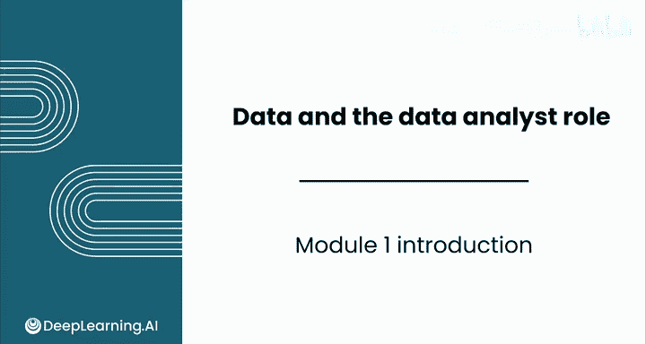

# 吴恩达《数据分析（数据分析基础／应用统计学，1-2课／共5课）｜DeepLearning.AI Data Analytics》中英字幕（claude-4-s - P3：2_模块1 简介.zh_en - GPT中英字幕课程资源 - BV1SCXrYuEwr

Imagine a world where every decision is backed by solid evidence a world where businesses can harness the power of data to drive efficiency。

 success and innovation。 Welcome to the world of data analytics you'll see how this multidisciplinary field combines the problem solving prowess of mathematics the computational power of technology and the strategic thinking of business to create an invaluable discipline from ancient civilizations tracking agricultural cycles to modern businesses optimizing their decision making the principles of data analytics have been shaping our world for thousands of years in this module。

 you'll gain a comprehensive understanding of the different types of data and how they flow through an organization you'll meet the diverse cast of characters that make up the data ecosystem each with their own unique skill set Finally。

 you'll learn to harness a powerful tool large language models like chatptT these AI power tools can serve as a thought partner helping you brainstorm refine your ideas and even run analyses whether you're。

😊，pir to launch a career in data or looking to leverage analytics in your current role。

 this module will provide you with a Rock solidd Foundation Next up is a glimpse of yourself in the data analyst role What does a day in the life look like How about a year How about a career followow me to the next video to take a look。

