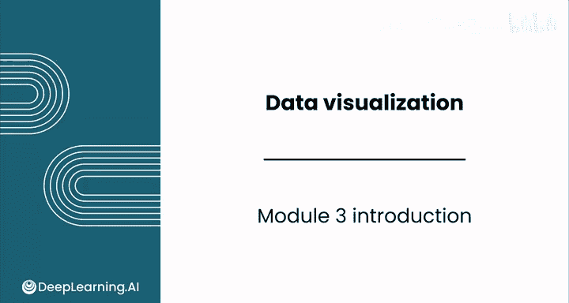
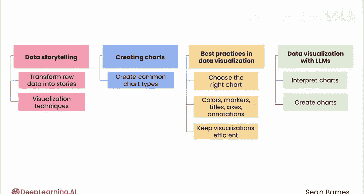

# 吴恩达《数据分析（数据分析基础／应用统计学，1-2课／共5课）｜DeepLearning.AI Data Analytics》中英字幕（claude-4-s - P40：39_模块3 简介.zh_en - GPT中英字幕课程资源 - BV1SCXrYuEwr

Welcome to module 3 of data analyticsly Foundations。

 Everything you need to know about data visualization so far you've learned what data is as well as how to process and analyze it using a spreadsheet Now you'll get handson with data visualization the practice of communicating data with graphics you'll see how to transform raw data into captivating stories that resonate with your audience then you'll explore visualization techniques to communicate insights effectively including the most common chart types you'll use as a data analyst charts can be misused and misinterpret it you'll learn how to choose the right chart for your data plus how to use colors。

 markers， titles， axes and annotations to highlight key insights plus you'll see how to keep your visualizations efficient by maximizing the data to ratio and minimizing chart junk you'll also practice how to use LLMs to both interpret and create charts you'll engage with these tools using a skeptical mindset to save time and avoid mistakes By the end of this module you'll be equipped with the core visualization skills。

Need to drive real world impact。 Let's get started。

