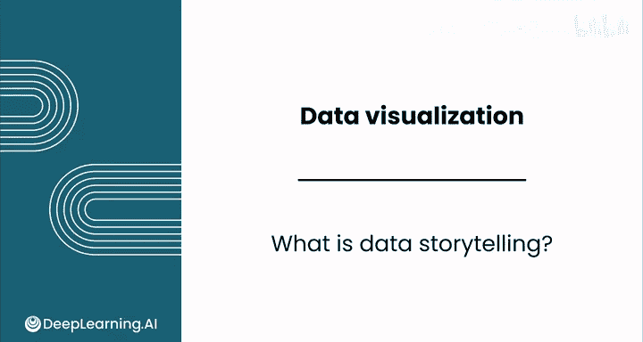
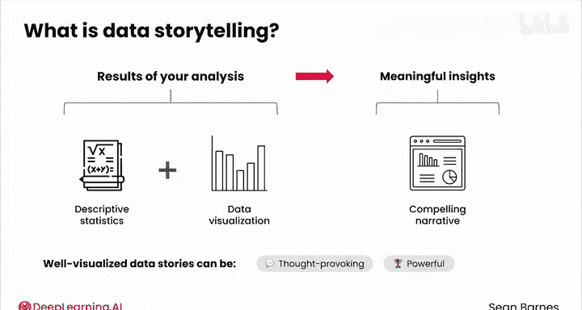
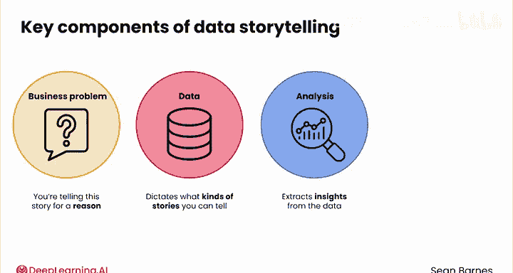
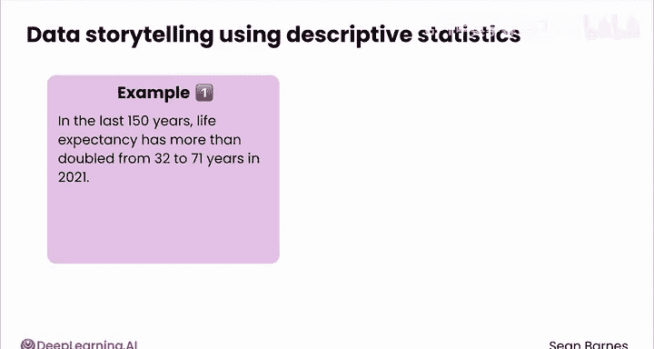
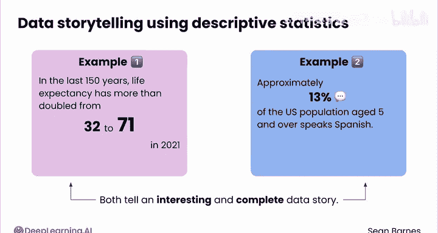
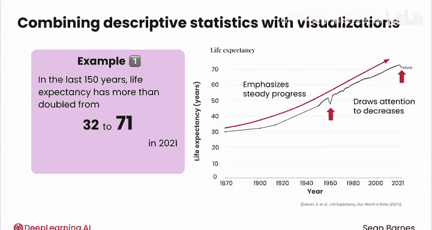
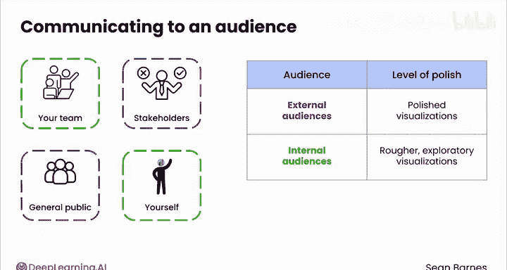
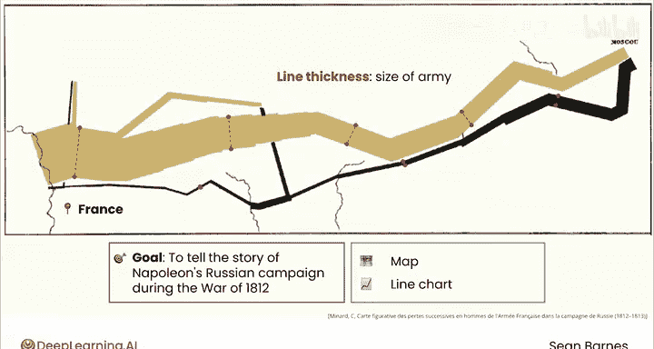

# 吴恩达《数据分析（数据分析基础／应用统计学，1-2课／共5课）｜DeepLearning.AI Data Analytics》中英字幕（claude-4-s - P41：40_什么是数据叙事.zh_en - GPT中英字幕课程资源 - BV1SCXrYuEwr

Imagine you're looking at two different presentations of the same data。

One is a dry list of numbers and statistics， while the other is a colorful visual narrative that instantly draws you in。

 Data storytelling is the difference between dry and engaging。In this video。

 we'll explore what data storytelling is。 It's key components and why it's such a crucial skill for anyone working with data。

 Let's get started with an example。 Let me tell you a story about Sean and Sean。

 Two spellings of the same name This story uses the same baby name data you saw in the previous module and it was created by Kelly Gilbert。

 Here's a graph of Seanwn and Seanwn over time with time on the X axis starting from 1960 to 2024 and the percent of babies born with each name on the Y axis。

 and green is Seanwn with the W and in blue is the other Seanwn。 and the late 1960s。

 Blue Shawn began to take off in popularity。 It matched green Shawn for a few years before falling out of favor again。

 only to finally overtake green Shawn in the year 1980 Since then Blue Shawn has been the dominant spelling。

 but the gap has been narrowing lately If you want to give your child a more unique spelling go with Green Shawn while Blue Shawn may be the more popular one。

 Data storytelling is all about translating the result of your analysis。😊。

Into meaningful insights it's the art of combining descriptive statistics and data visualization to convey a compelling narrative as the saying goes。

 a picture is worth 1 thousand words。 Well visualualized data stories can be thoughtprovoking powerful even emotional So what are the key components of data storytelling。

 First is the business problem Always remember you're telling the story for a reason。

 focus on your audience and your goal。 Next there's the data itself。

 because data is your raw material it dictates what type of stories you can tell Then there's the analysis。

 The process of extracting insights from the data。 The descriptive statistics you calculated in the previous module like averages and percentages are fantastic tools and more complex analysis are certainly valuable to Finally。

 there's the visualization。 The way you present the data visually to your audience you can tell a data story without a visualization using just descriptive statistics Here are two examples In the last 150 years life expectancy has more than doubled from 32。

To 71 years in 2021 Ref huge advances in areas like nutrition and healthcare worldwide approximately 13% of the US population aged 5 and over speak Spanish Ref the deep cultural roots and growing influence of Hispanic and Latinx communities across the nation。

 Both of these descriptive statistics tell an interesting and complete data story。

 you can even use a technique like conditional formatting in a spreadsheet to help visually explain your data and maybe I can judge these numbers up a little make 71 larger than 30 add a little speech bubble next to 13% already I'm starting to emphasize the key points in a more visual away。

 However， combining these descriptive statistics with a raw crafted visualization can take your data story to the next level For example。

 you can combine this story with the line graph Here's one of you on the X axis and average global life expectancy on the Y axis。

 it emphasizes steady progress and draws attention to decreases This combination provides context and helps your audience grasp the key insights at a glance。

Data storytelling is usually about communicating to an audience， whether that's your team。

 your stakeholders or the general public， but you can also create them for yourself to quickly spot trends in time series data or get a rough sense of which revenue streams are the biggest right now。

 More polish visualizations are often needed for external audiences while rougher。

 more exploratory visualizations may suffice for internal analytical purposes。

 In this course will focus primarily on the storytelling aspect and the design elements that make for a compelling data narrative I mentioned that emotional data stories earlier。

 Let's see an example。 One of my favorite visualizations is Charles Joseph Minard's march to Moscow graphic The text is in French and cursive。

 so just focus on the graphics while I walk you through step by step。

 Minard's goal was to tell the story of Napoleon's Russian campaign during the war of 1812 What would take a writer thousands of words he explained with a single image This visualization is both a map and a line chart showing time series data The thickness。

Of the line represents the size of the Army as it starts in France on the left。

 marches to Moscow on the right and comes back。 Brown is the size of the Army going towards Moscow。

 Black is the Army coming back。 What do you think was it a successful campaign。

 You don't need to read French or know that Napoleon lost almost 410000 men to know the campaign was disastrous As one historian said of this graphic。

 It seems to defy the pen of the historian by its brutal elegance。

 Now you've seen the power of a well toldold， well visualized data story。

 Join me in the next video to learn about the language or data visualizations and how to break them down into their component parts。

 I'll see there。

