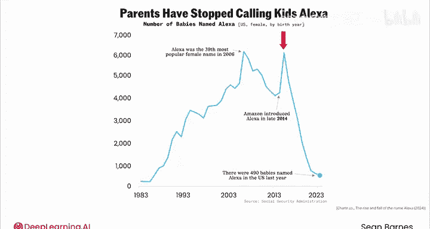
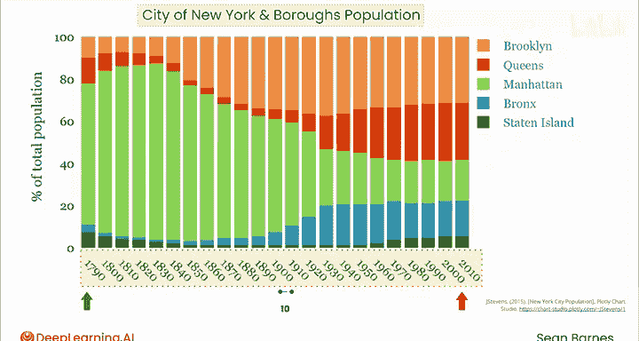
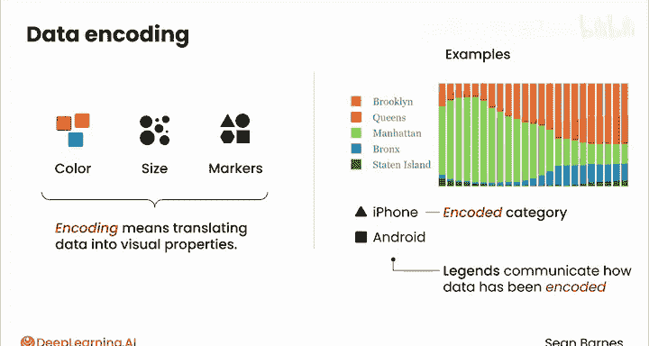
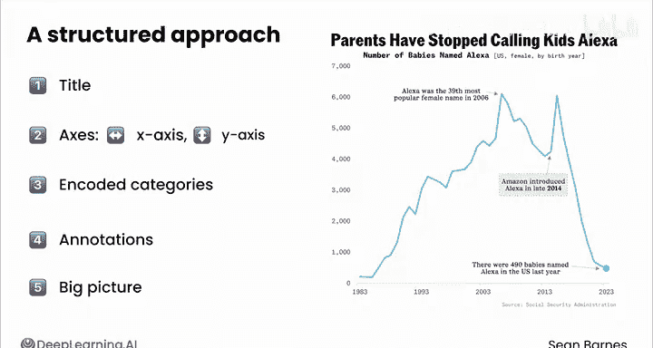

# 吴恩达《数据分析（数据分析基础／应用统计学，1-2课／共5课）｜DeepLearning.AI Data Analytics》中英字幕（claude-4-s - P42：41_数据可视化语言.zh_en - GPT中英字幕课程资源 - BV1SCXrYuEwr

Have you ever looked at a graph and felt a bit lost。 You're not alone。

 The subreddit for ugly data has over 100000 members。 Not all visualizations are created equal。

 and some are easier to interpret than others。 Let's break down the common components of a visualization so that you can interpret them skillfully。

 Let's start with another baby name example， let me orient you to this chart。 First off， the title。

 parents have stopped calling their kids Alexa。 That's pretty clear。

 and it tells me what I should expect to see。 Now， the X axis。 It doesn't have a title。

 but since it starts at 1983 and ends at 2023， I get a clear sense that it's time and shows the past 40 years with the earliest date on the left。

 the most recent on the right。 Now， the Y axis。 again， no title。

 but it starts at0 and ends at 7000 with even increments of 1000。 When I look at the chart subtitle。

 though， I see number of babies named Alexa US female。 Okay， so per year。

 this is how many female babies were named Alexa。 Sometimes this approach of describing the Y axis label。

😊。

In the subtitle is used to preserve some space on the lefthand side。 Now I'll look for colors。

 markers on the line and a legend。 The line is blue。 but since it's the only one。

 it doesn't seem like it means anything specific。 There's also no legend I see this marker at 2023 that indicates the end of a graph。

 It brings some focus to where the trend sits at the time this chart was made which helps emphasize the headline。

 Now I'll look at annotations。 I see a peek in the line here indicating Alexa being a very popular name at almost 6000 female babies per year。

 Here's another annotation for Amazon introducing Alexa and then all the way in the bottom right。

490 babies were named Alexa in 2023。 Now the insight it looks like Alexa was pretty popular overall until about 2016。

 then there's a sharp dropoff。 without looking at the title and annotations that would lead me to wonder what caused the dropoff。

 But the annotations make it pretty clear Just two years after introducing the Alexa virtual assistant parents stopped naming their kids Alexa What do you think was the reason。

Maybe people thought they might accidentally trigger their Alexa by calling their child。

 The chart leaves you to infer reason， and that mystery is pretty interesting to think about。 Now。

 take a moment to read this chart。 What is it trying to communicate。

You might feel your eyes jumping from one area to the next。

 and the most important parts might not be standing out to you。

 Let me walk you through interpreting this graph to understand its main insight。

 I notice the title says City of New York and borough's population。

 So this is a chart about population and it shows the five boroughs， which are like districts。

 Now I'll look at the X axis。 I can tell these are years。

 So starting from the year 1790 all the way on the left， then going to the year 2010 on the right。

 and a quick check tells me these are a consistent increments of 10 years。

 which means it's an even comparison between all these bars going across the X axis。

 Now I'll look at the y axis。 This one does have an access label percent of total population。

 It starts from0 at the bottom and goes to 100 at the top。

 So that tells me each bar represents 100% of the population of New York City broken down by borough。

 I know you've been thinking about all these colors。 In this case。

 the color of each column segment represents the percent of the total population that lives in。😊。

Of the five borrowoughs in the earlier time periods from about 1790 through 1920。

 Manhattan was by far the most populous borough but around 1920 to 1930 Brooklyn took over and has remained at the top The borrows are sorted by population both in the stack of column segments and in the legend based on whether order landed in 2010 this consistent ordering allows you to trace the trends within each category over time So what's the overall story here This chart summarizes the population trends across the five browoughs throughout the history of the city Again。

 much of the population was concentrated in the city center in Manhattan in the earlier years in the present day the population is distributed much more evenly across four of the boroughs with Staten Island being a smaller proportion relative to the other boughs color size and markers are all examples of encoding which means translating data into visual properties So light green means Manhattan while blue means the Bronx or a triangle marker represents iPhone sales while。

Square marker represents Android sales Triangle doesn't inherently mean iPhone。

 It's an encoded category。 One way the chart can convey meaning visually and we use legends to communicate how the data has been encoded on a particular visualization when you see any chart。

 take a structured approach to identifying what it is trying to tell you first。

 check the title and subtitle。 What is this chart about。

 is there a key insight the creator is trying to communicate Next。

 review the axes Almost every chart has at least one axis and axis can have take marks or good lines which mark major steps along that axis check your x axis first What is happening from left to right in the case of these two examples it was time represented in years typically the x axis increases from left to right but don't take that for granted。

 then check your y axis what is changing from bottom to top like the x axis it typically increases Next。

 review any encoded categories。 read the。

To identify the encoded categories and look for color。

 marker or size differences then look for annotations Annotations are notes or labels added into the chart to provide context or highlight key points These help draw your attention to what matters most in the chart Once you reviewed all of these individual components assess the big picture What type of insight are you looking for should you be making a comparison should you be looking for a trend over time。

 Look for surprising information， big changes， gradual changes use annotations and the chart title or subtitle to guide your thinking as you encounter data visualizations whether in the news at work or in this course try interpreting them using the fivestep process you just learned It's a great way to practice your data visualization literacy In the next video you'll get some more practice extracting insights from data visualizations See。

