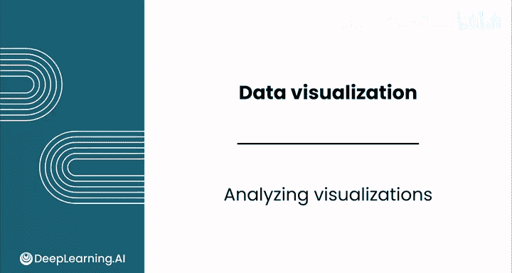
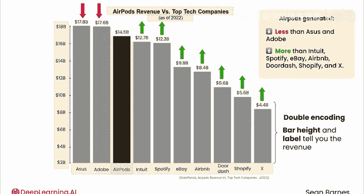
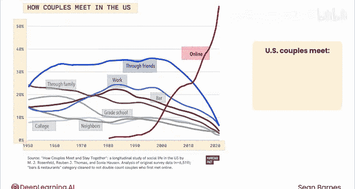
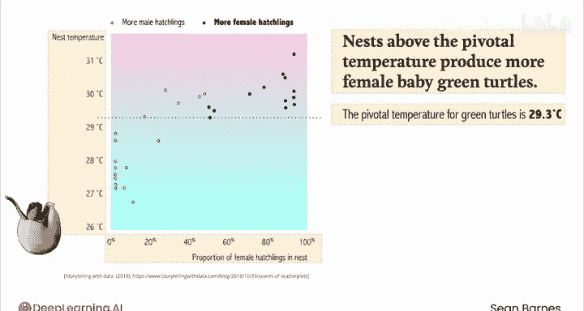

# 吴恩达《数据分析（数据分析基础／应用统计学，1-2课／共5课）｜DeepLearning.AI Data Analytics》中英字幕（claude-4-s - P43：42_可视化分析.zh_en - GPT中英字幕课程资源 - BV1SCXrYuEwr

Now that you've seen the core components of data visualizations。

 you'll put that knowledge into practice by analyzing three example visualizations for each chart I encourage you to pause a video and practice your five step process for interpretation let's start with this column chart。

 pause for a moment and give it a shot。First， the title Airpods revenue versus top tech companies and the subtitle as of 2022。

 I expect to see the revenue generated by Airpods alone versus some top tech companies on the X axis。

 What do you see These are some top tech companies like Ass， Adobe into it Spotify and so on。

 What about the Y axis。 There's no axis title but based on the chart title。

 you can infer that this is revenue as a 2022 specifically and in billions of dollars。

 I also notice each bar has a label with the revenue which makes it easier to compare revenue between them。

 This strategy is called double encoding Both the bar height and this label tell you how much revenue the company or Airpods made Look for encoded categories。

 What do you see This chart uses color to highlight Airpods compared with the other companies。

 So big picture What insight is this chart communicating It's expecting you to make a comparison between the revenue generated by Airpods and the revenue from these huge companies。

AirPods generated slightly less revenue than Ass and Adobe as a whole。

 but more than Intuit Spotify and all the other companies in this chart。

 that's a pretty surprising insight because it's surprising you may want to track either the data or your assumptions。

Here's another interesting one， this time a line chart。

 pause for a moment and see if you can figure out the story。Start with the title。

 How couples Me in the US。 What does that tell you about the data represented in this chart。

 It's only people in the US。 It doesn't say anything more about how a couple is defined。

 For instance， I happen to know that this data only represents heterosexual couples。

 What do you see on the X axis。 You can safely assume that this represents the year of the data。

What about the Y axis， The labels go from 0% to 50%， and the Y axis is unlabeled based on the title。

 you can assume this means percent of couples。 Now， check the encoded categories。

 I don't see any markers or a legend， but each line has a different color。 On line is red。

 and it really stands out。 Friends and work are different shades of blue。

 And the other lines are different shades of gray。 It's not clear whether the blue categories are more relevant than the gray ones。

 but they are the next most popular。 Next， you should check for annotations。

 but I don't see any here。 So what's the big picture。

This chart is encouraging you to compare the change in couples meeting online with couples meeting in all the other ways displayed here。

 Each of the categories aside from online has a sharp drop off while meeting online shows a sharp increase。

 starting around 2000 social media began to proliferate starting with the likes of Myspace。

 Frister and Facebook remember Myspace in Frister Me online surpassed the previous top method of meeting through friends around 2012 or so the year tender was released and in 2020 over half of couples met online you can find some other insights in this chart as well。

 like how around 10% of US couples met their partner in college consistently from 1950 to about 2000。

 or the consistent decline of couples meeting through family。

 grade school or neighbors but the key insight here is about meeting online compared with in-person。

Last one， here's an interesting scatter plot about science。h turtles are so cute。

 This one is a little more challenging。 pauseuse the video for a moment and see if you can figure out the story。

😊，First， look at the title Nest above the pivotal temperature produced more female baby green turtles and the subtitle The pivotal temperature for green turtles is 29。

3 degreesC。 on the X axis。 What do you see， It's a percent from0 to 100 showing the percent of female hatchlings found in the nest。

 Since each hatching is likely to produce different numbers of babies。

 It makes sense to focus more on the percentage than the absolute count。 What's on the y axis。

 It labeled nest temperature， and it's in degreesC。

26 degreesC is around 78 degrees Fit and 31 degreesC is around 87 degrees Fheit。 Now。

 the encoded categories。 What do you notice At first， the color may not jump out at you。

 but it's a nice natural encoding with colder temperatures as blues and higher temperatures as pinks。

 You should also notice the different markers for nests with more male hatchlings versus more female hatchlings based on the legend at the top。

 An empty circle for hatchlings with more。😊。

And a filled circle for hatchlings with more females。 Do you see any annotations。

 Annotations don't have to be text。 This dotted line shows the pivotal temperature for green turtles。

 which is around 29。3 degreesC。 You may not know what that means。

 but the annotation here indicates you should look for changes around that line。 So big picture。

 What insights can you get from this chart。 Since it's a scatterpl。

 one technique you can use is to sketch what a line through the middle of all of these points could look like。

 This is called the line of best fit。 as the temperature increases， So going up the y axis。

 The proportion of majority female hatchlings increases。 the effect is pretty dramatic。 Now。

 examine the pivotal temperature line below the pivotal temperature。

 there are no nests with greater than 30% female hatchlinks。 above it。

 there are a lot more nests with mostly females。 This gets me curious about the scientific mechanism behind this finding。

😊，Great work analyzing those charts In this lesson。

 you see in the power of data storytelling and the role that data visualization plays in crafting a compelling data story。

 you've also practiced a structure process for analyzing data visualizations Once you're done at the practice assessment for this lesson。

 follow me to the next one where you'll learn how to create beautiful visualizations and Google sheetets See you there。

😊。