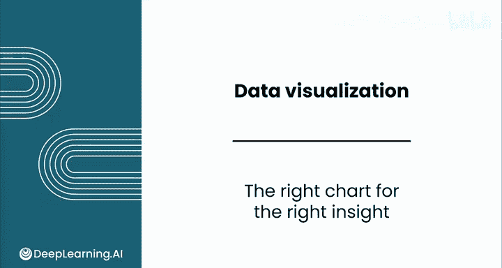
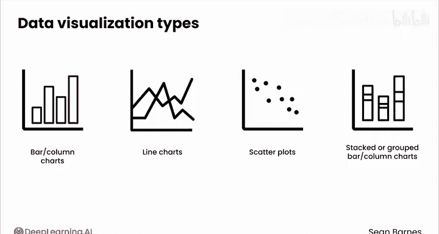
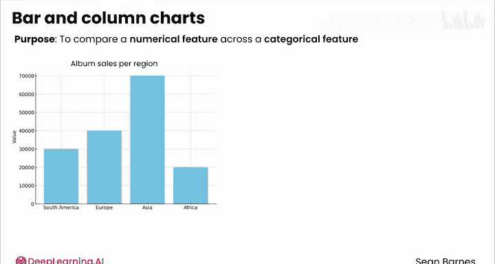
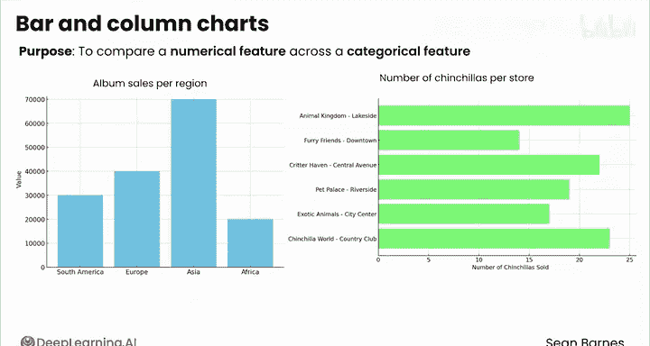
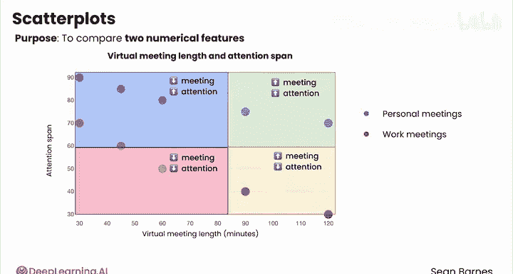
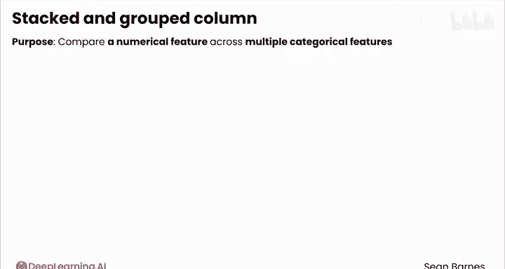
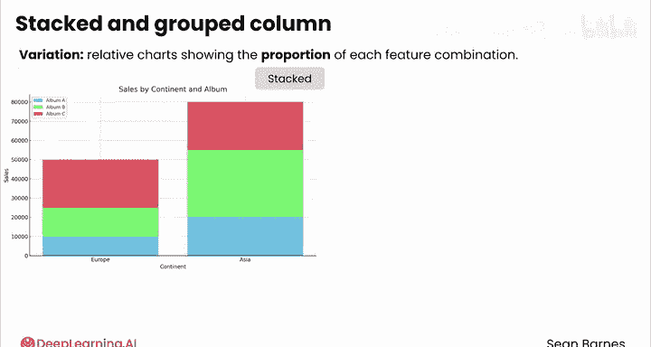
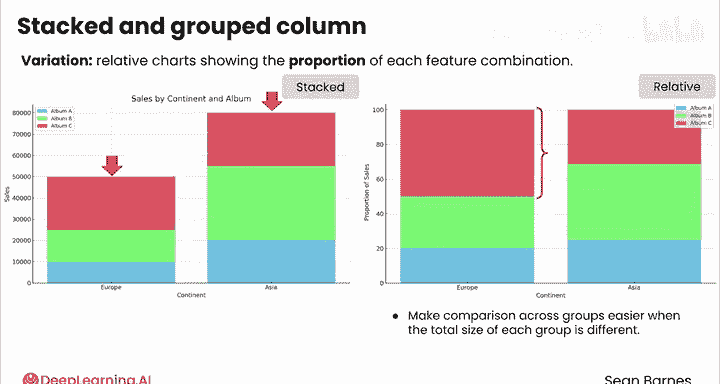
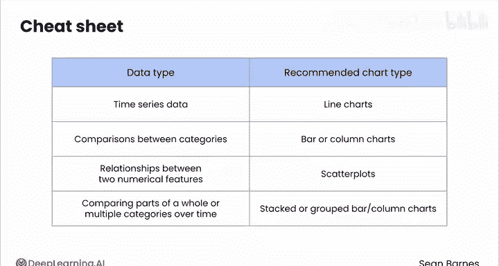
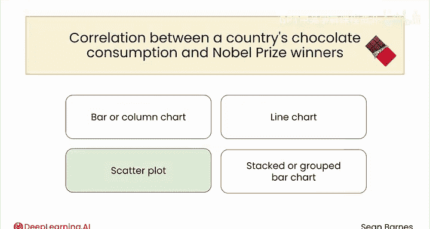

# 吴恩达《数据分析（数据分析基础／应用统计学，1-2课／共5课）｜DeepLearning.AI Data Analytics》中英字幕（claude-4-s - P44：43_图表类型选择策略.zh_en - GPT中英字幕课程资源 - BV1SCXrYuEwr

Let me tell you a story。 The other day， I saw my friend dip his French fries in mayonnaise right in front of me。

 You're probably wrinkling your nose right now and thinking， wow， that is just so wrong。

 By the end of this lesson， you'll see some data visualizations the same way as I see my mayonnaise dipping front。

 That is just so wrong because data visualization is both an art and a science。😊，As a science。

 there are right and wrong answers， specifically it's crucial to choose the right type of visualization for the insights you're trying to communicate。

Let's see how to do that。 There are hundreds of beta visualization types。

 but we'll focus on the core4 Bar are column charts， line charts。

 scatter plots and stacked or grouped bar or column charts。

 These four types cover a majority of the insights you'll want to communicate。

 I'd say you can effectively communicate close to 80% of insights with just these four types。

 You don't have to get fancy。 First， bar and column charts。

 Their purpose is to compare a numerical feature across a categorical one。 For example。

 they're great for visualizing data like album sales per region。

 here you can see continent on the X axis and sales on the y axis。

 Or the number of chinchiillas per store。 In this case。

 the number of chinnchillas sold on the X axis。 At each of these six exotic pet store locations on the Y axis。

 Next， take a look at line charts。 Their purpose is to show trends and a numerical feature over time。

 Here's the line chart of monthly sales over time with month on the X。😊。

Aes and album sales on the Y axis。 The slope of the line between each point emphasizes the rate of change month to month。

 So you can see how sharply sales increased or decreased between each period。

 you may have also seen in area chart， which is a common variation on the line chart。

 it emphasizes the volume of data， not just the trend， especially an accumulation over time。

 The rate of sales goes up and down but the total number only ever gets bigger。

 and now we come to my personal favorite scatter plots。

 Their purpose is to compare two numerical features。

 They're great for exploring relationships between those features。

 scatter plots have a lot of flexibility。 Here's an example with virtual meeting length on the x axis and my attention span on the y axis。

 with personal meetings in blue and work meetings in Ren。

 Another common enhancement is to add quadrants emphasizing high low combinations。

 If I add quadrants to this plot。 I see long meetings with the high attention span short meetings with the short attention span and so on。

 It helps highlight that。😊，Most meetings are short with the high attention span。 Finally。

 let's look at stacked and grouped column charts。 you can also have bar charts with this variation which are very similar。

 These are a variation on the standard column chart and their purpose is to compare a numerical feature across multiple categorical features a stack chart which looks like a stack of books shows a part to whole relationship In this case it shows continent on the X axis and sales on the Y axis with different albums shown in the three different colors This chart answers the question how much does each album contribute to the total sales in each region In Asia most sales come from Al B while in Europe most sales come from Al C a group chart is better for direct comparison between the categories Here's a group column chart with pet store location on the X axis and sales on the Y axis which pet store sells the most chinchs。

It looks like grandmas。 a common variation is to have relative charts that show the proportion of each feature combination rather than the raw number。

 Here's what that looks like for the album sales data。 the X axis is the same。

 but now the y axis shows the proportion of sales rather than a number of sales。

 Reative charts may comparison across groups easier in particular when the total size of each group is different。

 In this case， sales are much smaller in Europe than Asia。

 but you can highlight how album C is selling well there using this type of chart。

 This is a choice you as the data analyst will need to make。

 Sometimes the magnitude is most important。 you want to highlight that Asia has many more sales in Europe。

 but sometimes you want to highlight that Europe buys more of album C proportionally When choosing the right visualization。

 remember this is a science。 there are right and wrong answers。

 Here's a cheat sheet time series data often suits line charts。

 comparisonisons between categories might use bar or column charts。 Reship between two。😊。

Nical features could use scatter plots for comparing parts of a hole or multiple categories over time。

 consider stacked or grouped bar or column charts Let's do a lighting round I'll give you an insight and you take a moment to think of the right chart for it。

The number of James Bond movies with each of the seven different James Bond actors。

The answer is bar or column， and I would have a slight preference for bar here so that you could easily fit each actor's name as a label on the axis。

Global coffee consumption by country over the last 50 years。

The answer is a line chart because we are comparing consumption over time。

 and we can incorporate each country with a distinctly colored line proportion of five different pizza toppings ordered in New York versus Chicago。

The answer is a stacked bar chart because we want to analyze the relative proportion of each topping across the two locations。

Correlation between the country's chocolatepic consumption and Nobel Prize winners。

The answer is a scatterplot because we want to compare two numerical features together Great work in the remaining videos in this lesson you'll see how to create each of these foundational chart types in Google Sheets I'll show you all the tips and tricks I now see you there。

