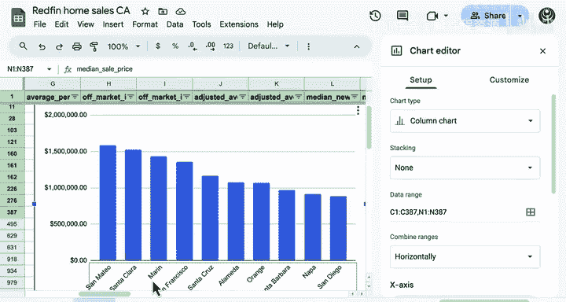
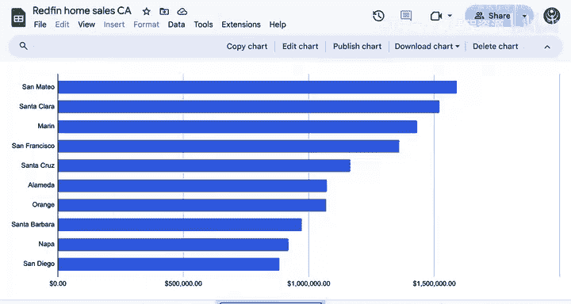
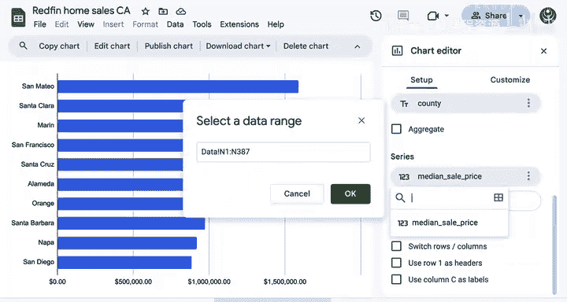
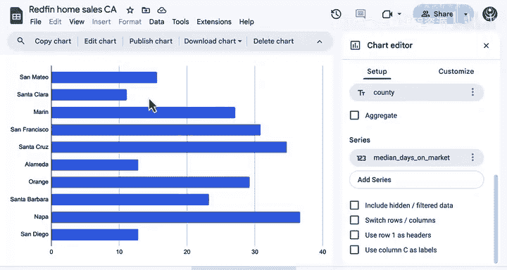

# 吴恩达《数据分析（数据分析基础／应用统计学，1-2课／共5课）｜DeepLearning.AI Data Analytics》中英字幕（claude-4-s - P45：44_演示：柱状图与条形图.zh_en - GPT中英字幕课程资源 - BV1SCXrYuEwr

Bar and column charts are one of the most common data visualizations。 They're versatile。

 easy to understand and can be used to compare different groups。

 Let's explore how to create these charts in Google sheets using a data set of housing sales from Redfin For the first portion of this demo。

 you'll take a look at this data set and explore some of the different features you might want to visualize。

 Then in the latter half， you'll see how to create a bar chart showing how long homes take to sell in the priciest counties。

 As a reminder， if you want to follow along， you can access this sheet in the downloads tab below this video。

 Each observation represents the home sales in a given time period in a given county。 For example。

 row2 shows the home sales in Stans lawss County from February 27，2023 to May 21 2024。

 which is 12 weeks。 Each feature in the dataset is some characteristic of home sales in that period。

 Some of these are salesy and might be hard to understand。 For example， in column D。

 we have the adjusted average new listings， which represents the number of new homes listed。😊。

For sale in the county during that time period in column J。

 this represents the number of homes sold in the county during the same time period in column L for the homes that were listed。

 this is the media listing price and column N is the median sales price and all the way in column W we have the median days on market how long it actually takes the house to sell the year over year difference。

 So this represents a percent difference from the previous year。

 Let's do a little bit of preprocessing to better understand this data freeze the first row。

 let's take a look at the average new listings。 Add a conditional formatting scale just to help us explore this data more easily。

 you can see in Santa Clara there is much more houses listed during this particular time period whereas most of the data points are much smaller for Santa Loss County。

 Let's also reduce the data by filtering the beginning period So I'm just going pick the first week in June。

So this period represents back to school it's an active housing sale period let's explore the average new listings across these counties during the third quarter pretty interesting trends。

 larger counties like Los Angeles or San Diego or even Orange County have many more listings than some of the smaller counties that you see in the lighter colors Sierra County only had one listing during this period。

Now let's take a look at column W the year over year changes for days on market since this column represents a percent change。

 this would be a great application for our diversioning color scales Many of these colors are actually pretty lightly shaded and we only see darker shades like these 14 or 22% increases the further we get from zero let's also do a little bit of reconnaissance so first all of the counties there's 58 distinct counties represented in this data I can also take a look at the average number of homes sold so on the low end we have the minimum of one house sold whereas in other counties there are over 1 thousand00 houses sold and you can actually see that value right here which corresponds to Los Angeles County。

So if I highlight the median sale price， I can also get some information about the average home sales price across all of the counties around $627。

000 California is a very expensive housing market you can also see on the lower end there are median sales prices that are $165。

000 and on the highest end there's one county that has a median home sales price of almost $1。

6 million Wow that's really expensive。Let's just make sure these are sorted。

Let's create our first chart。 I'm going to highlight the first 10 counties。

 and I'm going to visualize that against the median sales price。

 And then I'm going to go up to the insert menu and insert a new chart。

 You can see that the X axis labels for each county are readable。

 but they're a little bit close together。 So this is a good example where we might want to change the chart type to a bar chart so that all of the labels are a little easier to read。

 I'm going to close this chart editor so we can just see a little bit better。

 So using this cabab menu， you can download this chart， you can delete it。

 You also can move this chart to its own sheet。😊。

What do you see in the data Overall， you can see that San Mateo has the highest median sale price of almost $1。

6 million。 So this is that maximum value that we saw just a moment ago。

 And throughout the rest of the top 10 counties， you see that San Diego is all the way at the bottom at around $883000 median sale price。

 But remember this is still the 10th highest。 Let's modify this chart to show how a different numerical feature behaves across these same top 10 counties in terms of median home sale price。

 So now we need to modify this chart。 So I'm going to click edit a chart。

You can actually change the range of the data that was included。

 So I'm going to just change this to the median days on market feature from the data results are not sorted anymore because they have been ordered by mediumn home sale price。

 but this is medium days on market Home at Napa typically take almost 37 days to sell while homes in San Mateo。

 Santa Clara， Alameda and San Diego only take a couple weeks to sell or less there is not a clear relationship between the home sale price and the time it takes to actually sell the home。

Okay， there you have it。 you've created your first data visualization in Google Sheets。

 let's take it over to the next video to learn how you can customize your chart to tell a stronger data story。

