# 吴恩达《数据分析（数据分析基础／应用统计学，1-2课／共5课）｜DeepLearning.AI Data Analytics》中英字幕（claude-4-s - P46：45_演示：图表定制.zh_en - GPT中英字幕课程资源 - BV1SCXrYuEwr

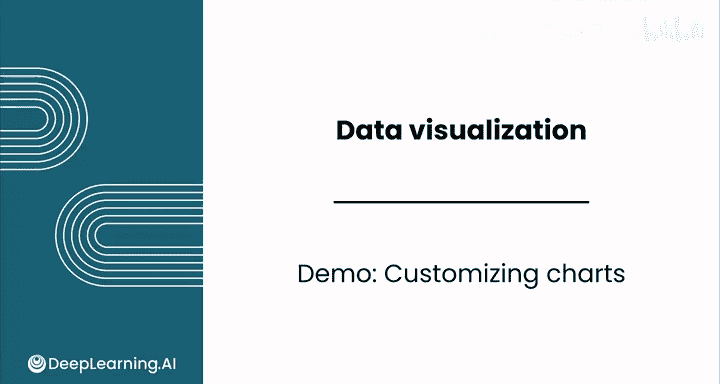

Allright， you've created a chart in Google sheetets， but it's looking a little plain。 Don't worry。

 it's time to unleash your creativity。 You can bring your data visualizations to life with customizations。

 Let's customize the bar chart on median home sale prices from the previous video As a reminder。

 if you want to follow along， you can access this sheet in the downloads tab below this video。

 The first category is the chart style。 You can change the background color to gray。

 which I'm not going do。 You can also enable 3D。 It's distracting and doesn't really add any insights to your chart。

 So I'm going to take that off。 The next thing you can do is add chart or access titles。

 Your title should be as descriptive as possible。 Q3 means quarter 3 You can also select any of your other axes or add a subtitle and then label median home sales。

 boldold this text and make it a little bit bigger。😊。

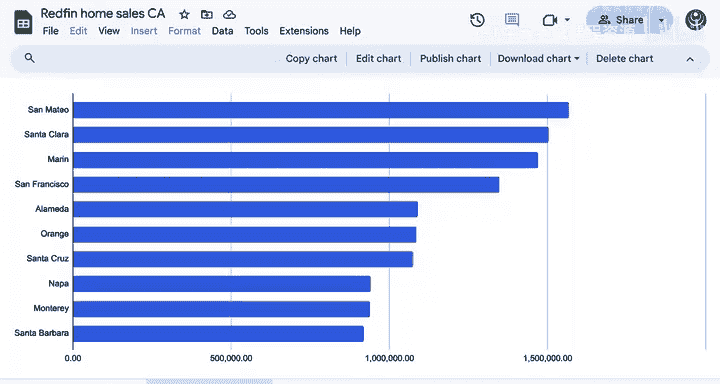

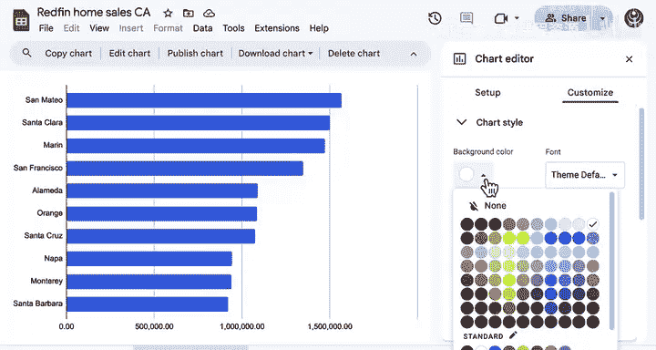

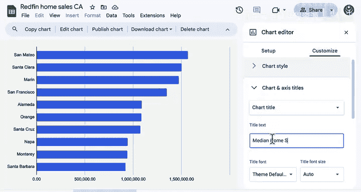

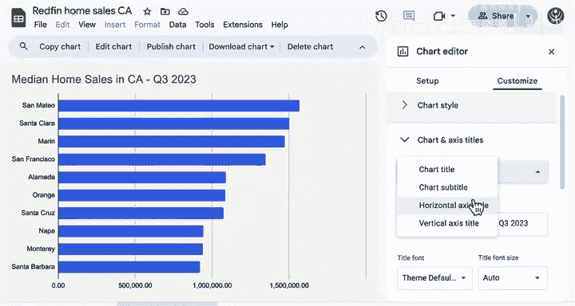

Like an at county just takes up a little bit of extra space and based on the access labels themselves。

 you already have an idea that it represents county。

 so this access title is a little bit unnecessary。 Let's take a look at the series tab。

 So for example， the fill color to a different color like orange or pink。

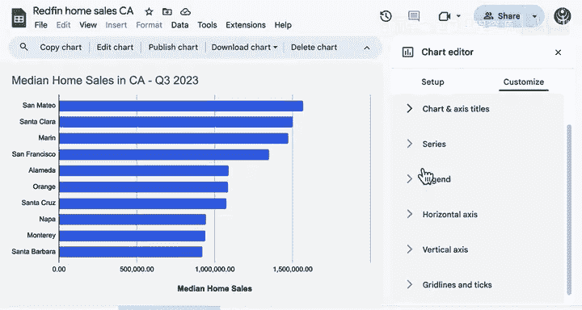

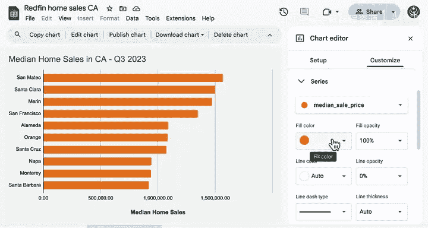

Or I can go back to the default of blue。So by checking this option you can now see that the exact home sales price is visualized on each bar in the chart This helps us on not having to rely on interpreting data from the grid lines alone What if you want to highlight median home price in San Francisco that's the county your company is working in you can actually format this data point to be different from the rest in the series settings you can click on add format data point and you can select a specific value in your data So in this case San Francisco and a highlight color orange。

Suppose you actually wanted to deemphasize your other counties。

 you can change these other bars to gray。

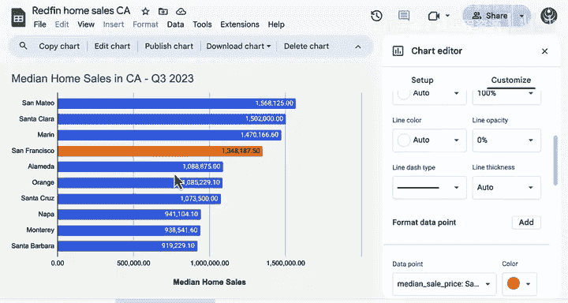

So this deemphasizes all of the other data points and brings your audience to focus in on San Francisco。

 which is the key to your story， you don't need a legend to differentiate these two colors because you already have the labels on your Y axis。

Let's take a look at the horizontal axis settings。 Overall， these labels are good。

 but we can increase the font size a little bit。 I'm also going to add a currency format。

I think these could stand out a little bit more， to add bold and also increase the font size。

 This just makes it a little easier to read each of the counties。 Lastly。

 let's configure the grid lines and ticks。 grid lines refer to the lines that span the entire chart While ticks sit on the axis itself。

 So why would you choose between grid lines and ticks。

 grid lines are really helpful when you need to read across the entire chart。

 whereas ticks can just serve as a simpler reference。

So for gridline and ticks we only need to focus on the horizontal axis here。

 grid liness are typically divided into major and minor in this case you'll notice that we have an increment of $500。

000 for our major grid lines so we could also implement minor grid liness。

So I can check this box and you can see now that we get these intermediate minor grid lines in between the major grid lines It can be helpful sometimes to make sure that these are spaced out evenly so that you know how to interpret the exact amount that aligns with those minor grid lines I'm going to increase the minor count to4。

 This represents the number of minor grid lines between major grid lines4 will ensure that each increment is $100。

000 Overall， I think this final design is pretty clean。

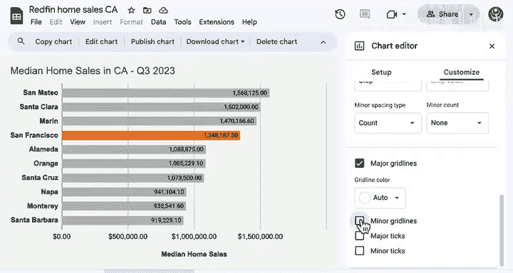

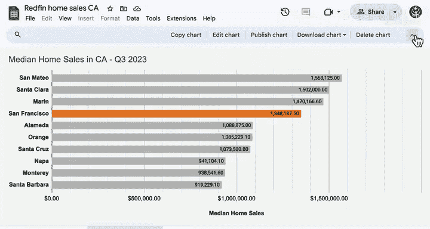

As you can see， our original chart was fine， but now our new chart has definitely highlighted the story that we want to tell。

 it also makes it easier to read the individual home sale prices。

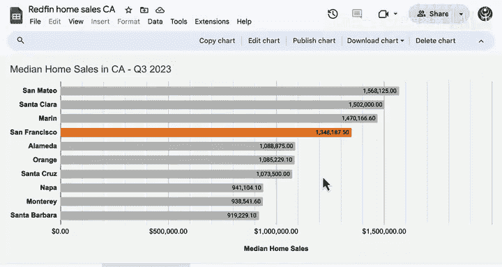

Don't be afraid to experiment and have fun with it with the little creativity and attention to detail。

 you can transform your charts into powerful tools for communicating your data story。

 followow me to the next video to explore creating a scatterplot that shows the relationship between home size and sale price。

😊。