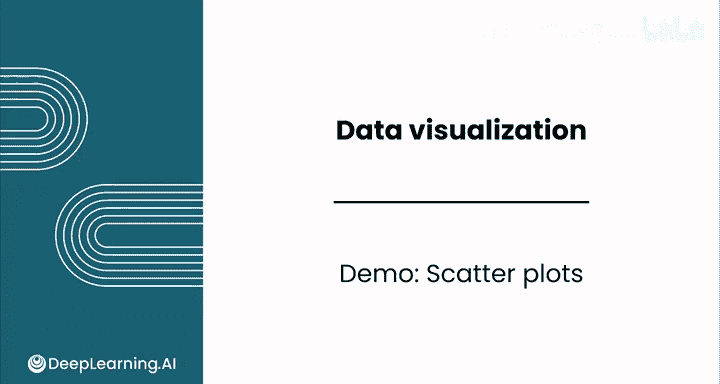
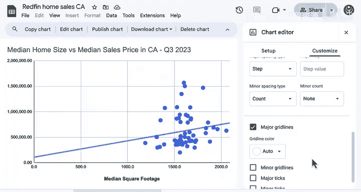

# 吴恩达《数据分析（数据分析基础／应用统计学，1-2课／共5课）｜DeepLearning.AI Data Analytics》中英字幕（claude-4-s - P47：46_演示：散点图.zh_en - GPT中英字幕课程资源 - BV1SCXrYuEwr

Scatter plots reveal relationships between two numerical features。

 Each point represents a pair of values， one on the X axis and one of the y axis。

 The position of the point shows how the two features relate to each other。

 Suppose you wanted to understand the relationship between home size and the median sales price。

 These are both numerical features and thus excellent candidates to visualize via scatterpl。

 starting in the data tab， I'll select median pending square feet and median sale price insert a chart by default。

 the assumed chart type is column chart but we want to change this to a scatter plot。

Let's move this to a new tab so that we have a little bit more space to work with。Okay。

 now we can start on our customizations， let's start by adding a title。

Since median home sales is in the title， I think we can get away with not labeling the vertical or Y axis。

 so let's go and change the horizontal axis title， it's not clear that this represents square footage。

Okay， remember， each one of these dots represents a county， not an individual house。

 One thing to consider with scatter plots is the size of the markers。 If you have a lot of data。

 you may want to use a smaller size or reduce the fi opacity。

 which adds some transparency to the markers These techniques help ensure that you can see all of the individual data points since there aren't too many data points here。

 you can make them larger Let's increase it to 10 pixels。 Data labels work well in our bar chart。

 What about here， the chart gets really， really busy and it's difficult to read each label。 We could。

 however， look at adding a trend line， which helps visualize the linear trend through the data。

 increase the thickness and increase the opacity。 There's a positive slope to this trend line。

 which suggests that as the median square footage increases for the county。

 the median sales price also increases on average。By default。

 this chart zoomed into the observed bounds of our data with a minimum around 1200 square feet and a maximum just over 2000 square feet。

 what does it look like if I set the minimum value to 0？In reality。

 we are not likely to observe any immediate house sizes of， say 200 square feet。

 but it helps to know how the trend behaves all the way to 0。 Both axes contain numerical data。

 So these are worth tinkering with。 Since data labels are too heavy。

 your audience may have to rely more on grid lines to estimate the axis values for each data point。

 Start by adding minor grid lines。

And an increment of 100 square feet， and then change to the vertical axis。

And also add minor grid lines。Add count of four， which is going to create increments of $100，000。

 Now we have a grid that enables us to estimate each data point fairly well。

 and the grid lines are not so heavy that they distract us from the data itself。

 I'm pretty happy with this。What do you see in the data？Based on the trend line。

 you observe a positive correlation between the median square footage and the median home sale price as the median home size increases。

 so does the median sale price。 However， this trend line seems to dissect the data into two groups。

 One lower price group that follows a fairly consistent trend and one higher price group that doesn't appear to follow a trend at all。

 Since some of the most expensive counties do not seem to have the largest homes。

 Perhaps there are some other drivers of these high prices at play。Remember。

 scatter plots are powerful tools for uncovering hidden relationships in your data。

 use them to explore correlations， identify outliers。

 and generate hypotheses for further investigation follow me to the next video to create group bar and column charts。

