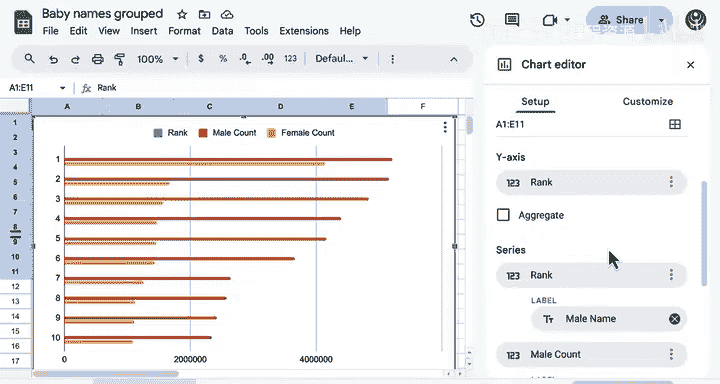
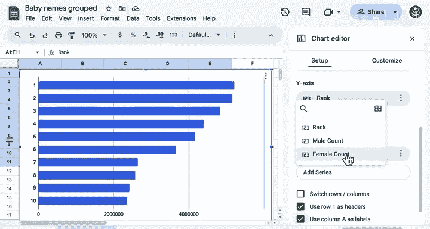
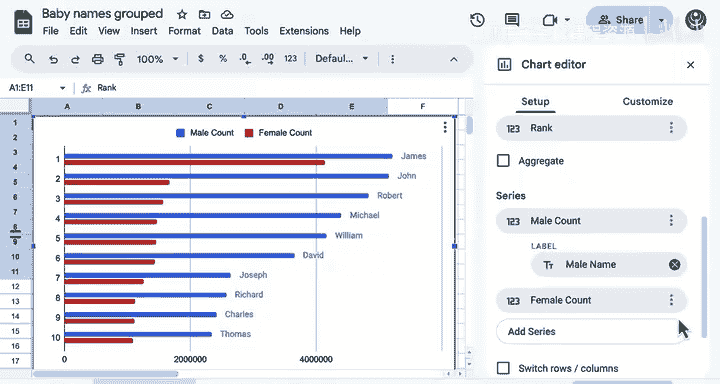
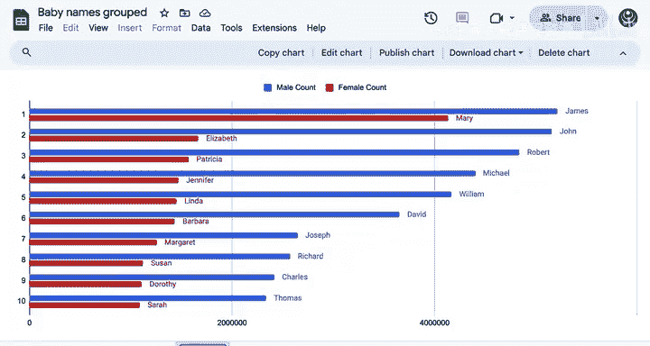
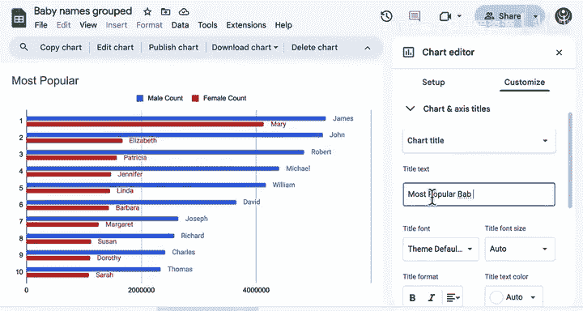
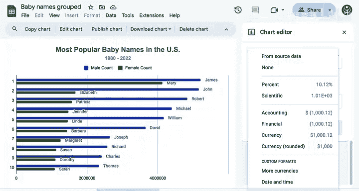
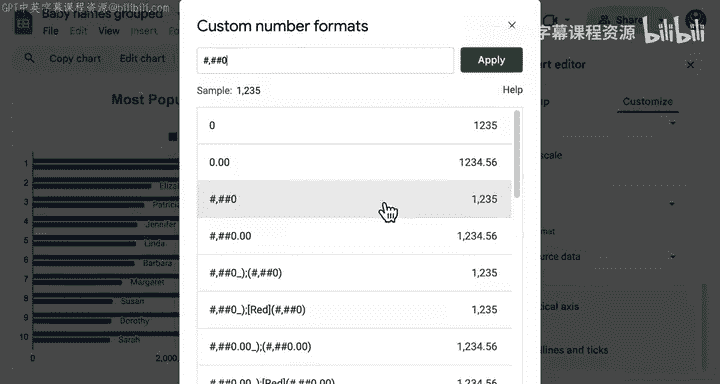
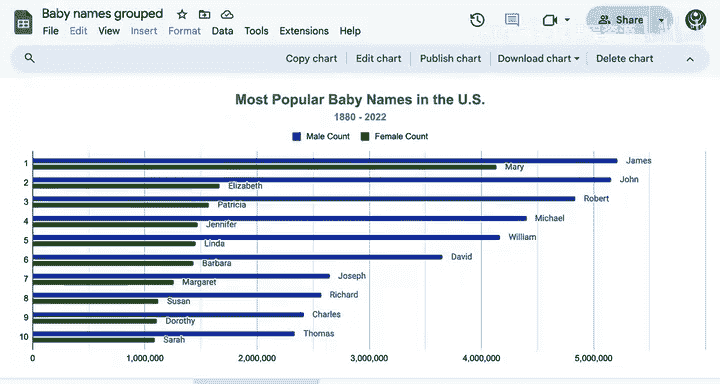

# 吴恩达《数据分析（数据分析基础／应用统计学，1-2课／共5课）｜DeepLearning.AI Data Analytics》中英字幕（claude-4-s - P48：47_演示：分组柱状图-条形图.zh_en - GPT中英字幕课程资源 - BV1SCXrYuEwr

Group bar and column charts allow you to compare an outcome of interest across different groups。

 revealveing complex relationships and trends in your data。

 Suppose you wanted to visualize the most popular male and female baby names across all years。

 using the baby names dataset set you've seen a few times so far。

 you would need to visualize the number of babies by both the rank and the gender Two features at once。

 That makes this data set a great candidate for a group chart。

 Let's start by taking a look at the data needed to create this chart。

 Here's a summary of the top 10 male and female names of all time based on the data。

 This data sums up the total baby count for each name and gender across all years sorted by rank。 So。

 for example， John is the most popular male baby name in the US。

 with over 5 million babies given that name。The number one female baby name is Mary。

 and over 4 million babies， So these names are both rank1。

 John for male names and Mary for female names。 It takes some work to assemble this data。

 You'll learn more about pivot tables which make short work of this task in the next course For now。

 we'll start here。 you'll need data in this format to create group bar charts in Google sheetets。

 a common set of categories， here its rank and then distinct sets of counts for each gender。

There is some work to do in order to configure this chart properly， Since there are 10 baby names。

 switch the chart type to a bar chart， assign the rank column to the Y axis and you'll see that the one of 10 labels appear I would like to have one series for the male baby counts and one series for the female baby counts I'm just going to clear all of these out and then read them。

I'm going to add labels。Which will be the male name。And for the female count， the female name， Okay。

 that's a pretty good start。 I'm going to move this to a separate sheet。

Add a title。

Add a subtitle which can help you add additional context about the chart。

 Don't worry about the overlap of the labels over the bars。

 It's just because I'm pretty zoomed in so you can read the chart more easily。Next。

 let's soften these colors in the series menu， they're a bit hard on the eyes。

Trange the female to green。And the male to a darker blue。

The X axis's values are a bit hard to read with so many zeroes， so let's add commas。

Change the format of the numbers。 You need to go into a custom format in order to add commas。

 select other custom formats and look for the format that adds commas to the numbers。

 So that's going to be this one right here。 And now it makes it a lot easier to see that these are millions of babies。

 Lastly， it's pretty challenging to estimate the baby counts with just the major grid lines。

To start with the horizontal access， configure the major grid lines。I'm enaving。7even。Overall。

And then add minor grid lines， one between each pair of major grid lines。

 That will achieve a 500000 count increment。 So now it's pretty clear that Elizabeth through Barbara are hovering around the 1。

5 million mark。 Okay， I think that's pretty good。 What insights do you see。For me。

 what stands out most is that the top 10 male baby names are significantly more popular than their female counterparts。

 In fact， the top 10 male baby names are more popular than all of the top 10 female baby names except for Mary Interesting Great work on that group chart followow me to the next video to see how to create a stack chart。

