# 吴恩达《数据分析（数据分析基础／应用统计学，1-2课／共5课）｜DeepLearning.AI Data Analytics》中英字幕（claude-4-s - P49：48_演示：堆叠柱状图-条形图.zh_en - GPT中英字幕课程资源 - BV1SCXrYuEwr

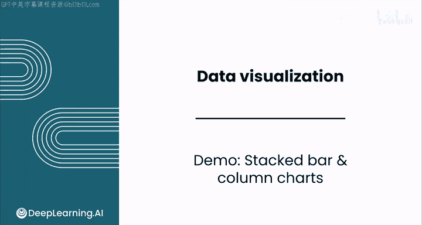

Suppose we want to analyze trends over time in the proportion of male versus female babies for a unisex name For that。

 you can create a stack bar chart。 Let's take a look at Riley。

 which is a fairly common unisex name with an interesting trend。 Let's take a look at the data。

 You can tell that there was some prep work here。 This table shows the count of male and female babies for each year in the data。

Many of the earlier years do not have any female Riley babies。 Select all the columns。

And then insert a chart。Even though we have many years in the data set。

 a column chart makes more sense because we typically want to have time on the X axis。Okay。

 let's clean this up。

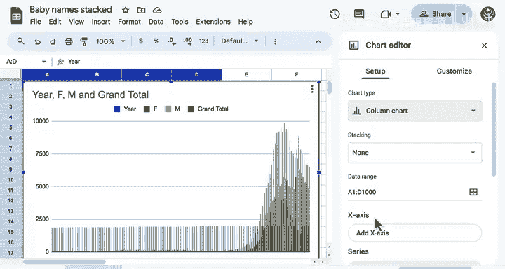

So for the X axis， we want to select the here。And the Y axis。

 we want to clean this up so that we only have the female and male counts。 Okay。

 let's move this to a separate sheet。

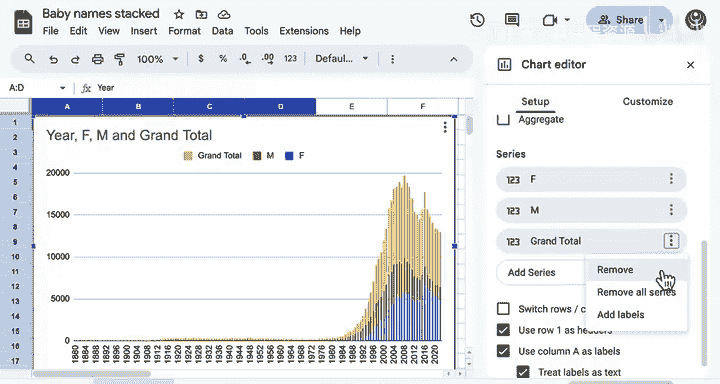

I'm going to add a title。I'm also going to add a subtitle which again represents the time span of the data。

Okay， let's configure our data a little bit。I'm going to change the color of the series to be consistent with the previous heart。

I'm just going to make a few additional subtle changes， move the legend inside the chart。

That expands our chart space in this case we're using different colors for different genders。

 so we want to have a reference in the chart that helps the audience easily differentiate between the categories then I'll lighten up the grid lines a bit since they're not too important for the story。

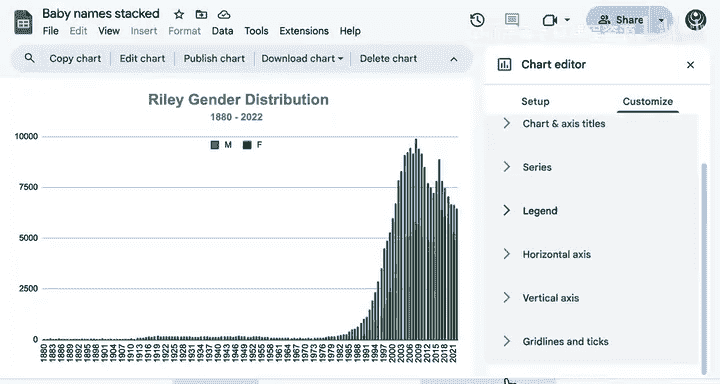

Now let's analyze our chart， where do you see？The name Riley was fairly uncommon from 1880 all the way until the 1980s when it first began to rise in popularity。

 it was also used exclusively for boys prior to this rise in popularity。

 and then began a steady increase in usage for female babies as well。 After the turn of the century。

 Riley actually became a more popular name for female babies than males。

 Suppose I was less concerned about the total count of Riley babies。

 And I wanted to focus more on the distribution of male versus female Riley babies。

 to answer this question more directly。 I could use a 100% cent stacked column chart instead。

 to start by duplicating this chart。

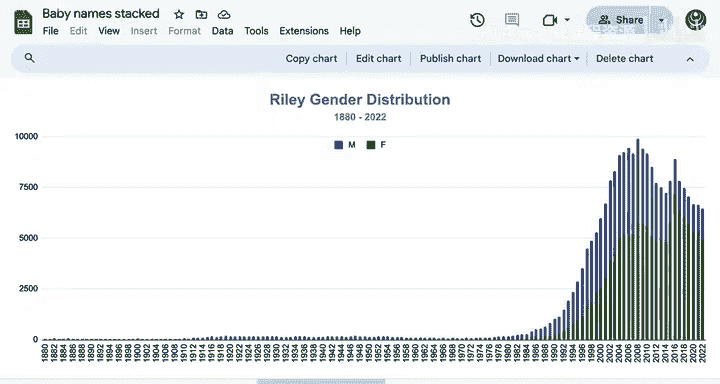

Chaanged the chart type from stacked column chart to 100% stacked。

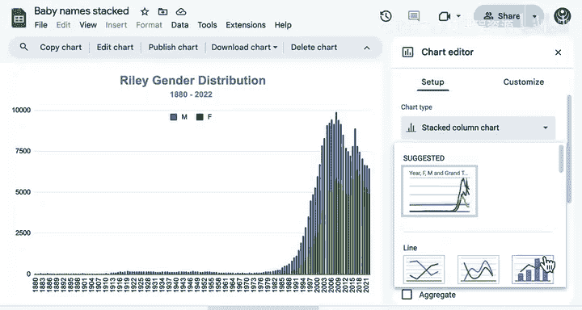

Wow， this looks pretty different and the Y axis labels change from counts to percentages。

The blue is a little aggressive， so I'm going to lighten up a bit。

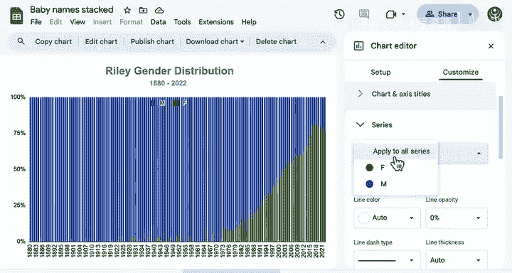

And I'll move the legend while I'm at it。 Since now the data actually overlaps the legend。

If I'm only focused on which is the dominant gender。

 I could actually reduce the grid lines to just include the midpoint and make it a little darker so that it's easy to see which gender is the majority。

Go into the grid lines for the vertical axis that have three total。

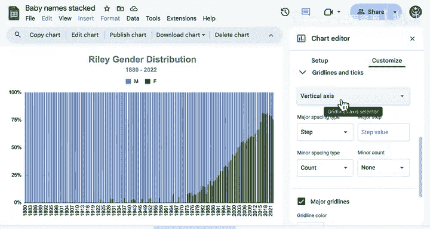

So now there's just 0%， 50% and 100%， and I'm going to change the color to your gray。

 It looks like it was the year 2003 when the female Ri babies began to outnumber their male counterparts。

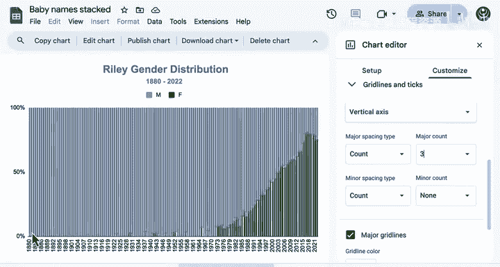

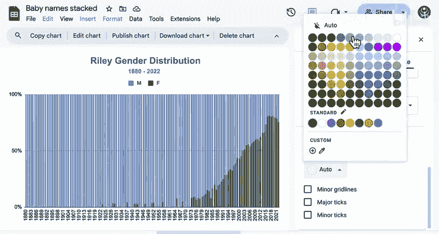

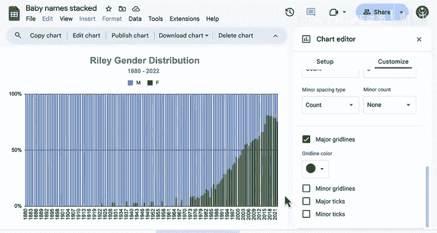

Both grouped and stack bar and column charts are powerful tools for showcasing complex relationships between multiple features Join me in the next video to learn about your final visualization type Line charts Line charts are great for time series data I'll see you there。

😊。