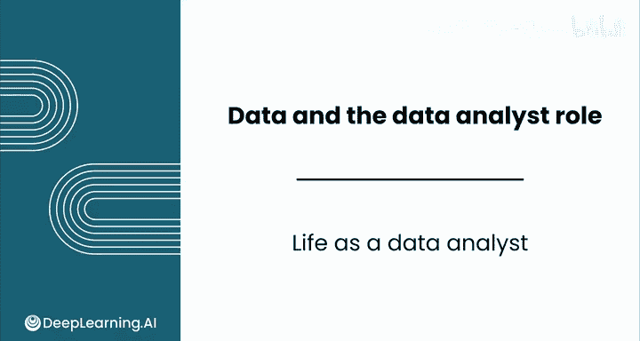
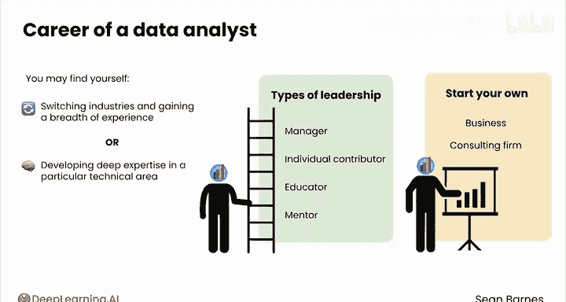

# 吴恩达《数据分析（数据分析基础／应用统计学，1-2课／共5课）｜DeepLearning.AI Data Analytics》中英字幕（claude-4-s - P4：3_数据分析师的工作日常.zh_en - GPT中英字幕课程资源 - BV1SCXrYuEwr

Of all the data analysts I've known every single one of them has been passionate about this work as long as you're in a company that treats you fairly。

 this job will become one of your joys。 It's fun， it's fast paceacd and it stays fresh I want to share with you what I love about data analytics on the daily in the medium term and as a career But first I highlight reel my coworkerworkers and I love data analytics because you're always discovering something new which keeps the job fresh it connects with so many different fields almost every industry needs data analysts from tech giants and startups to the government and nonprofits。

 high demand for your skills translates into competitive salaries and job security it attracts people from all kinds of backgrounds。

 you might work alongside former physicists， psychologists or business majors who have all found their way into data you'll constantly be learning new technical skills since the field evolves quickly if you're the type of person who loves learning problem solving and making discoveries you'll fit right in。

a mock schedule of a typical day at 9 a。 Start your day by exploring a new problem you need to solve at 10 a。

 meet with the data team。 catch up about the company's new priorities and get your hands on the data you need at 11 AM heads down work time get your hands dirty with spreadsheets。

 databases and coding make new discoveries and even have a wow moment or two at 2 pm create a dashboard。

 figure out how to tell the hidden stories in the data and visualize those stories in a beautiful yet functional way at 3 pm present your progress on the dashboard It feels great to share your hard work。

 get direct feedback from your teammates about how this dashboard will help them deliver value at 330 pm celebrate your presentation and dashboard progress。

 Re yourself with an afternoon beverage and a quick break I sometimes go for a T at 4 pm learn a new technical skill。

 Take an advanced statistics course or learn a new programming language It's so rewarding to learn on the job at 6 pm happy hour with the data team socialize with your fellow analyst and data scientists。

Learn about new trends and discuss upcoming projects。 Your days will be action packedact。

 I encourage you to take time to celebrate and track your successes Over the course of a couple years。

 you'll likely complete several big projects seeing the impact of your work in the real world is incredibly satisfying you'll be able to create a portfolio of your work a portfolio not only showcases your skills but also help you prepare for future growth opportunities you will also develop your industry expertise from terminology to unspoken rules your technical skills will improve significantly as different projects require you to upskill and by leading successful projects you'll earn the trust of your teammates building strong relationships creates opportunities to work on compelling problems Each of these aspects of data analytics is rewarding in its own right It may seem far away but before you know it。

 you'll be celebrating big successes and mastering brand new skills Day and years build careers What does the career of a data analyst look like you may find yourself switching industry。

Gining a breadth of experience across different fields like tech， healthcare， fashion。

 supply chain and more or you can develop deep expertise in a particular technical area becoming a go-to specialist as you progress you will become a leader there are many types of leadership as a manager a highly skilled individual contributor or an educator you can also develop mentorship relationships with younger colleagues to help them grow their skills as you gain expertise you might decide to start your own business or consulting firm leveraging that expertise to help others succeed the effort you put into each day on the job each project。

 each conversation opens up a rich variety of career trajectories in data analytics。

To me， data analytics is more than just a job。 It's a joy。

 I value every learning opportunity I get and every conversation with my brilliant colleagues。

 I know you'll come to enjoy the field just as much as I do。 With that goal in mind。

 join me in the next lesson to learn more about data analytics and its history。

 I'm excited for you to take this first important step in your data analytics career。 I'll see there。

😊。

