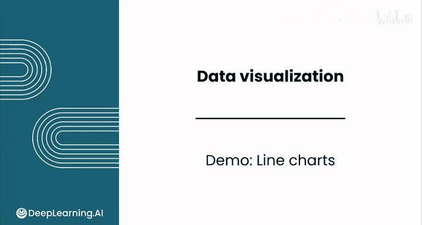
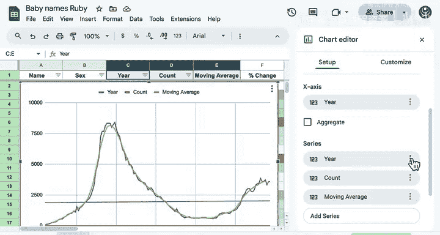
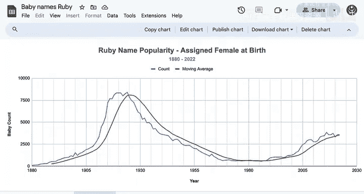

# 吴恩达《数据分析（数据分析基础／应用统计学，1-2课／共5课）｜DeepLearning.AI Data Analytics》中英字幕（claude-4-s - P50：49_演示：折线图.zh_en - GPT中英字幕课程资源 - BV1SCXrYuEwr

The primary chart type for visualizing time series data is called a line chart。

 though they may seem simple， this type of chart is delivering business value daily。

Does this look familiar？This is where we left off with rubby names in module2 let's create a chart with both the count and moving average。

 select all three of these columns and then insert the chart， select line chart。

And then configure our axes， so the X axis will be year。

 and then we want to remove the year from the series。

Move it to a new sheet。Let's start by adding a title。And then let's add a subtitle。Okay。

 let's also add a horizontal access title。Let's add a vertical access title。

Let's add some grid lines so that the audience can more easily spot particular years。

Select the horizontal axis where the years are being plotted。

 add 25 years for their major grid lines。And then add minor grid lines with a count of four。

So that we get five year increments。Now let's analyze the chart。

 starting with the original count data plotted in blue。

 the trend shows an initial rise in popularity and then proceeding to decline consistently。

 then in more recent years there appears to have been a small resurgence You may remember that there was a sharp increase in rubies in 1963。

That spike isn't as apparent in this chart。We can， however， see a clear cyclical pattern in the data。

 given the initial rise in fall of popularity， followed by the recent resurgence。

 this cycle would have been impossible to predict， but is clear from the historical data。

 Perhaps there will be another cycle in the future。 We'll just have to see。Overall。

 while there is some noise in the data， it doesn't distract from observing the overall patterns。

 the moving average follows the data quite closely。

And that's a wrap on creating charts and Google Sheetss。

 I hope you're feeling inspired to develop your own beautiful charts。😊。

You have a lot of capabilities now coming up， I hope you'll try out the practice La where you will create visualizations for the hotel reservations data set from the previous module once you' finished the practice lab and assessment。

 follow me to the next video to learn about best practices and data visualization See there。

